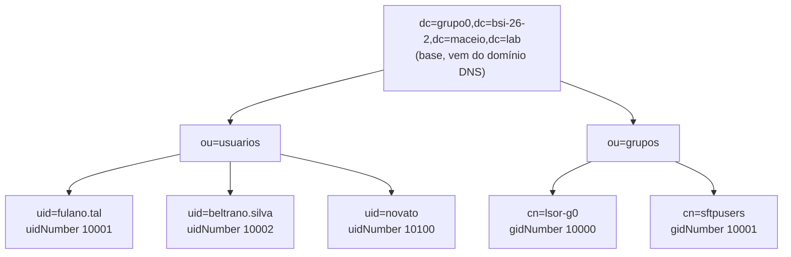
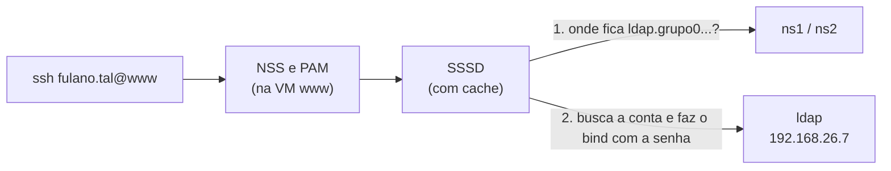

# Aula 10: Diretório LDAP, Login Unificado com SSSD e Samba

Objetivo: entender como funciona um diretório LDAP e montar, na VM `ldap`, o **diretório do grupo** com os usuários e grupos do projeto; ligar o **login unificado** (SSSD) nas VMs e testá-lo por SSH; e, por fim, montar o **Samba** na VM `arquivos`, primeiro com uma conta local (sem login unificado) e depois com as contas e o grupo do LDAP. Corresponde às seções 9, 10 e 11 do [Projeto Final](projeto-final/README.md).

**Duração:** 1h30 · **Ambiente:** VirtualBox, as 9 VMs da Etapa 1 · **Base:** [Aula 09](Aula9.md) (DNS do grupo funcionando)

**Pré-requisito:** todas as VMs resolvem `ldap.grupo0.bsi-26-2.maceio.lab` → `192.168.26.7` (seção 8 da Aula 09). Confira na VM `cliente` com `dig +short ldap`.

---

## Organização da aula

| Tempo | Parte | Conteúdo |
|:--|:--|:--|
| 0–15 min | Teoria | LDAP: árvore do diretório, DN, classes de objeto, LDIF e login unificado (seção 1) |
| 15–40 min | Prática 1 | OpenLDAP na VM `ldap`: grupos e contas dos integrantes (seções 2 e 3) |
| 40–60 min | Prática 2 | Login unificado: remover as contas locais, SSSD no `cliente`, `www` e `arquivos` e teste por SSH (seções 4, 5 e 6) |
| 60–85 min | Prática 3 | Samba no `arquivos`: primeiro sem login unificado, depois com as contas do LDAP (seção 7) |
| 85–90 min | Fechamento | O que precisa estar pronto para a Aula 11 (seção 9) |

Em sala, o SSSD é ligado em três VMs (`cliente`, `www` e `arquivos`). O grupo repete a seção 5 nas outras seis VMs até a Aula 11.

---

## 1. Conceitos

### 1.1 Diretório LDAP

O LDAP é um protocolo de acesso a um **diretório**: um banco de dados organizado em árvore, otimizado para muitas leituras e poucas escritas, usado para guardar as contas, os grupos e as senhas de uma organização [1, 2]. Com o esquema da RFC 2307, cada entrada guarda os mesmos campos de `/etc/passwd` e `/etc/group` [3].

**Figura 1:** Árvore do diretório do Grupo 0.



| Termo | Significado | Exemplo |
|:--|:--|:--|
| **DN** (*Distinguished Name*) | Endereço completo e único de uma entrada, da folha até a base | `uid=fulano.tal,ou=usuarios,dc=grupo0,dc=bsi-26-2,dc=maceio,dc=lab` |
| **Base** | Raiz da árvore: o domínio DNS escrito em componentes `dc=` | `dc=grupo0,dc=bsi-26-2,dc=maceio,dc=lab` |
| **OU** | Pasta que organiza entradas | `ou=usuarios`, `ou=grupos` |
| **objectClass** | Define quais atributos a entrada pode ou deve ter | `posixAccount` exige `uidNumber`, `gidNumber` e `homeDirectory` |
| **LDIF** | Formato de texto para criar ou alterar entradas | arquivo `grupo0.ldif` da seção 3 |
| **Bind** | Autenticação no LDAP com um DN e uma senha | `ldapwhoami -D uid=fulano.tal,...` |

**De onde vem a base.** Por convenção, cada parte do nome DNS vira um componente `dc=` (*domain component*) [4]: o domínio `grupo0.bsi-26-2.maceio.lab` gera a base `dc=grupo0,dc=bsi-26-2,dc=maceio,dc=lab`. No Grupo 1, `dc=grupo1,dc=bsi-26-2,dc=maceio,dc=lab`.

**Do `/etc/passwd` para o LDAP.** A mesma informação, em outro lugar:

| `/etc/passwd` e `/etc/group` | Atributo no LDAP | Valor de `fulano.tal` |
|:--|:--|:--|
| nome de usuário | `uid` | `fulano.tal` |
| UID | `uidNumber` | `10001` |
| GID do grupo primário | `gidNumber` | `10000` (`lsor-g0`) |
| nome completo | `cn` | `Fulano de Tal` |
| diretório home | `homeDirectory` | `/home/fulano.tal` |
| shell | `loginShell` | `/bin/bash` |
| senha (no `/etc/shadow`) | `userPassword` | `{SSHA}...` |
| membros do grupo | `memberUid` (no `posixGroup`) | `fulano.tal` |

### 1.2 Login unificado

Quando o Linux procura um usuário, ele consulta o **NSS** (quem é: UID, grupos, home) e o **PAM** (a senha confere?). Com o **SSSD**, essas consultas vão ao LDAP, e a mesma conta passa a valer em todas as VMs [5, 6]:

**Figura 2:** Caminho de um `ssh fulano.tal@www`.



> **Segurança.** A porta 389 trafega em texto puro, inclusive a senha do *bind*. No projeto deste semestre isso é aceito porque tudo fica na rede interna do grupo; o SSSD exige uma opção explícita para isso (seção 5). Em produção, usa-se TLS — é um dos bônus do projeto.

---

## 2. Prática 1 — Instalar o OpenLDAP (`ldap`)

Tire um *snapshot* da VM `ldap` (`antes-aula10`). Depois [7]:

```bash
sudo apt-get update
sudo apt-get install -y slapd ldap-utils
sudo dpkg-reconfigure slapd
```

| Pergunta | Resposta (Grupo 0) |
|:--|:--|
| *Omit OpenLDAP server configuration?* | **No** |
| *DNS domain name* | `grupo0.bsi-26-2.maceio.lab` (gera a base `dc=grupo0,dc=bsi-26-2,dc=maceio,dc=lab`) |
| *Organization name* | `LSOR Grupo 0` |
| *Administrator password* | senha definida pelo grupo (não publique) |
| *Do you want the database to be removed when slapd is purged?* | **No** |
| *Move old database?* | **Yes** |

Confira a base e a conta do administrador:

```bash
sudo slapcat | head -20                                            # dn: dc=grupo0,dc=bsi-26-2,dc=maceio,dc=lab
ldapwhoami -x -H ldap://localhost -D cn=admin,dc=grupo0,dc=bsi-26-2,dc=maceio,dc=lab -W
```

---

## 3. Grupos e contas do projeto (`ldap`)

### 3.1 Gerar as senhas

Para cada integrante e para o `novato`, gere um *hash* da senha:

```bash
slappasswd          # digite a senha duas vezes; copie a saída {SSHA}...
```

O LDIF guarda só o *hash*, nunca a senha em texto puro.

### 3.2 Criar o LDIF

Crie o `grupo0.ldif` com **uma entrada por integrante**, seguindo o modelo (troque `fulano.tal` e `beltrano.silva` pelos logins do seu grupo, os mesmos da Etapa 1):

```ldif
dn: ou=usuarios,dc=grupo0,dc=bsi-26-2,dc=maceio,dc=lab
objectClass: organizationalUnit
ou: usuarios

dn: ou=grupos,dc=grupo0,dc=bsi-26-2,dc=maceio,dc=lab
objectClass: organizationalUnit
ou: grupos

dn: cn=lsor-g0,ou=grupos,dc=grupo0,dc=bsi-26-2,dc=maceio,dc=lab
objectClass: posixGroup
cn: lsor-g0
gidNumber: 10000
memberUid: fulano.tal
memberUid: beltrano.silva

dn: cn=sftpusers,ou=grupos,dc=grupo0,dc=bsi-26-2,dc=maceio,dc=lab
objectClass: posixGroup
cn: sftpusers
gidNumber: 10001
memberUid: novato

dn: uid=fulano.tal,ou=usuarios,dc=grupo0,dc=bsi-26-2,dc=maceio,dc=lab
objectClass: inetOrgPerson
objectClass: posixAccount
objectClass: shadowAccount
uid: fulano.tal
cn: Fulano de Tal
sn: Tal
mail: fulano.tal@grupo0.bsi-26-2.maceio.lab
uidNumber: 10001
gidNumber: 10000
homeDirectory: /home/fulano.tal
loginShell: /bin/bash
userPassword: {SSHA}cole-aqui-o-hash

dn: uid=beltrano.silva,ou=usuarios,dc=grupo0,dc=bsi-26-2,dc=maceio,dc=lab
objectClass: inetOrgPerson
objectClass: posixAccount
objectClass: shadowAccount
uid: beltrano.silva
cn: Beltrano da Silva
sn: Silva
mail: beltrano.silva@grupo0.bsi-26-2.maceio.lab
uidNumber: 10002
gidNumber: 10000
homeDirectory: /home/beltrano.silva
loginShell: /bin/bash
userPassword: {SSHA}cole-aqui-o-hash

dn: uid=novato,ou=usuarios,dc=grupo0,dc=bsi-26-2,dc=maceio,dc=lab
objectClass: inetOrgPerson
objectClass: posixAccount
objectClass: shadowAccount
uid: novato
cn: Usuario Novato
sn: Novato
uidNumber: 10100
gidNumber: 10001
homeDirectory: /home/novato
loginShell: /usr/sbin/nologin
userPassword: {SSHA}cole-aqui-o-hash
```

| Regra | Por quê |
|:--|:--|
| Login `nome.sobrenome`, igual ao da Etapa 1 | Os integrantes continuam com o mesmo nome de usuário |
| `uidNumber` dos integrantes a partir de 10001; `novato` com 10100 | Não colide com as contas locais (a partir de 1000) |
| `gidNumber 10000` (grupo `lsor-g0`) para os integrantes | É o grupo que dá `sudo`, a pasta do grupo e o `/admin` do site |
| `novato` no grupo `sftpusers`, com `/usr/sbin/nologin` | Só vai usar SFTP restrito no `www` (Aula 11) |
| Uma linha em branco entre as entradas | É o separador de entradas do LDIF |

### 3.3 Carregar e consultar

```bash
ldapadd -x -D cn=admin,dc=grupo0,dc=bsi-26-2,dc=maceio,dc=lab -W -f grupo0.ldif
```

Consultas, primeiro na própria VM `ldap` e depois na VM `cliente` (pelo nome do DNS):

```bash
sudo apt-get install -y ldap-utils         # só no cliente

# 1. As contas POSIX, com os campos usados pelo Linux
ldapsearch -x -LLL -H ldap://ldap.grupo0.bsi-26-2.maceio.lab \
  -b dc=grupo0,dc=bsi-26-2,dc=maceio,dc=lab "(objectClass=posixAccount)" uid uidNumber gidNumber loginShell

# 2. Os membros do grupo lsor-g0
ldapsearch -x -LLL -H ldap://ldap -b ou=grupos,dc=grupo0,dc=bsi-26-2,dc=maceio,dc=lab "(cn=lsor-g0)" memberUid

# 3. Bind com a conta de fulano.tal: confere a senha
ldapwhoami -x -H ldap://ldap -D uid=fulano.tal,ou=usuarios,dc=grupo0,dc=bsi-26-2,dc=maceio,dc=lab -W
```

| Opção | Significado |
|:--|:--|
| `-x` | Autenticação simples (DN e senha) |
| `-LLL` | Saída em LDIF, sem comentários |
| `-H ldap://ldap` | Servidor, pelo nome curto do DNS |
| `-b` | Base da busca |
| `-D` e `-W` | DN do *bind* e pedir a senha |

**Acrescentar um integrante depois:** crie um LDIF só com a nova conta e use `ldapadd`; para incluí-lo no grupo, use `ldapmodify` com:

```ldif
dn: cn=lsor-g0,ou=grupos,dc=grupo0,dc=bsi-26-2,dc=maceio,dc=lab
changetype: modify
add: memberUid
memberUid: cicrano.souza
```

> O `grupo0.ldif` com os *hashes* **não vai para o GitHub**. No tutorial, mostre o LDIF sem as linhas `userPassword`.

---

## 4. Prática 2 — Remover as contas locais (todas as 9 VMs)

Na Etapa 1, cada integrante ganhou uma conta local em todas as VMs. Com o LDAP, essas contas atrapalham: o Linux consulta primeiro o `/etc/passwd` e usaria a conta local, com outro UID e outra senha. **Mantenha o `administrador`** e remova só as contas dos integrantes:

```bash
# Entre como administrador. Troque pela lista do seu grupo.
for u in fulano.tal beltrano.silva cicrano.souza; do
  sudo deluser --remove-home "$u"
done
getent passwd | awk -F: '$3 >= 1000 && $3 < 60000 {print $1, $3}'   # deve sobrar só o administrador
```

> Se houver algum arquivo da Etapa 1 que você queira guardar, copie-o antes para o home do `administrador`.

---

## 5. Login unificado com SSSD (todas as 9 VMs)

Faça primeiro na VM `cliente` e teste; depois repita no `www` e no `arquivos`. Até a Aula 11, repita nas outras seis VMs (inclusive `gw` e `ldap`) [5, 6].

```bash
sudo apt-get install -y sssd-ldap libnss-sss libpam-sss ldap-utils
sudo nano /etc/sssd/sssd.conf
```

`/etc/sssd/sssd.conf`:

```ini
[sssd]
services = nss, pam
domains = grupo0

[domain/grupo0]
id_provider = ldap
auth_provider = ldap
ldap_uri = ldap://ldap.grupo0.bsi-26-2.maceio.lab
ldap_search_base = dc=grupo0,dc=bsi-26-2,dc=maceio,dc=lab
cache_credentials = true
# Projeto sem TLS: libera o bind com senha em texto puro na rede interna
ldap_auth_disable_tls_never_use_in_production = true
```

| Linha | Função |
|:--|:--|
| `id_provider = ldap` | Usuários e grupos (NSS) vêm do LDAP |
| `auth_provider = ldap` | A senha (PAM) é conferida com um *bind* no LDAP |
| `ldap_uri` | Servidor, pelo nome do DNS |
| `cache_credentials` | Guarda a última senha válida: o login continua se o `ldap` cair por pouco tempo |
| `ldap_auth_disable_tls_never_use_in_production` | Sem ela, o SSSD recusa a senha por falta de TLS |

```bash
sudo chmod 600 /etc/sssd/sssd.conf          # o SSSD não sobe com outra permissão
sudo systemctl restart sssd
sudo pam-auth-update --enable mkhomedir     # cria o /home no primeiro login

# sudo para os integrantes, pelo grupo do LDAP
echo '%lsor-g0 ALL=(ALL:ALL) ALL' | sudo tee /etc/sudoers.d/lsor-g0
sudo chmod 440 /etc/sudoers.d/lsor-g0
sudo visudo -c

# Login por senha no SSH (se a imagem vier com ele desligado)
echo 'PasswordAuthentication yes' | sudo tee /etc/ssh/sshd_config.d/50-senha.conf
sudo sshd -t && sudo systemctl restart ssh
```

**Verificação em cada VM:**

```bash
getent passwd fulano.tal       # fulano.tal:*:10001:10000:Fulano de Tal:/home/fulano.tal:/bin/bash
id fulano.tal                  # grupo lsor-g0 (10000)
grep fulano.tal /etc/passwd    # não aparece: a conta não é local
```

> **Mantenha o `administrador` local em todas as VMs.** É o acesso de emergência se o LDAP ou o DNS caírem.

---

## 6. Teste do login unificado por SSH (na VM `cliente`)

Correspondem aos testes 6 a 8 da seção 14 do enunciado.

```bash
ldapsearch -x -LLL -H ldap://ldap -b dc=grupo0,dc=bsi-26-2,dc=maceio,dc=lab uid   # integrantes e novato
ssh fulano.tal@www          # senha do LDAP; o home é criado no primeiro login
id; sudo -l; exit           # grupo lsor-g0 e sudo liberado
ssh fulano.tal@arquivos     # mesma senha, outra VM
ssh novato@www              # recusado: shell /usr/sbin/nologin
```

**Troca de senha valendo em todas as VMs**, na VM `ldap`:

```bash
ldappasswd -x -D cn=admin,dc=grupo0,dc=bsi-26-2,dc=maceio,dc=lab -W -S \
  uid=fulano.tal,ou=usuarios,dc=grupo0,dc=bsi-26-2,dc=maceio,dc=lab
```

Repita `ssh fulano.tal@www` e `ssh fulano.tal@arquivos` com a senha nova: ela vale nas duas sem mexer nas VMs.

### 6.1 Problemas comuns do LDAP e do SSSD

| Sintoma | Causa provável | O que fazer |
|:--|:--|:--|
| `ldapadd: Invalid syntax` ou `objectClass violation` | Atributo obrigatório faltando, ou espaço no fim de uma linha do LDIF | Confira a entrada indicada na mensagem |
| `ldap_add: Already exists (68)` | A entrada já foi criada numa tentativa anterior | Carregue só as entradas que faltam |
| `ldapsearch` no `cliente` dá `Can't contact LDAP server` | DNS não resolve `ldap`, ou `slapd` parado | `dig +short ldap` e `sudo systemctl status slapd` |
| `getent passwd fulano.tal` mostra uid 1001 | A conta local da Etapa 1 ainda existe | Seção 4 |
| `getent` não mostra nada | `sssd.conf` com permissão diferente de 600, ou base errada | `sudo systemctl status sssd` e `sudo journalctl -u sssd -n 30` |
| Login recusado com a senha certa | Falta a linha `ldap_auth_disable_tls_never_use_in_production` | Confira o `sssd.conf` e reinicie o `sssd` |
| Senha nova não vale logo | *Cache* do SSSD | `sudo sss_cache -E` na VM |
| `sudo` negado para o integrante | Arquivo do `sudoers.d` com erro ou integrante fora do `lsor-g0` | `sudo visudo -c` e `id fulano.tal` |

---

## 7. Prática 3 — Samba no `arquivos`

O Samba compartilha pastas do Linux pela rede com o protocolo SMB, o mesmo das pastas compartilhadas do Windows [8, 9]. A prática tem duas etapas, para mostrar a diferença que o login unificado faz:

| Etapa | Quem acessa | De onde vem a conta |
|:--|:--|:--|
| 7.2 Sem login unificado | `visitante`, criado só no `arquivos` | `/etc/passwd` do `arquivos`: a conta não existe nas outras VMs |
| 7.3 Com login unificado | `fulano.tal` e os integrantes, pelo grupo `lsor-g0` | LDAP: a mesma conta, UID e grupo em todas as VMs |

### 7.1 Instalação e pastas

Tire um *snapshot* do `arquivos` (`antes-samba`). Depois:

```bash
sudo apt-get install -y samba smbclient
sudo ss -tlnp | grep -E ':(139|445)\s'      # Samba escutando nas portas 139 e 445
sudo cp /etc/samba/smb.conf /etc/samba/smb.conf.original
```

### 7.2 Etapa 1 — Samba sem login unificado

Crie uma conta **local**, só no `arquivos`, e uma pasta para ela:

```bash
sudo adduser --shell /usr/sbin/nologin --gecos "" visitante
sudo mkdir -p /srv/arquivos/local
sudo chown visitante:visitante /srv/arquivos/local
sudo chmod 770 /srv/arquivos/local
```

O Samba não usa a senha do Linux: ele guarda um *hash* próprio. Cadastre a conta no Samba:

```bash
sudo smbpasswd -a visitante
sudo pdbedit -L                     # visitante
```

Crie um `/etc/samba/smb.conf` novo, só com o necessário:

```ini
[global]
   workgroup = LSOR
   server string = Arquivos do Grupo 0
   server role = standalone server
   map to guest = Bad User
   log file = /var/log/samba/log.%m
   max log size = 1000

[local]
   path = /srv/arquivos/local
   valid users = visitante
   read only = no
```

```bash
testparm -s                         # sem erros, com o compartilhamento [local]
sudo systemctl restart smbd
```

**Teste na VM `cliente`:**

```bash
sudo apt-get install -y smbclient
smbclient -L //arquivos -U visitante                                   # lista o [local]
smbclient //arquivos/local -U visitante -c 'put /etc/hostname teste.txt; ls'
ssh fulano.tal@www 'id visitante'                                      # no such user: a conta só existe no arquivos
```

**O problema:** para cada pessoa, seria preciso criar a conta no `arquivos`, com uma senha a mais, e de novo em cada servidor que ela usar. É o que o login unificado resolve.

### 7.3 Etapa 2 — Samba com login unificado

Agora o acesso é pelo **grupo `lsor-g0` do LDAP**. Crie as pastas do projeto:

```bash
sudo mkdir -p /srv/arquivos/publico /srv/arquivos/grupo0
sudo chown root:lsor-g0 /srv/arquivos/publico /srv/arquivos/grupo0   # lsor-g0 vem do LDAP, pelo SSSD
sudo chmod 2775 /srv/arquivos/publico
sudo chmod 2770 /srv/arquivos/grupo0
ls -ld /srv/arquivos/*
```

O bit **setgid** (o `2` de `2770`) faz todo arquivo criado na pasta herdar o grupo `lsor-g0`.

Troque o compartilhamento `[local]` do `smb.conf` pelos dois do projeto (o `[global]` continua igual):

```ini
[publico]
   path = /srv/arquivos/publico
   read only = yes
   guest ok = yes
   write list = @lsor-g0

[grupo0]
   path = /srv/arquivos/grupo0
   valid users = @lsor-g0
   read only = no
   force group = lsor-g0
   create mask = 0660
   directory mask = 2770
```

| Opção | Função |
|:--|:--|
| `@lsor-g0` | O `@` indica um **grupo**: o Samba pergunta ao sistema quem é membro, e o SSSD responde com o LDAP |
| `guest ok` e `map to guest = Bad User` | No `publico`, quem não tem conta entra como convidado, só para ler |
| `force group`, `create mask`, `directory mask` | Arquivos novos do grupo, com leitura e escrita para o grupo |

O Samba continua guardando o próprio *hash* de senha, que o LDAP do projeto não tem. Cadastre cada integrante **com a mesma senha do LDAP**; o `smbpasswd` só aceita `fulano.tal` porque o SSSD já faz o sistema enxergar a conta:

```bash
sudo smbpasswd -a fulano.tal
sudo smbpasswd -a beltrano.silva
sudo smbpasswd -a novato            # para o teste de acesso negado
testparm -s && sudo systemctl restart smbd
```

Remova a conta local da etapa 1, que não faz parte do projeto:

```bash
sudo smbpasswd -x visitante
sudo deluser --remove-home visitante
sudo rm -r /srv/arquivos/local
```

**Teste na VM `cliente`** (testes 9 e 10 da seção 14 do enunciado):

```bash
smbclient -L //arquivos -N                                                   # publico e grupo0, sem senha
smbclient //arquivos/publico -N -c 'ls'                                      # convidado lê o publico
smbclient //arquivos/grupo0 -U fulano.tal -c 'put /etc/hostname teste-smb.txt; ls'
smbclient //arquivos/grupo0 -U novato -c 'ls'                                # NT_STATUS_ACCESS_DENIED: fora do lsor-g0
ssh fulano.tal@arquivos 'ls -l /srv/arquivos/grupo0'                         # dono fulano.tal, grupo lsor-g0
```

O arquivo gravado pelo Samba pertence a `fulano.tal` e ao grupo `lsor-g0`, os mesmos UID e GID que essa conta tem em todas as VMs.

> **Integração completa.** Com o esquema do Samba no LDAP, o próprio diretório guardaria o *hash* do Samba e o `smbpasswd -a` deixaria de ser necessário. Fica fora do escopo do projeto.

### 7.4 Problemas comuns do Samba

| Sintoma | Causa provável | O que fazer |
|:--|:--|:--|
| `testparm` acusa erro | Nome de parâmetro digitado errado | Corrija a linha indicada e rode de novo |
| `smbpasswd -a fulano.tal`: *Failed to add entry* | O `arquivos` ainda não enxerga o LDAP | `getent passwd fulano.tal` e seção 5 |
| `NT_STATUS_LOGON_FAILURE` | Conta sem `smbpasswd -a`, ou senha diferente | Cadastre de novo com `smbpasswd -a` |
| `NT_STATUS_ACCESS_DENIED` para um integrante | Integrante fora do `lsor-g0` no LDAP | `id fulano.tal` no `arquivos` |
| Arquivo gravado sem o grupo `lsor-g0` | Pasta sem o bit setgid | `sudo chmod 2770 /srv/arquivos/grupo0` |

---

## 8. Registro no repositório do grupo

Nas seções **LDAP**, **Login unificado** e **Servidor de arquivos** do tutorial do grupo, no [Modelo de 7 Passos](README.md):

1. As respostas do `dpkg-reconfigure slapd` (sem a senha).
2. O LDIF **sem as linhas `userPassword`** e a saída do `ldapsearch`.
3. O `sssd.conf`, o arquivo do `sudoers.d`, o `getent passwd`/`id` em três VMs diferentes e o teste de troca de senha com `ldappasswd`.
4. O `smb.conf` das duas etapas, `testparm -s`, `pdbedit -L` e os testes das seções 7.2 e 7.3, explicando a diferença entre elas.

---

## 9. Para a Aula 11 (25/11)

Chegue com:

- [ ] SSSD nas 9 VMs: `ssh fulano.tal@<qualquer VM>` com a senha do LDAP e `sudo` liberado.
- [ ] Nenhuma conta local de integrante sobrando nas VMs.
- [ ] Samba do `arquivos` com os compartilhamentos `publico` e `grupo0`.

Na Aula 11 o grupo monta a aplicação web (LAMP) no `www` e no `bd`, com o envio do site por SFTP e a área de administração protegida pelo LDAP.

---

## Referências

[1] OPENLDAP FOUNDATION. **OpenLDAP Software Administrator's Guide**. Disponível em: <https://www.openldap.org/doc/admin26/>.

[2] ZEILENGA, K. (Ed.). **RFC 4510 — Lightweight Directory Access Protocol (LDAP): Technical Specification Road Map**. IETF, 2006. Disponível em: <https://www.rfc-editor.org/rfc/rfc4510>.

[3] HOWARD, L. **RFC 2307 — An Approach for Using LDAP as a Network Information Service**. IETF, 1998. Disponível em: <https://www.rfc-editor.org/rfc/rfc2307>.

[4] KILLE, S. et al. **RFC 2247 — Using Domains in LDAP/X.500 Distinguished Names**. IETF, 1998. Disponível em: <https://www.rfc-editor.org/rfc/rfc2247>.

[5] CANONICAL. **How to set up SSSD with LDAP**. Ubuntu Server documentation. Disponível em: <https://documentation.ubuntu.com/server/how-to/sssd/with-ldap>.

[6] SSSD PROJECT. **sssd-ldap(5)** — página de manual. Disponível em: <https://manpages.ubuntu.com/manpages/noble/man5/sssd-ldap.5.html>.

[7] CANONICAL. **Install and configure LDAP**. Ubuntu Server documentation. Disponível em: <https://documentation.ubuntu.com/server/how-to/openldap/install-openldap>.

[8] SAMBA TEAM. **smb.conf(5)** — opções `valid users`, `write list`, `force group`, `create mask`, `directory mask` e `map to guest`. Disponível em: <https://www.samba.org/samba/docs/current/man-html/smb.conf.5.html>.

[9] CANONICAL. **Set up Samba as a file server**. Ubuntu Server documentation. Disponível em: <https://ubuntu.com/server/docs/how-to/samba/file-server/>.
