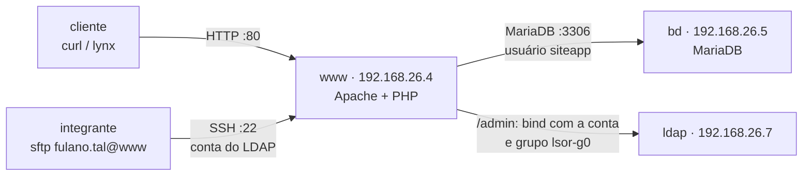

# Aula 11: Aplicação Web em Duas Camadas (LAMP) com SFTP e Login do LDAP

Objetivo: montar a aplicação web do grupo em **duas camadas**: o MariaDB no `bd` e o Apache com PHP no `www`. O site chega ao `www` por **SFTP**, com a conta do LDAP, e a área de administração é protegida pelo **LDAP**. Fecha com o **roteiro da apresentação de 02/12**. Corresponde às seções 12, 13 e 14 do [Projeto Final](projeto-final/README.md).

**Duração:** 1h30 · **Ambiente:** VirtualBox, as 9 VMs da Etapa 1 · **Base:** Aulas 09 e 10 (DNS do grupo, LDAP, SSSD em todas as VMs e Samba)

Todos os testes são feitos **a partir da VM `cliente`**, pelo nome das VMs.

---

## Organização da aula

| Tempo | Parte | Conteúdo |
|:--|:--|:--|
| 0–10 min | Pré-requisito e conceitos | Conferir DNS e login unificado; o que é uma aplicação em duas camadas (seções 0 e 1) |
| 10–30 min | Prática 1 | Banco de dados MariaDB no `bd` (seção 2) |
| 30–50 min | Prática 2 | Apache e PHP no `www` e envio do site por SFTP (seções 3 e 4) |
| 50–70 min | Prática 3 | *Virtual host*, área `/admin` com LDAP e testes (seções 5 e 6) |
| 70–80 min | Prática 4 | SFTP restrito do `novato` (seção 7) |
| 80–90 min | Apresentação | Roteiro de 02/12 (seção 8) |

---

## 0. Pré-requisito (na VM `cliente`)

```bash
dig +short www bd ldap               # três IPs do grupo
getent passwd fulano.tal             # uid 10001, vindo do LDAP
ssh fulano.tal@www 'id'              # entra com a senha do LDAP e mostra o grupo lsor-g0
ssh fulano.tal@bd 'id'               # idem no bd
```

Se algum falhar, termine as Aulas 09 e 10 antes de continuar. Tire um *snapshot* do `www` e do `bd` (`antes-aula11`).

---

## 1. Conceitos: aplicação em duas camadas

Numa pilha **LAMP** (Linux, Apache, MariaDB/MySQL e PHP), o Apache recebe o pedido HTTP, o PHP monta a página e consulta o banco. No projeto, o servidor web e o banco ficam em **VMs separadas**: cada página atravessa a rede do grupo até o banco [1, 2, 3].



| Camada | VM | Quem acessa | Proteção |
|:--|:--|:--|:--|
| Apresentação e lógica | `www` | Qualquer VM do grupo, pela porta 80 | `/admin` só para o grupo `lsor-g0` do LDAP |
| Dados | `bd` | Só o `www`, pela porta 3306 | Usuário `siteapp` aceito só a partir do IP do `www` |

O grupo usa o [site demo](projeto-final/site-demo/README.md), que cadastra grupos, integrantes e VMs.

---

## 2. Prática 1 — Banco de dados (`bd`)

```bash
sudo apt-get update
sudo apt-get install -y mariadb-server
sudo mysql_secure_installation
sudo nano /etc/mysql/mariadb.conf.d/50-server.cnf
```

O MariaDB só escuta em `127.0.0.1` por padrão. Para o `www` alcançá-lo:

```ini
bind-address = 192.168.26.5
```

Traga o [`criar-banco.sql`](projeto-final/site-demo/bd/criar-banco.sql) para o `bd`, entrando com a sua conta do LDAP (`git clone` do repositório da disciplina, ou SFTP a partir de outra VM), e ajuste ao seu grupo: o IP do `www` no usuário `siteapp`, os IPs da tabela `host` e a senha `TROQUE-ESTA-SENHA`. Depois:

```bash
sudo systemctl restart mariadb
sudo mariadb < criar-banco.sql
sudo ss -tlnp | grep 3306             # 192.168.26.5:3306
sudo mariadb -e "SELECT user, host FROM mysql.user WHERE user='siteapp'"   # siteapp | 192.168.26.4
```

O usuário `siteapp` só entra **a partir do IP do `www`** e só tem `SELECT`, `INSERT`, `UPDATE` e `DELETE` no banco `projeto`.

---

## 3. Prática 2 — Apache e PHP (`www`)

```bash
sudo apt-get install -y apache2 php libapache2-mod-php php-mysql mariadb-client
curl -s http://localhost/ | grep -o '<title>.*</title>'               # página padrão do Apache
mariadb -h bd -u siteapp -p projeto -e 'SELECT COUNT(*) FROM host'   # teste de rede até o banco
```

---

## 4. Envio do site por SFTP (`www`)

O SFTP é a transferência de arquivos do SSH. Os integrantes não precisam de configuração nova: o login já vem do LDAP [4].

Numa VM com o [site demo](projeto-final/site-demo) (por exemplo, o `cliente`, com `git clone` do repositório da disciplina), entre na pasta `projeto-final/site-demo` e envie para o seu home no `www` a pasta do site e o *virtual host*:

```bash
sftp fulano.tal@www
sftp> put -r www.grupo0.bsi-26-2.maceio.lab
sftp> put apache/www.grupo0.bsi-26-2.maceio.lab.conf
sftp> ls
sftp> bye
```

No `www`, instale o site e dê a pasta ao grupo `lsor-g0`, para que qualquer integrante possa atualizá-lo depois por SFTP:

```bash
sudo cp -r ~/www.grupo0.bsi-26-2.maceio.lab /var/www/
cd /var/www/www.grupo0.bsi-26-2.maceio.lab
sudo cp app/config.exemplo.php app/config.php
sudo nano app/config.php                       # servidor bd, usuário siteapp e a senha
sudo chown -R root:lsor-g0 .
sudo find . -type d -exec chmod 2775 {} +
sudo find . -type f -exec chmod 664 {} +
sudo chgrp www-data app/config.php && sudo chmod 640 app/config.php   # só o Apache lê a senha
```

---

## 5. *Virtual host* e área `/admin` com LDAP (`www`)

O [*virtual host*](projeto-final/site-demo/apache/www.grupo0.bsi-26-2.maceio.lab.conf) publica só a pasta `public/` (a `app/`, com a senha do banco, fica fora) e protege `/admin` com o LDAP [5, 6]. O trecho da área restrita:

```apache
    <Location /admin>
        AuthType Basic
        AuthName "Administração do site - Grupo 0 (login do LDAP)"
        AuthBasicProvider ldap
        AuthLDAPURL "ldap://ldap.grupo0.bsi-26-2.maceio.lab/ou=usuarios,dc=grupo0,dc=bsi-26-2,dc=maceio,dc=lab?uid?one"
        AuthLDAPGroupAttribute memberUid
        AuthLDAPGroupAttributeIsDN off
        Require ldap-group cn=lsor-g0,ou=grupos,dc=grupo0,dc=bsi-26-2,dc=maceio,dc=lab
    </Location>
```

| Diretiva | Função |
|:--|:--|
| `AuthLDAPURL` | Servidor, base dos usuários e atributo do login (`uid`) |
| `AuthLDAPGroupAttribute memberUid` e `...IsDN off` | Os grupos POSIX guardam o login do membro, não o DN |
| `Require ldap-group` | Só membros do `lsor-g0` entram |

```bash
sudo cp ~/www.grupo0.bsi-26-2.maceio.lab.conf /etc/apache2/sites-available/   # enviado na seção 4
sudo a2enmod ldap authnz_ldap
sudo a2ensite www.grupo0.bsi-26-2.maceio.lab
sudo a2dissite 000-default
sudo apache2ctl configtest && sudo systemctl reload apache2
sudo apache2ctl -S                     # o virtual host do grupo na porta 80
```

---

## 6. Testes da aplicação (na VM `cliente`)

Correspondem aos testes 11 a 13 da seção 14 do enunciado.

```bash
sudo apt-get install -y curl lynx mariadb-client                                    # uma vez
curl -s http://www.grupo0.bsi-26-2.maceio.lab/ | grep -o 'Conectado[^<]*'          # conexão com o bd
curl -s -o /dev/null -w '%{http_code}\n' http://www/admin/                         # 401
curl -s -o /dev/null -w '%{http_code}\n' -u fulano.tal http://www/admin/           # 200
curl -s -o /dev/null -w '%{http_code}\n' -u novato http://www/admin/               # 401: fora do lsor-g0
mariadb -h bd -u siteapp -p projeto -e 'SELECT 1'                                   # recusado: só o www entra
```

**Cadastro pelo site:** `lynx http://www/admin/` (o `lynx` pede usuário e senha do LDAP); cadastre um integrante em **Integrantes** e uma VM em **Máquinas virtuais**. No `bd`, confira:

```bash
sudo mariadb projeto -e 'SELECT * FROM aluno; SELECT * FROM host;'
```

**Atualização por outro integrante:** `beltrano.silva` altera um arquivo do site por SFTP (por exemplo, o título em `public/index.php`) e a mudança aparece no `curl`. Funciona porque a pasta pertence ao grupo `lsor-g0`.

---

## 7. Prática 4 — SFTP restrito do `novato` (`www`)

O `novato` (grupo `sftpusers`, shell `/usr/sbin/nologin`) só pode **enviar arquivos** para uma pasta própria no `www`, sem terminal e sem ver o resto do sistema [4]. No **final** do `/etc/ssh/sshd_config` do `www`:

```
Match Group sftpusers
    ChrootDirectory /srv/sftp/%u
    ForceCommand internal-sftp
    AllowTcpForwarding no
    X11Forwarding no
```

```bash
sudo mkdir -p /srv/sftp/novato/arquivos
sudo chown root:root /srv/sftp/novato && sudo chmod 755 /srv/sftp/novato   # exigência do ChrootDirectory
sudo chown novato:sftpusers /srv/sftp/novato/arquivos
sudo sshd -t && sudo systemctl restart ssh
```

**Teste na VM `cliente`** (teste 14 da seção 14 do enunciado):

```bash
sftp novato@www <<< 'ls; cd /etc'      # vê só a pasta arquivos; /etc não existe para ele
ssh novato@www                         # recusado: só SFTP
```

### 7.1 Problemas comuns

| Sintoma | Causa provável | O que fazer |
|:--|:--|:--|
| Página mostra erro de conexão com o banco | `bind-address` ainda em `127.0.0.1`, ou usuário `siteapp` criado com outro IP | `ss -tlnp` no `bd` e o IP no `criar-banco.sql` |
| `mariadb -h bd` no `www` dá `Access denied` | Senha diferente da do `criar-banco.sql`, ou `siteapp` com outro IP | `SELECT user, host FROM mysql.user` no `bd` |
| `/admin` sempre devolve 401 | Base do LDAP errada no *virtual host*, ou integrante fora do `lsor-g0` | `sudo tail /var/log/apache2/www.grupo0-error.log` |
| `curl http://www/` mostra a página padrão do Apache | `000-default` ainda habilitado | `sudo a2dissite 000-default` e `reload` |
| Página PHP aparece como texto | Falta o `libapache2-mod-php` | Instale e reinicie o Apache |
| `put -r` recusado no `www` | Pasta do site sem escrita para o `lsor-g0` | `chown -R root:lsor-g0` e `chmod 2775` (seção 4) |
| `novato` não entra por SFTP | Pasta do *chroot* não pertence ao `root` ou tem escrita para o grupo | `ls -ld /srv/sftp/novato` deve mostrar `root root drwxr-xr-x` |

---

## 8. Apresentação de 02/12

Cada grupo apresenta **ao vivo**, a partir da VM `cliente`, os 14 testes da [seção 14 do enunciado](projeto-final/README.md#14-testes-e-apresentação-0212), nesta ordem. Deixe os comandos prontos num arquivo de texto e as VMs ligadas antes da aula.

| # | Serviço | O que mostrar | Testes |
|:--:|:--|:--|:--:|
| 1 | Topologia | Diagrama do grupo e a tabela de nomes e IPs | — |
| 2 | Gateway | `ping 1.1.1.1` do `cliente` | 1 |
| 3 | DNS | `dig www`, `dig -x` de um IP, SOA igual no `ns1` e no `ns2`; `ns2` respondendo com o `ns1` parado | 2 a 5 |
| 4 | LDAP e login | `ldapsearch`; `ssh` com o mesmo integrante em três VMs; `id` e `sudo -l`; troca de senha com `ldappasswd` | 6 a 8 |
| 5 | Samba | `publico` para convidado; `grupo0` gravável pelo integrante e negado ao `novato`; dono e grupo do arquivo vindos do LDAP | 9 e 10 |
| 6 | Web | Página com a conexão ao `bd`; `/admin` com a conta do LDAP; cadastro refletido no `bd` | 11 a 13 |
| 7 | SFTP | `novato` preso à pasta `arquivos` no `www` | 14 |
| 8 | Bônus | Firewall, TLS, e-mail ou backup, se houver | — |

Cada integrante deve saber explicar pelo menos um serviço.

---

## 9. Registro no repositório do grupo

1. **Banco:** `50-server.cnf` (só o `bind-address`) e a consulta ao `mysql.user`.
2. **Web:** o *virtual host*, `apache2ctl -S`, as permissões da pasta do site e os testes da seção 6.
3. **SFTP:** o envio do site e o trecho `Match` do `sshd_config`, com o teste do `novato`.
4. Sem senhas, *hashes* ou o conteúdo do `config.php`.

---

## Referências

[1] APACHE SOFTWARE FOUNDATION. **Apache HTTP Server Version 2.4 Documentation — Virtual Hosts**. Disponível em: <https://httpd.apache.org/docs/2.4/vhosts/>.

[2] THE PHP GROUP. **PHP Manual — PDO**. Disponível em: <https://www.php.net/manual/en/book.pdo.php>.

[3] MARIADB FOUNDATION. **MariaDB Knowledge Base — Configuring MariaDB for Remote Client Access**. Disponível em: <https://mariadb.com/kb/en/configuring-mariadb-for-remote-client-access/>.

[4] OPENBSD PROJECT. **sshd_config(5)** — opções `Match`, `ChrootDirectory` e `ForceCommand`; **sftp(1)**. Disponível em: <https://man.openbsd.org/sshd_config> e <https://man.openbsd.org/sftp>.

[5] APACHE SOFTWARE FOUNDATION. **Apache Module mod_authnz_ldap**. Disponível em: <https://httpd.apache.org/docs/2.4/mod/mod_authnz_ldap.html>.

[6] CANONICAL. **Install and configure Apache2** e **Apache2 settings**. Ubuntu Server documentation. Disponível em: <https://documentation.ubuntu.com/server/how-to/web-services/install-apache2/>.
