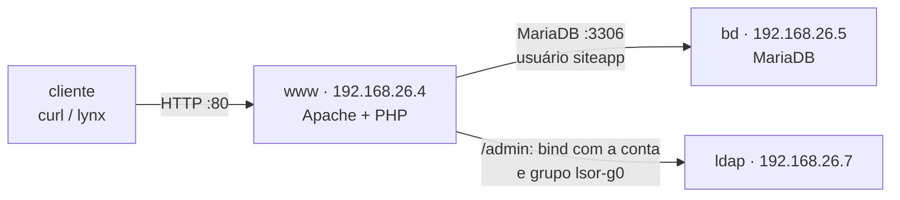

# Aula 11: Servidor de Arquivos (Samba e SFTP) e Aplicação Web em Duas Camadas

Objetivo: implantar os serviços que o usuário final enxerga, todos usando as contas do LDAP da [Aula 10](Aula10.md). Primeiro o **servidor de arquivos**, com as mesmas pastas por Samba e por SFTP; depois a **aplicação web**, com Apache e PHP no `www` e MariaDB no `bd`, e a área de administração protegida pelo LDAP. Fecha com o **roteiro da apresentação de 02/12**. Corresponde às seções 11, 12 e 13 do [Projeto Final](projeto-final/README.md).

**Duração:** 1h30 · **Ambiente:** VirtualBox, as 9 VMs da Etapa 1 · **Base:** Aulas 09 e 10 (DNS do grupo, LDAP e SSSD em todas as VMs)

Todos os testes são feitos **a partir da VM `cliente`**, pelo nome das VMs.

---

## Organização da aula

| Tempo | Parte | Conteúdo |
|:--|:--|:--|
| 0–5 min | Pré-requisito | Conferir DNS e login unificado (seção 0) |
| 5–40 min | Prática 1 | Servidor de arquivos: Samba e SFTP na VM `arquivos` (seção 1) |
| 40–80 min | Prática 2 | Aplicação web: MariaDB no `bd`, Apache e PHP no `www`, área `/admin` com LDAP (seção 2) |
| 80–90 min | Apresentação | Roteiro de 02/12 (seção 3) |

---

## 0. Pré-requisito (na VM `cliente`)

```bash
dig +short arquivos www bd ldap      # quatro IPs do grupo
getent passwd fulano.tal             # uid 10001, vindo do LDAP
ssh fulano.tal@www 'id'              # entra com a senha do LDAP e mostra o grupo lsor-g0
```

Se algum dos três falhar, termine as Aulas 09 e 10 antes de continuar. Tire um *snapshot* do `arquivos`, do `www` e do `bd` (`antes-aula11`).

---

## 1. Prática 1 — Servidor de arquivos (`arquivos`)

O `arquivos` oferece **as mesmas pastas** por dois protocolos: **Samba** (SMB, o compartilhamento de pastas do Windows) e **SFTP** (transferência de arquivos pelo SSH) [1, 2].

**Tabela 1:** Pastas e acessos (Grupo 0)

| Compartilhamento | Caminho | Samba | SFTP |
|:--|:--|:--|:--|
| `publico` | `/srv/arquivos/publico` | Leitura para todos, inclusive convidado | Leitura para os integrantes |
| `grupo0` | `/srv/arquivos/grupo0` | Leitura e escrita só para o grupo `lsor-g0` | Leitura e escrita para os integrantes |
| — | `/srv/sftp/novato/arquivos` | — | Só o `novato`, preso a essa pasta e sem terminal |

### 1.1 Instalação e pastas

```bash
sudo apt-get update
sudo apt-get install -y samba smbclient
sudo ss -tlnp | grep -E ':(139|445)\s'      # Samba escutando nas portas 139 e 445

sudo mkdir -p /srv/arquivos/publico /srv/arquivos/grupo0
sudo chown root:lsor-g0 /srv/arquivos/publico /srv/arquivos/grupo0   # lsor-g0 vem do LDAP
sudo chmod 2775 /srv/arquivos/publico
sudo chmod 2770 /srv/arquivos/grupo0
ls -ld /srv/arquivos/*
```

O bit **setgid** (o `2` de `2770`) faz todo arquivo criado na pasta herdar o grupo `lsor-g0`, venha ele pelo Samba ou pelo SFTP.

### 1.2 Configuração do Samba

Guarde o arquivo original e crie um novo, só com o necessário:

```bash
sudo cp /etc/samba/smb.conf /etc/samba/smb.conf.original
sudo nano /etc/samba/smb.conf
```

```ini
[global]
   workgroup = LSOR
   server string = Arquivos do Grupo 0
   server role = standalone server
   map to guest = Bad User
   log file = /var/log/samba/log.%m
   max log size = 1000

[publico]
   path = /srv/arquivos/publico
   read only = yes
   guest ok = yes
   write list = @lsor-g0

[grupo0]
   path = /srv/arquivos/grupo0
   valid users = @lsor-g0
   read only = no
   force group = lsor-g0
   create mask = 0660
   directory mask = 2770
```

| Opção | Função |
|:--|:--|
| `map to guest = Bad User` | Usuário inexistente entra como convidado (só onde houver `guest ok`) |
| `write list = @lsor-g0` | No `publico`, só o grupo grava |
| `valid users = @lsor-g0` | No `grupo0`, só o grupo entra |
| `force group`, `create mask`, `directory mask` | Arquivos novos do grupo, com leitura e escrita para o grupo |

```bash
testparm -s                 # deve terminar sem erros e listar os dois compartilhamentos
sudo systemctl restart smbd
```

### 1.3 Senha do Samba para cada integrante

O Samba autentica com um *hash* próprio, que o LDAP do projeto não guarda. Cadastre cada integrante **com a mesma senha do LDAP**. O `smbpasswd` só aceita o login porque o SSSD já faz o sistema enxergar a conta:

```bash
sudo smbpasswd -a fulano.tal
sudo smbpasswd -a beltrano.silva
sudo pdbedit -L             # integrantes cadastrados no Samba
```

### 1.4 SFTP

**Integrantes:** nada a configurar. O SFTP é parte do SSH, e o login já vem do LDAP. Eles trabalham em `/srv/arquivos`, com as permissões normais.

**`novato`:** só SFTP, preso à própria pasta. No **final** do `/etc/ssh/sshd_config`:

```
Match Group sftpusers
    ChrootDirectory /srv/sftp/%u
    ForceCommand internal-sftp
    AllowTcpForwarding no
    X11Forwarding no
```

```bash
sudo mkdir -p /srv/sftp/novato/arquivos
sudo chown root:root /srv/sftp/novato && sudo chmod 755 /srv/sftp/novato   # exigência do ChrootDirectory
sudo chown novato:sftpusers /srv/sftp/novato/arquivos
sudo sshd -t && sudo systemctl restart ssh
```

### 1.5 Testes do servidor de arquivos (na VM `cliente`)

Correspondem aos testes 9 a 11 da seção 13 do enunciado.

```bash
sudo apt-get install -y smbclient                             # cliente Samba (uma vez)
smbclient -L //arquivos -N                                   # lista publico e grupo0 sem senha
smbclient //arquivos/grupo0 -U fulano.tal -c 'put /etc/hostname teste-smb.txt; ls'
sftp fulano.tal@arquivos <<< 'ls -l /srv/arquivos/grupo0'    # o arquivo do Samba aparece no SFTP, grupo lsor-g0
smbclient //arquivos/grupo0 -U novato -c 'ls'                # NT_STATUS_ACCESS_DENIED
sftp novato@arquivos <<< 'ls'                                # só a pasta arquivos
ssh novato@arquivos                                          # recusado: só SFTP
```

> O `novato` também precisa de `sudo smbpasswd -a novato` no `arquivos` para o teste do Samba mostrar `ACCESS_DENIED` (conta válida, mas fora do `lsor-g0`). Sem isso, a resposta é `LOGON_FAILURE`.

---

## 2. Prática 2 — Aplicação web em duas camadas (`bd` e `www`)

O Apache com PHP roda no `www` e o MariaDB roda no `bd`: cada página atravessa a rede do grupo até o banco. O grupo usa o [site demo](projeto-final/site-demo/README.md), que cadastra grupos, integrantes e VMs [3, 4, 5].



### 2.1 Banco de dados (`bd`)

```bash
sudo apt-get install -y mariadb-server
sudo mysql_secure_installation
sudo nano /etc/mysql/mariadb.conf.d/50-server.cnf
```

O MariaDB só escuta em `127.0.0.1` por padrão. Para o `www` alcançá-lo:

```ini
bind-address = 192.168.26.5
```

Copie o [`criar-banco.sql`](projeto-final/site-demo/bd/criar-banco.sql) para o `bd` (por SFTP, ou clonando o repositório da disciplina) e ajuste ao seu grupo: o IP do `www` no usuário `siteapp`, os IPs da tabela `host` e a senha `TROQUE-ESTA-SENHA`. Depois:

```bash
sudo systemctl restart mariadb
sudo mariadb < criar-banco.sql
sudo ss -tlnp | grep 3306             # 192.168.26.5:3306
```

O usuário `siteapp` só entra **a partir do IP do `www`** e só tem `SELECT`, `INSERT`, `UPDATE` e `DELETE` no banco `projeto`.

### 2.2 Servidor web (`www`)

```bash
sudo apt-get install -y apache2 php libapache2-mod-php php-mysql mariadb-client
mariadb -h bd -u siteapp -p projeto -e 'SELECT COUNT(*) FROM host'   # teste de rede até o banco
```

Envie a pasta [`www.grupo0.bsi-26-2.maceio.lab/`](projeto-final/site-demo/www.grupo0.bsi-26-2.maceio.lab) para o seu home no `www` por SFTP, com a sua conta do LDAP (`sftp fulano.tal@www` e `put -r`), e instale:

```bash
sudo cp -r ~/www.grupo0.bsi-26-2.maceio.lab /var/www/
cd /var/www/www.grupo0.bsi-26-2.maceio.lab
sudo cp app/config.exemplo.php app/config.php
sudo nano app/config.php                       # servidor bd, usuário siteapp e a senha
sudo chown -R root:lsor-g0 .                   # integrantes (grupo do LDAP) podem atualizar o site por SFTP
sudo find . -type d -exec chmod 2775 {} +
sudo find . -type f -exec chmod 664 {} +
sudo chgrp www-data app/config.php && sudo chmod 640 app/config.php   # só o Apache lê a senha
```

Instale o [*virtual host*](projeto-final/site-demo/apache/www.grupo0.bsi-26-2.maceio.lab.conf), que publica só a pasta `public/` e protege `/admin` com o LDAP. O trecho da área restrita:

```apache
    <Location /admin>
        AuthType Basic
        AuthName "Administração do site - Grupo 0 (login do LDAP)"
        AuthBasicProvider ldap
        AuthLDAPURL "ldap://ldap.grupo0.bsi-26-2.maceio.lab/ou=usuarios,dc=grupo0,dc=bsi-26-2,dc=maceio,dc=lab?uid?one"
        AuthLDAPGroupAttribute memberUid
        AuthLDAPGroupAttributeIsDN off
        Require ldap-group cn=lsor-g0,ou=grupos,dc=grupo0,dc=bsi-26-2,dc=maceio,dc=lab
    </Location>
```

```bash
sudo cp www.grupo0.bsi-26-2.maceio.lab.conf /etc/apache2/sites-available/
sudo a2enmod ldap authnz_ldap
sudo a2ensite www.grupo0.bsi-26-2.maceio.lab
sudo a2dissite 000-default
sudo apache2ctl configtest && sudo systemctl reload apache2
sudo apache2ctl -S                     # o virtual host do grupo na porta 80
```

### 2.3 Testes da aplicação (na VM `cliente`)

Correspondem aos testes 12 a 14 da seção 13 do enunciado.

```bash
sudo apt-get install -y curl lynx mariadb-client                                    # uma vez
curl -s http://www.grupo0.bsi-26-2.maceio.lab/ | grep -o 'Conectado[^<]*'          # conexão com o bd
curl -s -o /dev/null -w '%{http_code}\n' http://www/admin/                         # 401
curl -s -o /dev/null -w '%{http_code}\n' -u fulano.tal http://www/admin/           # 200
curl -s -o /dev/null -w '%{http_code}\n' -u novato http://www/admin/               # 401: fora do lsor-g0
mariadb -h bd -u siteapp -p projeto -e 'SELECT 1'                                   # recusado: só o www entra
```

**Cadastro pelo site:** `lynx http://www/admin/` (o `lynx` pede usuário e senha do LDAP), cadastre um integrante em **Integrantes** e uma VM em **Máquinas virtuais**. No `bd`, confira:

```bash
sudo mariadb projeto -e 'SELECT * FROM aluno; SELECT * FROM host;'
```

### 2.4 Problemas comuns

| Sintoma | Causa provável | O que fazer |
|:--|:--|:--|
| `testparm` acusa erro | Nome de parâmetro digitado errado | Corrija a linha indicada e rode de novo |
| `smbclient -U fulano.tal` dá `LOGON_FAILURE` | Integrante sem `smbpasswd -a` | Seção 1.3 |
| `novato` não entra por SFTP | Pasta do *chroot* não pertence ao `root` ou tem escrita para o grupo | `ls -ld /srv/sftp/novato` deve mostrar `root root drwxr-xr-x` |
| Página mostra erro de conexão com o banco | `bind-address` ainda em `127.0.0.1`, ou usuário `siteapp` criado com outro IP | `ss -tlnp` no `bd` e o IP no `criar-banco.sql` |
| `/admin` sempre devolve 401 | Base do LDAP errada no *virtual host*, ou integrante fora do `lsor-g0` | `sudo tail /var/log/apache2/www.grupo0-error.log` |
| `curl http://www/` mostra a página padrão do Apache | `000-default` ainda habilitado | `sudo a2dissite 000-default` e `reload` |
| Página PHP aparece como texto | Falta o `libapache2-mod-php` | Instale e reinicie o Apache |

---

## 3. Apresentação de 02/12

Cada grupo apresenta **ao vivo**, a partir da VM `cliente`, os 14 testes da [seção 13 do enunciado](projeto-final/README.md#13-testes-e-apresentação-0212), nesta ordem. Deixe os comandos prontos num arquivo de texto e as VMs ligadas antes da aula.

| # | Serviço | O que mostrar | Testes |
|:--:|:--|:--|:--:|
| 1 | Topologia | Diagrama do grupo e a tabela de nomes e IPs | — |
| 2 | Gateway | `ping 1.1.1.1` do `cliente` | 1 |
| 3 | DNS | `dig www`, `dig -x` de um IP, SOA igual no `ns1` e no `ns2`; `ns2` respondendo com o `ns1` parado | 2 a 5 |
| 4 | LDAP e login | `ldapsearch`; `ssh` com o mesmo integrante em três VMs; `id` e `sudo -l`; troca de senha com `ldappasswd` | 6 a 8 |
| 5 | Arquivos | Gravar pelo Samba e ver o arquivo pelo SFTP; `novato` negado no Samba e preso no SFTP | 9 a 11 |
| 6 | Web | Página com a conexão ao `bd`; `/admin` com a conta do LDAP; cadastro refletido no `bd` | 12 a 14 |
| 7 | Bônus | Firewall, TLS, e-mail ou backup, se houver | — |

Cada integrante deve saber explicar pelo menos um serviço.

---

## 4. Registro no repositório do grupo

1. **Arquivos:** `smb.conf`, `testparm -s`, `pdbedit -L`, o trecho `Match` do `sshd_config` e os testes da seção 1.5.
2. **Web e banco:** `50-server.cnf` (só o `bind-address`), o *virtual host*, `apache2ctl -S` e os testes da seção 2.3.
3. Sem senhas, *hashes* ou o conteúdo do `config.php`.

---

## Referências

[1] SAMBA TEAM. **smb.conf(5)** — opções `valid users`, `write list`, `force group`, `create mask`, `directory mask` e `map to guest`. Disponível em: <https://www.samba.org/samba/docs/current/man-html/smb.conf.5.html>.

[2] OPENBSD PROJECT. **sshd_config(5)** — opções `Match`, `ChrootDirectory` e `ForceCommand`. Disponível em: <https://man.openbsd.org/sshd_config>.

[3] APACHE SOFTWARE FOUNDATION. **Apache HTTP Server Version 2.4 Documentation — Virtual Hosts**. Disponível em: <https://httpd.apache.org/docs/2.4/vhosts/>.

[4] APACHE SOFTWARE FOUNDATION. **Apache Module mod_authnz_ldap**. Disponível em: <https://httpd.apache.org/docs/2.4/mod/mod_authnz_ldap.html>.

[5] MARIADB FOUNDATION. **MariaDB Knowledge Base — Configuring MariaDB for Remote Client Access**. Disponível em: <https://mariadb.com/kb/en/configuring-mariadb-for-remote-client-access/>.
