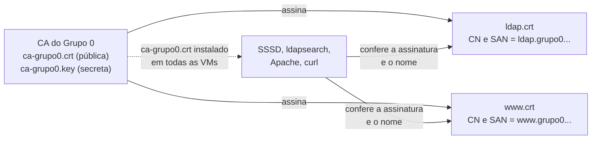

# Aula 12 (extra): Segurança dos Serviços — Chaves SSH, TLS no LDAP, HTTPS, Samba Seguro e DNSSEC

Objetivo: proteger os serviços montados nas Aulas 09 a 11. O grupo troca as senhas do SSH por **chaves**, cria uma **autoridade certificadora (CA)** própria, liga o **TLS** no LDAP (SSSD e Apache inclusos), publica o site em **HTTPS**, endurece o **Samba** e assina a zona do grupo com **DNSSEC**. Tudo é opcional para a apresentação de 02/12 e conta como **bônus** do [Projeto Final](projeto-final/README.md).

**Duração:** 1h30 em sala + continuação pelo grupo · **Ambiente:** as 9 VMs do projeto · **Base:** Aulas 09, 10 e 11 funcionando

> **Antes de começar:** tire um *snapshot* de **todas** as VMs (`antes-aula12`). Várias etapas desta aula, se feitas pela metade, deixam um serviço inacessível. O `administrador` local continua entrando com senha em todas as VMs: é o acesso de emergência.

---

## Organização da aula

As seções estão em ordem de prioridade. O que não couber em sala, o grupo termina em casa.

| Tempo | Parte | O que o grupo faz | VMs |
|:--|:--|:--|:--|
| 0–15 min | Conceitos | Criptografia simétrica e assimétrica, *hash*, assinatura, certificado, CA e TLS (seção 1) | — |
| 15–25 min | Chaves SSH | Login por chave e senha desligada no SSH (seção 2) | todas |
| 25–35 min | CA do grupo | CA própria e certificados do `ldap` e do `www` (seção 3) | `cliente` |
| 35–50 min | TLS no LDAP | A senha em texto puro na rede; StartTLS no `slapd`, no SSSD e nas ferramentas (seção 4) | `ldap` e todas |
| 50–65 min | HTTPS | Site em HTTPS e `/admin` falando com o LDAP por StartTLS (seção 5) | `www` |
| 65–75 min | Samba seguro | SMB3 com criptografia obrigatória, sem convidado (seção 6) | `arquivos` |
| 75–90 min | DNSSEC | Zona assinada no `ns1` e validação com âncora de confiança (seção 7) | `ns1`, `ns2`, `cliente` |

---

## 1. Conceitos

### 1.1 Ferramentas da criptografia

| Conceito | Definição | Exemplo |
|:--|:--|:--|
| **Texto puro** | Dado que trafega sem proteção: qualquer um no caminho lê | A senha no *bind* do LDAP da Aula 10 (seção 4.1 mostra isso com o `tcpdump`) |
| **Criptografia simétrica** | A **mesma chave** cifra e decifra. Rápida, usada para os dados em si; o problema é combinar a chave sem que ninguém a veja | AES, usado pelo TLS e pelo SMB3 depois que a conexão começa |
| **Criptografia assimétrica** | Cada um tem um **par de chaves**: a **pública**, que pode ser distribuída, e a **privada**, que nunca sai do dono. O que uma chave faz, só a outra desfaz | RSA, ECDSA e Ed25519: chaves SSH, certificados e DNSSEC |
| ***Hash*** | Função que transforma qualquer dado num resumo de tamanho fixo; mudar um bit do dado muda o resumo todo, e não dá para voltar do resumo ao dado | SHA-256; também é como as senhas ficam guardadas (`{SSHA}` no LDAP) |
| **Assinatura digital** | O dono calcula o *hash* de um dado e o cifra com a **chave privada**; qualquer um confere com a **chave pública**. Prova quem assinou e que nada foi alterado | A CA assina certificados; o `ns1` assina a zona (DNSSEC) |
| **Certificado X.509** | Documento que liga uma **chave pública** a um **nome** (por exemplo, `www.grupo0.bsi-26-2.maceio.lab`), com validade, **assinado por uma CA** | `www.crt` |
| **CA** (*Certification Authority*) | Entidade que assina certificados. Quem confia na CA confia nos certificados que ela assinou. Na internet, as CAs vêm instaladas no sistema e nos navegadores; no projeto, o grupo cria a própria | `ca-grupo0.crt` |
| **TLS** (*Transport Layer Security*) | Protocolo que protege uma conexão TCP: o servidor apresenta o certificado, o cliente o confere, os dois combinam uma chave simétrica usando criptografia assimétrica, e daí em diante tudo vai cifrado. Sucessor do SSL; versão atual 1.3 [12] | HTTPS (HTTP + TLS, porta 443) |
| **StartTLS** | O cliente conecta na porta normal, sem criptografia, e pede para "subir" para TLS antes de enviar qualquer senha | LDAP na porta 389 com `-ZZ` |

**Exemplo: o início de uma conexão HTTPS do `cliente` com o `www`.**

1. O `cliente` conecta na porta 443 e diz quais versões de TLS e algoritmos aceita.
2. O `www` responde com o seu **certificado** (`www.crt`, com a chave pública do `www`).
3. O `cliente` confere: o certificado foi **assinado pela CA do grupo**, em que ele confia? Está **na validade**? O **nome** no certificado é o nome que eu pedi (`www.grupo0...`)? Se algo falhar, a conexão para com erro de certificado.
4. Os dois combinam uma **chave de sessão** (simétrica). Só quem tem a chave privada do `www` consegue concluir essa etapa: é isso que prova que o servidor é mesmo o `www`.
5. A partir daí, o pedido HTTP, a senha do `/admin` e a página vão cifrados com AES.

### 1.2 O que cada mecanismo desta aula protege

| Mecanismo | Protege contra | Garante | Seção |
|:--|:--|:--|:--:|
| Chave SSH | Senha adivinhada ou roubada; ataque de força bruta | Autenticação forte do usuário | 2 |
| TLS (StartTLS, HTTPS, SMB3) | Escuta na rede (*sniffing*) e servidor falso | **Confidencialidade**, **integridade** e autenticidade do servidor | 4, 5, 6 |
| Certificado e CA | Servidor falso fingindo ser o `ldap` ou o `www` | O cliente confere que o nome do servidor foi assinado pela CA em que confia | 3 |
| DNSSEC | Resposta de DNS forjada (envenenamento de *cache*) | **Integridade** e origem das respostas DNS; **não** cifra nada | 7 |

**Cadeia de confiança do TLS no projeto:**



O certificado vale para um **nome**. Por isso os clientes precisam acessar `ldap.grupo0.bsi-26-2.maceio.lab` e `www.grupo0.bsi-26-2.maceio.lab` pelo nome do DNS: pelo IP, a verificação falha.

---

## 2. Login por chave no SSH (todas as VMs)

Até aqui, o SSH autentica por **senha**: ela viaja cifrada, mas pode ser adivinhada (ataque de **força bruta**, tentando milhares de senhas) ou roubada. Na **autenticação por chave**, o usuário tem um par de chaves:

| Arquivo | Onde fica | Função |
|:--|:--|:--|
| `~/.ssh/id_ed25519` | Só no computador do usuário (no projeto, o `cliente`), com permissão 600 | **Chave privada**: nunca é enviada a ninguém. Pode ser protegida por uma **frase-senha** |
| `~/.ssh/id_ed25519.pub` | Copiada para cada servidor | **Chave pública** |
| `~/.ssh/authorized_keys` | No servidor, no home do usuário | Lista das chaves públicas que podem entrar nessa conta |

**Como funciona o login:** o servidor envia um desafio; o cliente o **assina** com a chave privada; o servidor confere a assinatura com a chave pública do `authorized_keys`. A chave privada nunca trafega, e não há senha para adivinhar. **Ed25519** é o algoritmo de assinatura recomendado hoje: chaves curtas e rápidas [1, 2]. O `ssh-keygen` gera o par; o `ssh-copy-id` acrescenta a chave pública ao `authorized_keys` do servidor.

### 2.1 Gerar a chave e copiá-la para as VMs (na VM `cliente`, como `fulano.tal`)

```bash
ssh-keygen -t ed25519 -C "fulano.tal@grupo0"          # aceite o caminho padrão e defina uma frase-senha
ls -l ~/.ssh/                                         # id_ed25519 (privada, 600) e id_ed25519.pub (pública)

for vm in gw ns1 ns2 www bd arquivos ldap; do
  ssh-copy-id fulano.tal@$vm                          # pede a senha do LDAP uma última vez
done
ssh fulano.tal@www                                    # entra sem a senha do LDAP (só a frase-senha da chave)
```

Cada VM tem o seu próprio `/home/fulano.tal`, por isso a chave é copiada para cada uma. Cada integrante repete esta seção com a própria conta.

### 2.2 Desligar a senha no SSH (todas as VMs, como `administrador`)

Só faça isso **depois** que todos os integrantes tiverem copiado as chaves. Troque o conteúdo do `/etc/ssh/sshd_config.d/50-senha.conf` (criado na Aula 10):

```
PasswordAuthentication no
PubkeyAuthentication yes
PermitRootLogin no
```

E, no **final** do `/etc/ssh/sshd_config`, mantenha a senha para o acesso de emergência. No `www`, acrescente também `PasswordAuthentication yes` dentro do bloco `Match Group sftpusers` da Aula 11, para o `novato` continuar entrando:

```
Match User administrador
    PasswordAuthentication yes
```

```bash
sudo sshd -t && sudo systemctl restart ssh
sudo sshd -T -C user=fulano.tal,host=cliente,addr=192.168.26.9 | grep passwordauthentication      # no
sudo sshd -T -C user=administrador,host=cliente,addr=192.168.26.9 | grep passwordauthentication   # yes
```

**Teste na VM `cliente`:**

```bash
ssh -o PubkeyAuthentication=no fulano.tal@www      # Permission denied (publickey): senha recusada
ssh fulano.tal@www                                  # entra com a chave
```

> O Samba e a área `/admin` do site continuam usando a senha do LDAP. A chave vale só para o SSH e o SFTP.

---

## 3. CA do grupo e certificados (na VM `cliente`, como `administrador`)

O grupo cria a própria CA com o OpenSSL e assina com ela os certificados do `ldap` e do `www` [3]. A chave da CA (`ca-grupo0.key`) é o segredo mais importante do grupo: fica só no `cliente` e **nunca** vai para o GitHub.

```bash
mkdir -p ~/ca && cd ~/ca
chmod 700 ~/ca

# CA válida por um ano
openssl req -x509 -new -nodes -newkey rsa:3072 -sha256 -days 365 \
  -keyout ca-grupo0.key -out ca-grupo0.crt -subj "/O=LSOR Grupo 0/CN=CA do Grupo 0"
chmod 600 ca-grupo0.key
```

Crie o script `emitir.sh`, que gera a chave e o certificado de um servidor, com o nome completo e o nome curto no campo SAN (*Subject Alternative Name*, o campo que os clientes conferem):

```bash
#!/bin/bash
# Uso: ./emitir.sh ldap   -> ldap.key e ldap.crt para ldap.grupo0.bsi-26-2.maceio.lab
set -e
NOME=$1; DOM=grupo0.bsi-26-2.maceio.lab; FQDN=$NOME.$DOM
openssl req -new -nodes -newkey rsa:2048 -keyout $NOME.key -out $NOME.csr -subj "/O=LSOR Grupo 0/CN=$FQDN"
printf "subjectAltName=DNS:%s,DNS:%s\nextendedKeyUsage=serverAuth\nbasicConstraints=CA:FALSE\n" $FQDN $NOME > $NOME.ext
openssl x509 -req -in $NOME.csr -CA ca-grupo0.crt -CAkey ca-grupo0.key -CAcreateserial \
  -days 365 -sha256 -extfile $NOME.ext -out $NOME.crt
openssl verify -CAfile ca-grupo0.crt $NOME.crt
```

```bash
chmod +x emitir.sh
./emitir.sh ldap                                       # ldap.crt: OK
./emitir.sh www                                        # www.crt: OK
openssl x509 -in www.crt -noout -subject -ext subjectAltName -dates
```

Envie os arquivos para os servidores (o `administrador` ainda entra com senha):

```bash
scp ldap.crt ldap.key ca-grupo0.crt administrador@ldap:
scp www.crt www.key ca-grupo0.crt administrador@www:
for vm in gw ns1 ns2 bd arquivos; do scp ca-grupo0.crt administrador@$vm: ; done
```

**Em todas as VMs** (inclusive o `cliente`), instale a CA no repositório de certificados do sistema:

```bash
sudo cp ~/ca-grupo0.crt /usr/local/share/ca-certificates/ 2>/dev/null || sudo cp ~/ca/ca-grupo0.crt /usr/local/share/ca-certificates/
sudo update-ca-certificates                            # "1 added"
grep -q '^TLS_CACERT' /etc/ldap/ldap.conf 2>/dev/null || \
  echo 'TLS_CACERT /etc/ssl/certs/ca-certificates.crt' | sudo tee -a /etc/ldap/ldap.conf   # usado pelo ldapsearch
```

---

## 4. TLS no LDAP

### 4.1 O problema: a senha passa em texto puro

O **`tcpdump`** é um capturador de pacotes: mostra na tela o que passa por uma placa de rede. Com `-A`, mostra o conteúdo dos pacotes como texto; o filtro `tcp port 389` limita a captura ao LDAP. No `ldap`, capture o tráfego da porta 389:

```bash
sudo apt-get install -y tcpdump
sudo tcpdump -i enp0s3 -A -s0 'tcp port 389'
```

No `cliente`, faça um *bind* com a conta de `fulano.tal`:

```bash
ldapwhoami -x -H ldap://ldap -D uid=fulano.tal,ou=usuarios,dc=grupo0,dc=bsi-26-2,dc=maceio,dc=lab -W
```

A senha digitada aparece **legível** na saída do `tcpdump`. É o que acontece em todo login por SSSD, no `/admin` do site e em todo `ldapsearch` com `-W` desde a Aula 10. Pare a captura com `Ctrl+C`.

### 4.2 Certificado no `slapd` (`ldap`)

```bash
sudo mkdir -p /etc/ldap/tls
sudo cp ~/ldap.crt ~/ldap.key /etc/ldap/tls/
sudo chown root:openldap /etc/ldap/tls/ldap.key && sudo chmod 640 /etc/ldap/tls/ldap.key   # o slapd roda como openldap
```

Crie o `tls.ldif` e aplique na configuração do servidor (`cn=config`) [4, 5]:

```ldif
dn: cn=config
changetype: modify
replace: olcTLSCACertificateFile
olcTLSCACertificateFile: /etc/ssl/certs/ca-certificates.crt
-
replace: olcTLSCertificateFile
olcTLSCertificateFile: /etc/ldap/tls/ldap.crt
-
replace: olcTLSCertificateKeyFile
olcTLSCertificateKeyFile: /etc/ldap/tls/ldap.key
```

```bash
sudo ldapmodify -Y EXTERNAL -H ldapi:/// -f tls.ldif
echo | openssl s_client -starttls ldap -connect ldap.grupo0.bsi-26-2.maceio.lab:389 2>/dev/null | grep -E 'subject|Verify'
```

**Teste no `cliente`:** a opção `-ZZ` exige o StartTLS.

```bash
ldapsearch -x -ZZ -LLL -H ldap://ldap.grupo0.bsi-26-2.maceio.lab -b dc=grupo0,dc=bsi-26-2,dc=maceio,dc=lab uid
ldapwhoami -x -ZZ -H ldap://ldap -D uid=fulano.tal,ou=usuarios,dc=grupo0,dc=bsi-26-2,dc=maceio,dc=lab -W
ldapsearch -x -ZZ -H ldap://192.168.26.7 -b dc=grupo0,dc=bsi-26-2,dc=maceio,dc=lab uid   # falha: o IP não está no certificado
```

Repita o `ldapwhoami -ZZ` com o `tcpdump` ligado no `ldap`: a senha não aparece mais.

### 4.3 SSSD com StartTLS (todas as VMs)

No `/etc/sssd/sssd.conf`, **apague** a linha `ldap_auth_disable_tls_never_use_in_production` e acrescente as três linhas do TLS [6]:

```ini
[domain/grupo0]
id_provider = ldap
auth_provider = ldap
ldap_uri = ldap://ldap.grupo0.bsi-26-2.maceio.lab
ldap_search_base = dc=grupo0,dc=bsi-26-2,dc=maceio,dc=lab
cache_credentials = true
ldap_id_use_start_tls = true
ldap_tls_reqcert = demand
ldap_tls_cacert = /etc/ssl/certs/ca-certificates.crt
```

```bash
sudo systemctl restart sssd && sudo sss_cache -E
getent passwd fulano.tal && id fulano.tal
```

| Linha | Função |
|:--|:--|
| `ldap_id_use_start_tls = true` | Toda conexão ao LDAP começa com StartTLS |
| `ldap_tls_reqcert = demand` | Recusa o servidor se o certificado não for válido para o nome |
| `ldap_tls_cacert` | Onde estão as CAs confiáveis (inclui a do grupo, pela seção 3) |

### 4.4 Exigir TLS no servidor (`ldap`)

Depois que **as 9 VMs e o Apache** (seção 5) estiverem usando StartTLS, o `slapd` passa a recusar conexões sem criptografia. Crie o `exigir-tls.ldif`:

```ldif
dn: cn=config
changetype: modify
replace: olcSecurity
olcSecurity: ssf=71
```

```bash
sudo ldapmodify -Y EXTERNAL -H ldapi:/// -f exigir-tls.ldif
```

**Teste no `cliente`:**

```bash
ldapsearch -x -LLL -H ldap://ldap -b dc=grupo0,dc=bsi-26-2,dc=maceio,dc=lab uid       # Confidentiality required (13)
ldapsearch -x -ZZ -LLL -H ldap://ldap -b dc=grupo0,dc=bsi-26-2,dc=maceio,dc=lab uid   # funciona
```

> **Por que `ssf=71` e não `tls=1`?** O SSF (*security strength factor*) mede a força da proteção da conexão. O TLS dá 128 ou mais; uma conexão sem TLS dá 0; o *socket* local `ldapi:///`, usado pelo `administrador` com `-Y EXTERNAL`, vale 71. Com `ssf=71`, a rede só entra com TLS e o acesso local continua funcionando. Com `tls=1`, o `ldapi:///` também é recusado e o grupo perde o acesso ao `cn=config` (só se recupera com o `slapd` parado, usando `slapmodify`) [5].

---

## 5. Site em HTTPS (`www`)

**HTTPS** é o HTTP dentro de uma conexão TLS, na porta **443**. No Apache, quem faz o TLS é o módulo `mod_ssl`. O **HSTS** (*HTTP Strict Transport Security*) é um cabeçalho que diz ao navegador "a partir de agora, use só HTTPS com este site", evitando que alguém force o acesso por HTTP. O site passa a responder em HTTPS com o certificado do `www`; o HTTP só redireciona (código `301`). A área `/admin` também passa a falar com o LDAP por StartTLS. Sem isso, a senha do `/admin` cruzaria a rede **duas vezes** em texto puro: do navegador ao `www` (só codificada em Base64) e do `www` ao `ldap` [7, 8].

```bash
sudo cp ~/www.crt /etc/ssl/certs/www.grupo0.crt
sudo cp ~/www.key /etc/ssl/private/www.grupo0.key && sudo chmod 600 /etc/ssl/private/www.grupo0.key
sudo a2enmod ssl headers
```

Troque o *virtual host* pela [versão segura](projeto-final/site-demo/apache/www.grupo0.bsi-26-2.maceio.lab-https.conf) do site demo, enviada para o seu home no `www` por SFTP (como na Aula 11, seção 4). As diferenças em relação à Aula 11:

```apache
# Fora dos VirtualHost: o Apache confia na CA do grupo para o StartTLS com o LDAP
LDAPTrustedGlobalCert CA_BASE64 /usr/local/share/ca-certificates/ca-grupo0.crt

<VirtualHost *:80>
    ServerName www.grupo0.bsi-26-2.maceio.lab
    ServerAlias www
    Redirect permanent / https://www.grupo0.bsi-26-2.maceio.lab/
</VirtualHost>

<VirtualHost *:443>
    ServerName  www.grupo0.bsi-26-2.maceio.lab
    ServerAlias www
    SSLEngine on
    SSLCertificateFile    /etc/ssl/certs/www.grupo0.crt
    SSLCertificateKeyFile /etc/ssl/private/www.grupo0.key
    SSLProtocol all -SSLv3 -TLSv1 -TLSv1.1
    Header always set Strict-Transport-Security "max-age=31536000"
    # ... DocumentRoot e <Directory> iguais aos da Aula 11 ...
    <Location /admin>
        # ... igual à Aula 11, com STARTTLS no fim da AuthLDAPURL:
        AuthLDAPURL "ldap://ldap.grupo0.bsi-26-2.maceio.lab/ou=usuarios,dc=grupo0,dc=bsi-26-2,dc=maceio,dc=lab?uid?one" STARTTLS
    </Location>
</VirtualHost>
```

```bash
sudo cp ~/www.grupo0.bsi-26-2.maceio.lab-https.conf /etc/apache2/sites-available/www.grupo0.bsi-26-2.maceio.lab.conf
sudo apache2ctl configtest && sudo systemctl reload apache2
sudo ss -tlnp | grep -E ':(80|443)\s'
```

**Teste no `cliente`:**

```bash
curl -s -o /dev/null -w '%{http_code} %{redirect_url}\n' http://www/                 # 301 https://www.grupo0...
curl -s https://www.grupo0.bsi-26-2.maceio.lab/ | grep -o 'Conectado[^<]*'          # sem -k: a CA do grupo é confiável
curl -s -o /dev/null -w '%{http_code}\n' https://www/admin/                          # 401
curl -s -o /dev/null -w '%{http_code}\n' -u fulano.tal https://www/admin/            # 200
curl -sI https://www/ | grep -i strict-transport                                     # cabeçalho HSTS
curl -s https://192.168.26.4/                                                        # erro: o IP não está no certificado
lynx https://www/admin/
```

> **Para ver a diferença:** antes de ligar o HTTPS, rode `sudo tcpdump -i enp0s3 -A -s0 'tcp port 80' | grep -a Authorization` no `www` e acesse `/admin` com `curl -u`. O cabeçalho `Authorization: Basic ...` aparece; `echo <texto> | base64 -d` mostra `fulano.tal:senha`.

---

## 6. Samba seguro (`arquivos`)

Na Aula 10, o Samba aceita versões antigas do protocolo, não cifra os dados e deixa o `publico` aberto para convidados. A versão segura [9]:

| Ajuste | Efeito |
|:--|:--|
| `server min protocol = SMB3` | Recusa SMB1 e SMB2 (o SMB1 foi a porta de entrada do WannaCry) |
| `server smb encrypt = required` | Todo o tráfego cifrado (AES) e assinado |
| `map to guest = Never` e `restrict anonymous = 2` | Sem convidado e sem listagem anônima |
| `disable netbios = yes` e `smb ports = 445` | Desliga o NetBIOS (portas 137 a 139) |
| `hosts allow` e `hosts deny` | Só a rede do grupo |

No `[global]` do `/etc/samba/smb.conf`, troque a linha `map to guest = Bad User` pelo bloco:

```ini
   server min protocol = SMB3
   server smb encrypt = required
   map to guest = Never
   restrict anonymous = 2
   disable netbios = yes
   smb ports = 445
   hosts allow = 192.168.26.0/28 127.0.0.1
   hosts deny = ALL
```

E troque o compartilhamento `publico` por uma versão sem convidado (leitura para o grupo):

```ini
[publico]
   path = /srv/arquivos/publico
   valid users = @lsor-g0
   read only = yes
   write list = @lsor-g0
```

```bash
testparm -s
sudo systemctl restart smbd
sudo systemctl disable --now nmbd 2>/dev/null        # serviço NetBIOS, desnecessário agora
sudo ss -tlnp | grep smbd                            # só a porta 445
```

**Teste no `cliente`:**

```bash
smbclient -L //arquivos -N                                              # NT_STATUS_ACCESS_DENIED: sem anônimo
smbclient //arquivos/grupo0 -U fulano.tal -c 'ls'                       # funciona (SMB3 cifrado)
smbclient //arquivos/grupo0 -U fulano.tal -m SMB2 -c 'ls'               # NT_STATUS_NOT_SUPPORTED: SMB2 recusado
```

Para ver a criptografia, deixe uma sessão aberta (`smbclient //arquivos/grupo0 -U fulano.tal`) e, no `arquivos`, rode `sudo smbstatus -b`. As colunas mostram `SMB3_11` e `AES-128-GCM` (ou outro AES).

---

## 7. DNSSEC na zona do grupo (`ns1`, `ns2` e `cliente`)

O DNSSEC **assina** cada conjunto de registros da zona. Quem consulta confere a assinatura com a chave pública da zona (registro `DNSKEY`) e descobre se a resposta foi forjada no caminho. Ele garante integridade e origem, mas **não cifra** as consultas [10, 11].

| Registro | Conteúdo |
|:--|:--|
| `DNSKEY` | Chave pública da zona (o *flag* 257 indica a chave usada como âncora) |
| `RRSIG` | Assinatura de um conjunto de registros (por exemplo, dos registros `A` de `www`) |
| `NSEC` | Prova assinada de que um nome **não** existe |
| `DS` | Resumo da `DNSKEY`, publicado na zona **pai** para formar a cadeia de confiança |

### 7.1 Assinar a zona no primário (`ns1`)

Com a assinatura automática (*inline signing*), o BIND gera as chaves, assina a zona e renova as assinaturas sozinho. Ele grava a zona assinada **ao lado** do arquivo da zona, por isso os arquivos precisam ir para `/var/lib/bind/`, pasta em que o BIND pode escrever:

```bash
sudo mv /etc/bind/db.grupo0 /etc/bind/db.192.168.26 /var/lib/bind/
sudo chown bind:bind /var/lib/bind/db.*
```

No `/etc/bind/named.conf.local` do `ns1`, mude o caminho do arquivo e acrescente as duas linhas do DNSSEC em cada zona:

```
zone "grupo0.bsi-26-2.maceio.lab" {
    type primary;
    file "/var/lib/bind/db.grupo0";
    dnssec-policy default;
    inline-signing yes;
    allow-transfer { 192.168.26.3; };
    also-notify    { 192.168.26.3; };
};

zone "26.168.192.in-addr.arpa" {
    type primary;
    file "/var/lib/bind/db.192.168.26";
    dnssec-policy default;
    inline-signing yes;
    allow-transfer { 192.168.26.3; };
    also-notify    { 192.168.26.3; };
};
```

```bash
sudo named-checkconf && sudo systemctl restart named
sleep 5
ls /var/cache/bind/K*                                          # chaves geradas pelo BIND (.key, .private, .state)
ls /var/lib/bind/                                              # db.grupo0.signed: a zona assinada
dig @127.0.0.1 grupo0.bsi-26-2.maceio.lab DNSKEY +short        # 257 3 13 ...
```

O `ns2` não muda: ele recebe a zona **já assinada** pela transferência de zona.

> A partir de agora, edite as zonas em `/var/lib/bind/` e continue aumentando o serial; o BIND assina a nova versão sozinho após o `sudo rndc reload`.

### 7.2 Ver as assinaturas (`cliente`)

```bash
dig www.grupo0.bsi-26-2.maceio.lab +dnssec            # registro A e o RRSIG correspondente
dig @ns2 www.grupo0.bsi-26-2.maceio.lab +dnssec       # o ns2 também entrega as assinaturas
dig naoexiste.grupo0.bsi-26-2.maceio.lab +dnssec      # NXDOMAIN com NSEC e RRSIG: prova de inexistência
```

### 7.3 Validar com uma âncora de confiança (`cliente`)

Na internet, a cadeia de confiança vem da raiz: a zona pai publica o `DS` da zona filha. No laboratório, a zona pai (`bsi-26-2.maceio.lab`) não existe, então o grupo informa a chave da própria zona como **âncora de confiança** (*trust anchor*) ao validador `delv`:

```bash
sudo apt-get install -y bind9-dnsutils                # traz o delv
K=$(dig grupo0.bsi-26-2.maceio.lab DNSKEY +short | awk '$1==257 {$1=$2=$3=""; gsub(/ /,""); print}')
printf 'trust-anchors {\n  grupo0.bsi-26-2.maceio.lab. static-key 257 3 13 "%s";\n};\n' "$K" > ancora.conf
cat ancora.conf

delv @ns1 -a ancora.conf +root=grupo0.bsi-26-2.maceio.lab www.grupo0.bsi-26-2.maceio.lab A
```

A primeira linha da resposta deve ser `; fully validated`. Para ver uma falha de validação, altere um caractere da chave no `ancora.conf` e repita o `delv`: a resposta passa a ser recusada.

> **Algoritmo 13** é o ECDSA P-256 com SHA-256, o padrão da política `default` do BIND. Para validar nomes da internet, o BIND usa `dnssec-validation auto;` com a âncora da raiz; no laboratório isso só funciona se o DNS da rede (`172.20.20.1`) repassar as assinaturas, por isso a Aula 09 usa `dnssec-validation no`.

---

## 8. Checagem final (na VM `cliente`)

| # | Serviço | Teste | Resultado esperado |
|:--:|:--|:--|:--|
| S1 | SSH | `ssh -o PubkeyAuthentication=no fulano.tal@www` e depois `ssh fulano.tal@www` | Senha recusada; chave aceita |
| S2 | LDAP | `ldapsearch -x -H ldap://ldap ...` sem e com `-ZZ` | `Confidentiality required` sem TLS; resultado com TLS |
| S3 | LDAP | `tcpdump` no `ldap` durante `ldapwhoami -ZZ` | Senha não aparece |
| S4 | Login | `getent passwd fulano.tal` e `ssh fulano.tal@bd`, com o LDAP exigindo TLS | Funciona: o SSSD usa StartTLS |
| S5 | Web | `curl -I http://www/` e `curl https://www.grupo0.bsi-26-2.maceio.lab/` | 301 para HTTPS; página sem erro de certificado |
| S6 | Web | `curl -u fulano.tal https://www/admin/` | 200, com o Apache falando com o LDAP por StartTLS |
| S7 | Samba | `smbclient -L //arquivos -N` e `-m SMB2` | Anônimo e SMB2 recusados |
| S8 | Samba | `smbstatus -b` no `arquivos` com uma sessão aberta | `SMB3_11` e criptografia AES |
| S9 | DNS | `dig www.grupo0.bsi-26-2.maceio.lab +dnssec` | Registro `A` com `RRSIG` |
| S10 | DNS | `delv` com a âncora da seção 7.3 | `; fully validated` |

### 8.1 Problemas comuns

| Sintoma | Causa provável | O que fazer |
|:--|:--|:--|
| `ssh` pede senha e recusa depois da seção 2.2 | Chave não copiada para aquela VM | Entre como `administrador` e copie o `id_ed25519.pub` para `~fulano.tal/.ssh/authorized_keys` (dono `fulano.tal`, permissão 600) |
| `ldap_start_tls: Connect error (-11)` | CA do grupo não instalada no cliente, ou falta o `TLS_CACERT` no `/etc/ldap/ldap.conf`, ou acesso pelo IP | Seção 3; use o nome `ldap.grupo0...` |
| `ldapmodify` do `tls.ldif` dá `Other (e.g., implementation specific) error (80)` | `slapd` não consegue ler a chave | `ls -l /etc/ldap/tls/`: chave `root:openldap` com 640 |
| `getent` parou depois da seção 4.4 | Alguma VM ainda com o SSSD sem TLS | Seção 4.3 naquela VM |
| `/admin` devolve 500 ou 401 com a senha certa | Falta o `LDAPTrustedGlobalCert`, ou `STARTTLS` com a CA errada | `sudo tail /var/log/apache2/www.grupo0-error.log` |
| `curl: (60) SSL certificate problem` | CA do grupo não instalada no `cliente`, ou acesso pelo IP | Seção 3; use o nome `www` ou `www.grupo0...` |
| `smbclient` dá `NT_STATUS_ACCESS_DENIED` para o integrante | Conexão de fora da rede do grupo (`hosts allow`) ou `publico` sem `valid users` | Confira o `[global]` e o compartilhamento |
| Zona não é assinada; log com `permission denied` | Arquivo da zona ainda em `/etc/bind/` | Seção 7.1: mova para `/var/lib/bind/` |
| `delv` diz `no valid signature found` | Âncora com a chave errada, ou chave trocada pelo BIND | Gere o `ancora.conf` de novo |

---

## 9. Registro no repositório do grupo

Na seção **Bônus: segurança** do tutorial do grupo:

1. O `50-senha.conf` e os blocos `Match` do `sshd_config`.
2. O `emitir.sh`, a saída do `openssl x509 -noout -subject -ext subjectAltName` dos dois certificados e o `ca-grupo0.crt` (público). **Nunca** publique arquivos `.key`.
3. O `tls.ldif`, o `exigir-tls.ldif` e o `sssd.conf` com TLS.
4. O *virtual host* com HTTPS.
5. O `[global]` do `smb.conf` e o `smbstatus -b`.
6. O `named.conf.local` do `ns1` com o DNSSEC, a saída do `dig +dnssec` e do `delv`.
7. As capturas do `tcpdump` antes e depois do TLS (seções 4.1 e 4.2), com a senha apagada da imagem.

### Para ir além

Firewall no `gw` com política `DROP` na cadeia `FORWARD`; `fail2ban` contra tentativas de login no SSH; TLS também na conexão do `www` com o MariaDB; renovação dos certificados antes de vencerem (`openssl x509 -checkend`).

---

## Referências

[1] OPENBSD PROJECT. **ssh-keygen(1)**, **ssh-copy-id(1)** e **sshd_config(5)** — opções `PasswordAuthentication`, `PubkeyAuthentication`, `PermitRootLogin` e `Match`. Disponível em: <https://man.openbsd.org/>.

[2] CANONICAL. **OpenSSH server**. Ubuntu Server documentation. Disponível em: <https://documentation.ubuntu.com/server/how-to/security/openssh-server/>.

[3] OPENSSL PROJECT. **openssl-req(1)**, **openssl-x509(1)** e **x509v3_config(5)**. Disponível em: <https://docs.openssl.org/3.0/man1/>.

[4] CANONICAL. **LDAP and Transport Layer Security (TLS)**. Ubuntu Server documentation. Disponível em: <https://documentation.ubuntu.com/server/how-to/openldap/ldap-and-tls/>.

[5] OPENLDAP FOUNDATION. **OpenLDAP Software Administrator's Guide** — capítulos *Using TLS* e *Security Considerations* (`olcSecurity` e SSF). Disponível em: <https://www.openldap.org/doc/admin26/>.

[6] SSSD PROJECT. **sssd-ldap(5)** — opções `ldap_id_use_start_tls`, `ldap_tls_reqcert` e `ldap_tls_cacert`. Disponível em: <https://manpages.ubuntu.com/manpages/noble/man5/sssd-ldap.5.html>.

[7] APACHE SOFTWARE FOUNDATION. **SSL/TLS Strong Encryption: How-To** e **mod_ssl**. Disponível em: <https://httpd.apache.org/docs/2.4/ssl/ssl_howto.html>.

[8] APACHE SOFTWARE FOUNDATION. **mod_ldap** (`LDAPTrustedGlobalCert`) e **mod_authnz_ldap** (`AuthLDAPURL ... STARTTLS`). Disponível em: <https://httpd.apache.org/docs/2.4/mod/mod_ldap.html>.

[9] SAMBA TEAM. **smb.conf(5)** — opções `server min protocol`, `server smb encrypt`, `restrict anonymous`, `disable netbios` e `hosts allow`. Disponível em: <https://www.samba.org/samba/docs/current/man-html/smb.conf.5.html>.

[10] INTERNET SYSTEMS CONSORTIUM. **BIND 9 Administrator Reference Manual** — *DNSSEC*, `dnssec-policy` e `inline-signing`; **delv(1)**. Disponível em: <https://bind9.readthedocs.io/>.

[11] ARENDS, R. et al. **RFC 4033 — DNS Security Introduction and Requirements**. IETF, 2005. Disponível em: <https://www.rfc-editor.org/rfc/rfc4033>.

[12] RESCORLA, E. **RFC 8446 — The Transport Layer Security (TLS) Protocol Version 1.3**. IETF, 2018. Disponível em: <https://www.rfc-editor.org/rfc/rfc8446>.
