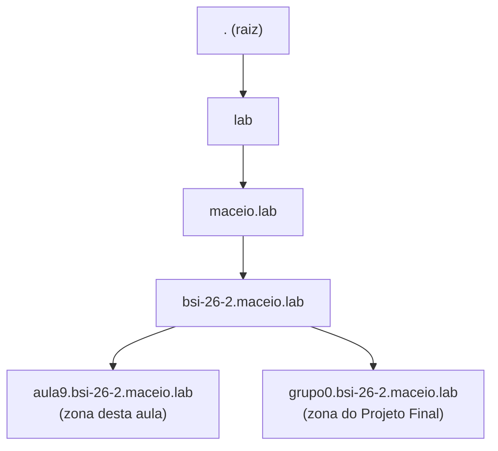
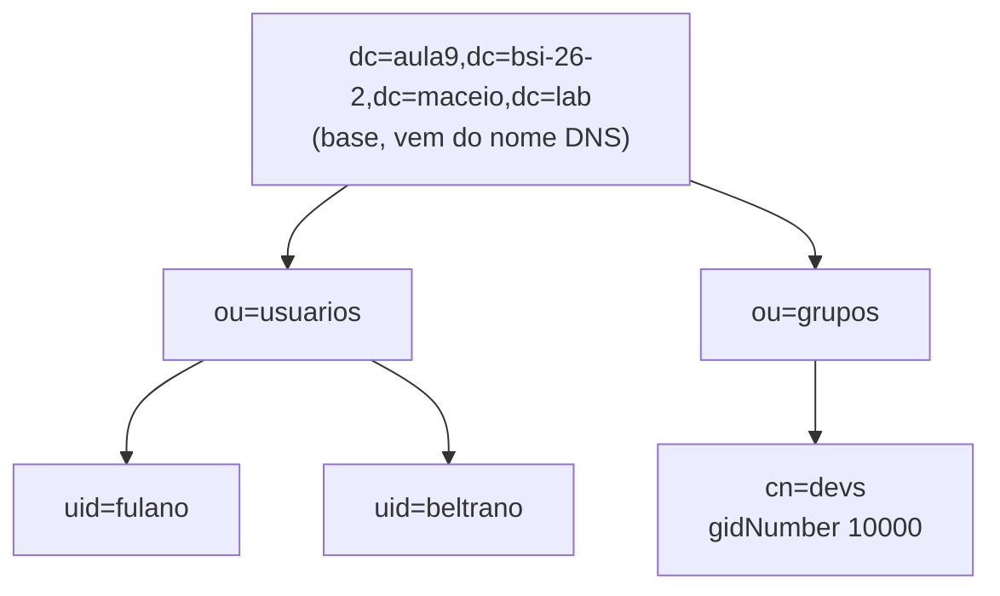
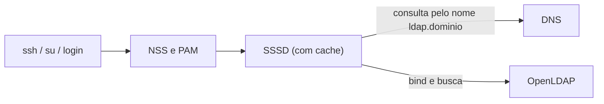
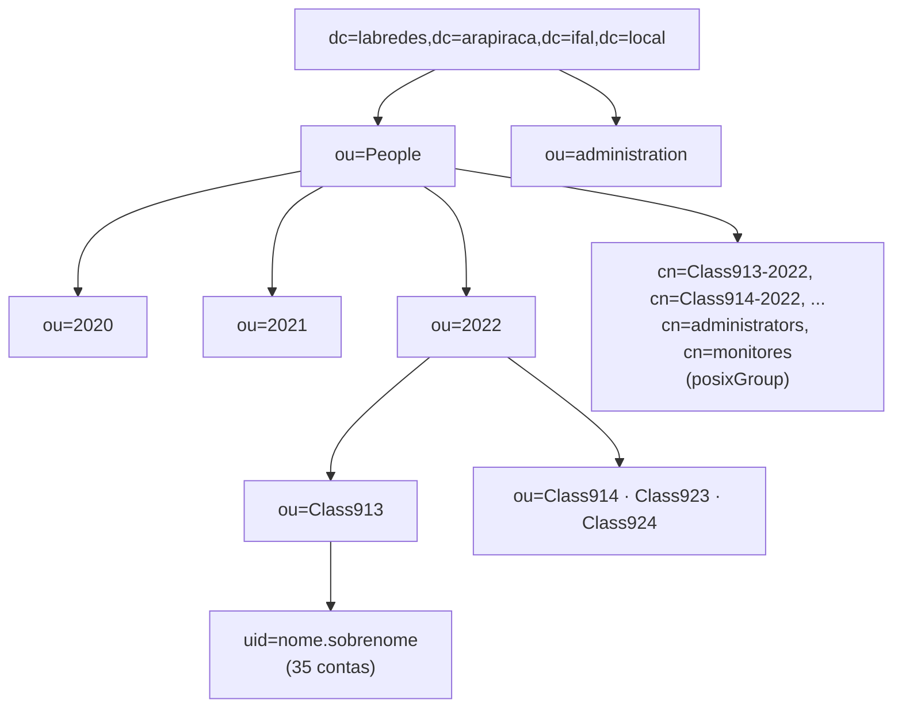

# Aula 09: DNS com BIND9 e Diretório LDAP — os dois pilares do Projeto Final

Objetivo: entender como funcionam o DNS e o LDAP e montar, nas VMs das Aulas 07 e 08, um **DNS autoritativo** para um domínio próprio e um **diretório OpenLDAP** com usuários e grupos POSIX, consultando o LDAP **pelo nome** resolvido no DNS. É a base das seções 8, 9 e 10 do [Projeto Final](projeto-final/README.md).

**Duração:** 1h30 · **Ambiente:** VirtualBox no laboratório · **Base:** Aulas 06, 07 e 08

---

## Organização da aula

| Tempo | Parte | Conteúdo |
|:--|:--|:--|
| 0–5 min | Abertura | Por que o Projeto Final começa pelo DNS e pelo LDAP |
| 5–20 min | Teoria 1 | DNS: hierarquia, servidor autoritativo e recursivo, zonas e registros |
| 20–35 min | Teoria 2 | LDAP: árvore do diretório, DN, classes de objeto, LDIF, login unificado e o caso real do laboratório de Arapiraca |
| 35–60 min | Prática 1 | DNS autoritativo na VM1 e testes na VM2 (seções 2 e 3) |
| 60–80 min | Prática 2 | OpenLDAP na VM1 e consultas da VM2 pelo nome (seções 4 e 5) |
| 80–90 min | Fechamento | O que muda no Projeto Final e próximos passos até a apresentação (seção 7) |

Quem terminar antes faz o **desafio da seção 6** (login na VM2 com uma conta do LDAP).

---

## 1. Conceitos

### 1.1 DNS

O DNS traduz nomes em endereços (e o contrário) por meio de um banco de dados **distribuído e hierárquico** [3, 11]. Nenhum servidor conhece todos os nomes: cada um responde pela sua parte da árvore, chamada **zona**.



| Papel | O que faz | Nesta aula |
|:--|:--|:--|
| **Autoritativo** | Responde com certeza pelos nomes da zona que hospeda | BIND9 na VM1, dono de `aula9.bsi-26-2.maceio.lab` |
| **Recursivo** | Busca a resposta em outros servidores para quem perguntou e guarda em *cache* | O mesmo BIND9, só para a rede interna |
| **Encaminhador** (*forwarder*) | Recebe as consultas que o recursivo não sabe responder | DNS do laboratório, `172.20.20.1` |
| **Primário / secundário** | O primário guarda o arquivo da zona; o secundário copia a zona (transferência) | Só o primário hoje; no projeto, `ns1` e `ns2` |

**Registros que vamos usar:**

| Registro | Significado | Exemplo |
|:--|:--|:--|
| `SOA` | Início da zona: servidor principal, contato e **serial** | `2026111101` (formato `AAAAMMDDnn`) |
| `NS` | Servidor de nomes da zona | `ns1.aula9.bsi-26-2.maceio.lab.` |
| `A` | Nome → endereço IPv4 | `ldap → 10.0.0.1` |
| `CNAME` | Apelido de outro nome | `www → gw` |
| `PTR` | Endereço → nome (zona reversa) | `10.0.0.2 → cliente` |
| `MX` | Servidor de e-mail do domínio | Fica para o Projeto Final (`mail`) |

Três regras que mais derrubam zonas:

1. **Todo nome completo termina com ponto** (`gw.aula9.bsi-26-2.maceio.lab.`). Sem o ponto, o BIND acrescenta o nome da zona ao final.
2. **O serial do SOA precisa aumentar** a cada alteração; senão, os secundários não copiam a zona nova.
3. `NS` e `MX` apontam para nomes com registro `A` próprio, **nunca para um CNAME** [4].

### 1.2 LDAP

O LDAP é um protocolo de acesso a um **diretório**: um banco de dados organizado em árvore, otimizado para muitas leituras e poucas escritas, usado para guardar contas, grupos e senhas de uma organização [5, 7]. Com o esquema da RFC 2307, cada entrada guarda os mesmos campos de `/etc/passwd` e `/etc/group` [8].



| Termo | Significado | Exemplo |
|:--|:--|:--|
| **DN** (*Distinguished Name*) | Endereço completo e único de uma entrada, da folha até a base | `uid=fulano,ou=usuarios,dc=aula9,dc=bsi-26-2,dc=maceio,dc=lab` |
| **Base** | Raiz da árvore; por convenção, o domínio DNS escrito em `dc=` | `dc=aula9,dc=bsi-26-2,dc=maceio,dc=lab` |
| **OU** | Pasta que organiza entradas | `ou=usuarios`, `ou=grupos` |
| **objectClass** | Define quais atributos a entrada pode ou deve ter | `posixAccount` exige `uidNumber`, `gidNumber`, `homeDirectory` |
| **LDIF** | Formato de texto para criar ou alterar entradas | arquivo `base.ldif` da seção 4 |
| **Bind** | Autenticação no LDAP com um DN e uma senha | `ldapwhoami -D uid=fulano,...` |

**Login unificado.** Quando o Linux procura um usuário, ele consulta o NSS (identidade) e o PAM (senha). Com o SSSD, essas consultas vão ao LDAP, e a mesma conta passa a valer em todas as máquinas [9]:



O LDAP depende do DNS: os clientes encontram o servidor pelo nome, e o certificado TLS do Projeto Final é emitido para esse nome. **Por isso o DNS vem primeiro.**

> **Segurança.** Por padrão, a porta 389 trafega em texto puro, inclusive as senhas do *bind*. Nesta aula isso é aceitável porque tudo fica na rede interna do VirtualBox. No Projeto Final o **StartTLS é obrigatório** (seção 9 do enunciado).

### 1.3 Caso real: o diretório do Laboratório de Redes de Arapiraca

O OpenLDAP que atendeu as turmas de 2020 a 2022 do laboratório hospedado na FAPEAL ainda está no ar. A exportação do diretório (`slapcat`) tem **194 entradas**: 172 contas, 8 grupos e 13 OUs. A estrutura, sem os dados dos alunos, é esta:



O que esse diretório real ensina:

| O que se observa | Avaliação | Como fica no Projeto Final |
|:--|:--|:--|
| Base derivada do domínio DNS `labredes.arapiraca.ifal.local` | Correto como convenção; mas o sufixo `.local` é reservado ao mDNS (RFC 6762) e pode conflitar com ele [12] | Domínio `grupoX.bsi-26-2.maceio.lab` |
| Contas organizadas por ano e turma (`ou=2022,ou=Class913`) e login `nome.sobrenome` | Boa organização: facilita desativar uma turma inteira no fim do ano | `ou=usuarios` e login `nome.sobrenome` |
| Em 2022, `uidNumber` que codifica ano, turma e número do aluno (ex.: `22913025`); em 2021, ano e sequência (`2021001`) | Garante números únicos sem planilha de controle | `uidNumber` a partir de 10001 |
| Grupos POSIX guardados dentro de `ou=People`, junto com as contas | Funciona, mas mistura pessoas e grupos | OU própria: `ou=grupos` |
| 167 senhas em `{SSHA}` e 5 em `{SHA}` | `{SHA}` não tem *salt*: senhas iguais geram o mesmo *hash* | Só `{SSHA}`, gerado com `slappasswd` |
| 6 contas com `gidNumber: 0` | **Grupo primário `root`**: um erro de segurança | Grupo primário `lsor-gX` (10000) |
| Contas genéricas por turma (`aluno914`) | Ninguém sabe quem usou a conta | Uma conta nominal por integrante |

---

## 2. Prática 1 — DNS autoritativo na VM1

Use as duas VMs das Aulas 07 e 08: a VM1 (`vm1-gateway`, com NAT funcionando) e a VM2 (`vm2-cliente`, na rede interna `10.0.0.0/24`). A VM1 vai ser o servidor DNS **e** o servidor LDAP.

**Tabela 1:** Nomes da zona `aula9.bsi-26-2.maceio.lab`

| Nome | Tipo | Valor | Observação |
|:--|:--|:--|:--|
| `ns1` | A | `10.0.0.1` | Servidor de nomes da zona (VM1) |
| `gw` | A | `10.0.0.1` | Gateway (VM1) |
| `ldap` | A | `10.0.0.1` | Servidor LDAP (VM1) |
| `cliente` | A | `10.0.0.2` | VM2 |
| `www` | CNAME | `gw` | Apelido, só para testar o CNAME |

### 2.1 Antes de tudo: instalar os clientes na VM2

Instale agora, enquanto a VM2 ainda usa o DNS do laboratório:

```bash
sudo apt-get update
sudo apt-get install -y dnsutils ldap-utils
```

### 2.2 Instalar o BIND9 (VM1)

```bash
sudo apt-get update
sudo apt-get install -y bind9 bind9-utils dnsutils
systemctl status named --no-pager
```

### 2.3 Opções do servidor (VM1)

Edite `/etc/bind/named.conf.options` e deixe-o assim [1, 2]:

```bash
sudo nano /etc/bind/named.conf.options
```

```
acl rede-interna { 10.0.0.0/24; localhost; };

options {
    directory "/var/cache/bind";

    listen-on { 127.0.0.1; 10.0.0.1; };
    listen-on-v6 { none; };

    allow-query     { rede-interna; };   // quem pode perguntar
    allow-recursion { rede-interna; };   // quem pode pedir nomes de fora da zona
    allow-transfer  { none; };           // ninguém copia a zona (no projeto: só o ns2)

    forwarders { 172.20.20.1; };         // DNS do laboratório

    // Desligado só no laboratório, porque o encaminhador pode não repassar DNSSEC.
    dnssec-validation no;
};
```

### 2.4 Declarar as zonas (VM1)

Acrescente ao final de `/etc/bind/named.conf.local`:

```
zone "aula9.bsi-26-2.maceio.lab" {
    type primary;
    file "/etc/bind/db.aula9";
};

zone "0.0.10.in-addr.arpa" {
    type primary;
    file "/etc/bind/db.10.0.0";
};
```

A zona reversa se escreve com os octetos da rede **ao contrário**: a rede `10.0.0.0/24` vira `0.0.10.in-addr.arpa`.

### 2.5 Arquivo da zona direta (VM1)

```bash
sudo nano /etc/bind/db.aula9
```

```
$TTL 3600
@       IN  SOA ns1.aula9.bsi-26-2.maceio.lab. administrador.aula9.bsi-26-2.maceio.lab. (
                2026111101  ; serial (AAAAMMDDnn) - aumente a cada alteração
                3600        ; refresh
                900         ; retry
                604800      ; expire
                300 )       ; TTL das respostas negativas

        IN  NS      ns1.aula9.bsi-26-2.maceio.lab.

ns1     IN  A       10.0.0.1
gw      IN  A       10.0.0.1
ldap    IN  A       10.0.0.1
cliente IN  A       10.0.0.2
www     IN  CNAME   gw
```

O segundo campo do SOA é o e-mail do responsável com o `@` trocado por ponto: `administrador.aula9...` significa `administrador@aula9...`.

### 2.6 Arquivo da zona reversa (VM1)

```bash
sudo nano /etc/bind/db.10.0.0
```

```
$TTL 3600
@       IN  SOA ns1.aula9.bsi-26-2.maceio.lab. administrador.aula9.bsi-26-2.maceio.lab. (
                2026111101 3600 900 604800 300 )

        IN  NS      ns1.aula9.bsi-26-2.maceio.lab.

1       IN  PTR     gw.aula9.bsi-26-2.maceio.lab.
2       IN  PTR     cliente.aula9.bsi-26-2.maceio.lab.
```

### 2.7 Validar e carregar (VM1)

**Sempre valide antes de recarregar.** Se algum comando acusar erro, corrija o arquivo indicado na linha informada:

```bash
sudo named-checkconf
sudo named-checkzone aula9.bsi-26-2.maceio.lab /etc/bind/db.aula9
sudo named-checkzone 0.0.10.in-addr.arpa /etc/bind/db.10.0.0
sudo systemctl restart named
sudo journalctl -u named --no-pager -n 20     # deve mostrar "zone ... loaded serial 2026111101"
```

Teste no próprio servidor:

```bash
dig @127.0.0.1 ldap.aula9.bsi-26-2.maceio.lab +short    # 10.0.0.1
dig @127.0.0.1 -x 10.0.0.2 +short                       # cliente.aula9.bsi-26-2.maceio.lab.
```

---

## 3. Testes do DNS a partir da VM2

### 3.1 Apontar o DNS da VM2 para a VM1

No arquivo YAML de `/etc/netplan/` da VM2 (o mesmo da Aula 08), troque o bloco `nameservers`:

```yaml
      nameservers:
        search: [aula9.bsi-26-2.maceio.lab]
        addresses: [10.0.0.1]
```

```bash
sudo netplan apply
resolvectl status enp0s3        # deve mostrar 10.0.0.1 e o domínio de busca
```

### 3.2 Consultas

```bash
dig gw.aula9.bsi-26-2.maceio.lab            # veja as seções QUESTION e ANSWER e a flag "aa"
dig +short ldap                             # nome curto: o domínio de busca completa o nome
dig +short www.aula9.bsi-26-2.maceio.lab    # CNAME para gw e depois o A
dig -x 10.0.0.2 +short                      # zona reversa
dig aula9.bsi-26-2.maceio.lab SOA +short    # confira o serial
dig google.com +short                       # recursão: a VM1 pergunta ao encaminhador
ping -c 2 gw
```

| O que observar | Por quê |
|:--|:--|
| Flag **`aa`** na resposta de `gw.aula9...` | A VM1 é **autoritativa** pela zona |
| `google.com` responde **sem** a flag `aa` | A resposta veio da recursão, não da zona local |
| `ping gw` funciona com o nome curto | O domínio de busca do Netplan completou o nome |

**Sua vez:** acrescente o registro `arquivos IN A 10.0.0.2`, **aumente o serial** para `2026111102`, valide, rode `sudo rndc reload` na VM1 e teste com `dig +short arquivos` na VM2.

---

## 4. Prática 2 — Diretório OpenLDAP na VM1

### 4.1 Instalar e configurar o slapd (VM1)

```bash
sudo apt-get install -y slapd ldap-utils
sudo dpkg-reconfigure slapd
```

Responda às perguntas do assistente [6]:

| Pergunta | Resposta |
|:--|:--|
| *Omit OpenLDAP server configuration?* | **No** |
| *DNS domain name* | `aula9.bsi-26-2.maceio.lab` |
| *Organization name* | `LSOR Aula 9` |
| *Administrator password* | a senha de laboratório (duas vezes) |
| *Remove the database when slapd is purged?* | **No** |
| *Move old database?* | **Yes** |

O assistente transforma o domínio na base `dc=aula9,dc=bsi-26-2,dc=maceio,dc=lab` e cria o administrador `cn=admin,dc=aula9,dc=bsi-26-2,dc=maceio,dc=lab`. Confira:

```bash
sudo slapcat | head -20
```

### 4.2 Gerar as senhas dos usuários (VM1)

As senhas vão para o LDAP como *hash*, **nunca em texto puro**. Gere um *hash* para cada usuário e copie a saída `{SSHA}...`:

```bash
slappasswd     # digite a senha de fulano
slappasswd     # digite a senha de beltrano
```

### 4.3 Criar a estrutura, o grupo e os usuários (VM1)

Crie o arquivo `base.ldif`, colando os *hashes* nos campos `userPassword`. Entre uma entrada e outra deve haver **uma linha em branco**:

```bash
nano ~/base.ldif
```

```ldif
dn: ou=usuarios,dc=aula9,dc=bsi-26-2,dc=maceio,dc=lab
objectClass: organizationalUnit
ou: usuarios

dn: ou=grupos,dc=aula9,dc=bsi-26-2,dc=maceio,dc=lab
objectClass: organizationalUnit
ou: grupos

dn: cn=devs,ou=grupos,dc=aula9,dc=bsi-26-2,dc=maceio,dc=lab
objectClass: posixGroup
cn: devs
gidNumber: 10000
memberUid: fulano
memberUid: beltrano

dn: uid=fulano,ou=usuarios,dc=aula9,dc=bsi-26-2,dc=maceio,dc=lab
objectClass: inetOrgPerson
objectClass: posixAccount
objectClass: shadowAccount
uid: fulano
cn: Fulano de Tal
sn: Tal
mail: fulano@aula9.bsi-26-2.maceio.lab
uidNumber: 10001
gidNumber: 10000
homeDirectory: /home/fulano
loginShell: /bin/bash
userPassword: {SSHA}cole-aqui-o-hash-de-fulano

dn: uid=beltrano,ou=usuarios,dc=aula9,dc=bsi-26-2,dc=maceio,dc=lab
objectClass: inetOrgPerson
objectClass: posixAccount
objectClass: shadowAccount
uid: beltrano
cn: Beltrano da Silva
sn: Silva
mail: beltrano@aula9.bsi-26-2.maceio.lab
uidNumber: 10002
gidNumber: 10000
homeDirectory: /home/beltrano
loginShell: /bin/bash
userPassword: {SSHA}cole-aqui-o-hash-de-beltrano
```

Os `uidNumber` começam em **10001** para não colidir com as contas locais, que começam em 1000.

Carregue o arquivo autenticando como administrador do diretório:

```bash
ldapadd -x -D cn=admin,dc=aula9,dc=bsi-26-2,dc=maceio,dc=lab -W -f ~/base.ldif
```

Cada entrada criada aparece como `adding new entry "..."`. Se um erro interromper o carregamento, corrija o LDIF e rode de novo **só com as entradas que faltaram** (as já criadas dão erro `Already exists`).

---

## 5. Testes do LDAP a partir da VM2 — pelo nome do DNS

Agora a VM2 encontra o LDAP pelo nome `ldap.aula9.bsi-26-2.maceio.lab`, resolvido pelo DNS da seção 2. Para encurtar os comandos, guarde a base numa variável:

```bash
BASE="dc=aula9,dc=bsi-26-2,dc=maceio,dc=lab"
URI="ldap://ldap.aula9.bsi-26-2.maceio.lab"
```

```bash
# 1. Toda a árvore (consulta anônima)
ldapsearch -x -LLL -H $URI -b $BASE dn

# 2. Só as contas POSIX, com os campos usados pelo Linux
ldapsearch -x -LLL -H $URI -b $BASE "(objectClass=posixAccount)" uid uidNumber gidNumber homeDirectory

# 3. Filtro composto: membros do grupo devs
ldapsearch -x -LLL -H $URI -b ou=grupos,$BASE "(&(objectClass=posixGroup)(cn=devs))" memberUid

# 4. Bind com a conta de fulano: confere a senha
ldapwhoami -x -H $URI -D uid=fulano,ou=usuarios,$BASE -W
```

| Teste | Resultado esperado |
|:--|:--|
| 1 | Os DNs da base, das duas OUs, do grupo e dos dois usuários |
| 2 | `fulano` com `uidNumber: 10001` e `beltrano` com `10002` |
| 3 | `memberUid: fulano` e `memberUid: beltrano` |
| 4 | `dn:uid=fulano,ou=usuarios,...`; com senha errada, `Invalid credentials (49)` |

Repare que a consulta anônima **não mostra** o atributo `userPassword`: o slapd protege esse campo por padrão.

**Sua vez:** crie o usuário `cicrano` (`uidNumber 10003`) num arquivo `cicrano.ldif`, inclua-o no grupo `devs` e mostre as duas mudanças com `ldapsearch`. Para acrescentar um membro a um grupo que já existe, use `ldapmodify` com o LDIF abaixo, salvo como `~/devs-cicrano.ldif`:

```ldif
dn: cn=devs,ou=grupos,dc=aula9,dc=bsi-26-2,dc=maceio,dc=lab
changetype: modify
add: memberUid
memberUid: cicrano
```

```bash
ldapmodify -x -D cn=admin,dc=aula9,dc=bsi-26-2,dc=maceio,dc=lab -W -f ~/devs-cicrano.ldif
```

### 5.1 Problemas comuns

| Sintoma | Causa provável | O que fazer |
|:--|:--|:--|
| `dig` responde `status: REFUSED` | A rede da VM2 não está na `acl rede-interna` | Confira a ACL e o IP da VM2 |
| `dig` responde `SERVFAIL` para o domínio | Zona não carregou | `sudo journalctl -u named -n 30` e `named-checkzone` |
| Nome resolve para `gw.aula9...aula9...` | Faltou o ponto final no arquivo da zona | Acrescente o ponto, aumente o serial e recarregue |
| Alteração na zona não aparece | Serial não foi aumentado ou faltou `rndc reload` | Aumente o serial e rode `sudo rndc reload` |
| `ldapsearch`: `Can't contact LDAP server (-1)` | Nome não resolve ou slapd parado | `dig +short ldap` e `systemctl status slapd` |
| `ldapadd`: `Invalid credentials (49)` | DN do administrador ou senha errados | O DN é `cn=admin,` seguido da base |
| `ldapadd`: `Invalid syntax (21)` ou `Object class violation (65)` | Atributo obrigatório ausente ou espaço sobrando no LDIF | Confira os campos da entrada indicada e os espaços no fim das linhas |

---

## 6. Desafio (se sobrar tempo): login na VM2 com a conta do LDAP

Este é o mecanismo da seção 10 do Projeto Final, em versão simplificada e **sem TLS**:

```bash
# VM2
sudo apt-get install -y sssd-ldap libnss-sss libpam-sss
sudo nano /etc/sssd/sssd.conf
```

```ini
[sssd]
services = nss, pam
domains = aula9

[domain/aula9]
id_provider = ldap
auth_provider = ldap
ldap_uri = ldap://ldap.aula9.bsi-26-2.maceio.lab
ldap_search_base = dc=aula9,dc=bsi-26-2,dc=maceio,dc=lab
cache_credentials = true
# SOMENTE NESTA AULA: aceita senha sem criptografia. No Projeto Final use StartTLS.
ldap_auth_disable_tls_never_use_in_production = true
```

```bash
sudo chmod 600 /etc/sssd/sssd.conf
sudo systemctl restart sssd
sudo pam-auth-update --enable mkhomedir     # cria o /home no primeiro login

getent passwd fulano       # 10001, vindo do LDAP
id fulano                  # grupo devs (10000)
grep fulano /etc/passwd    # não aparece: a conta não é local
su - fulano                # entra com a senha do LDAP; o home é criado agora
```

Sem a opção `ldap_auth_disable_tls_never_use_in_production`, o SSSD recusa a senha, justamente para não enviá-la em texto puro [10].

---

## 7. Do laboratório para o Projeto Final

| Nesta aula (VirtualBox) | No Projeto Final (servidor do laboratório) |
|:--|:--|
| DNS e LDAP na mesma VM | VMs separadas: `ns1`, `ns2` e `ldap` |
| Só servidor primário | Primário (`ns1`) e secundário (`ns2`), com `allow-transfer` e `also-notify` |
| Rede interna `10.0.0.0/24`, placas `enp0s3`/`enp0s8` | Rede do grupo `10.10.101.(16·X)/28`, placas `ens18`/`ens19` |
| Domínio `aula9.bsi-26-2.maceio.lab` | Domínio `grupoX.bsi-26-2.maceio.lab` |
| Recursão para a rede interna | Recursão só para o grupo; consultas também da VPN da turma |
| LDAP em texto puro (porta 389) | **StartTLS obrigatório**, com CA do grupo |
| Login no LDAP só na VM2 (desafio) | Login unificado nas **8 VMs**, com `sudo` pelo grupo `lsor-gX` |
| Testes a partir da VM2 | Testes a partir do computador do aluno, conectado à VPN |

**Apresentação do Projeto Final: 02/12.** Use os arquivos desta aula como ponto de partida para as seções 8 a 10 do enunciado: a estrutura das zonas, do LDIF e dos testes é a mesma, mudando os nomes, os endereços e o domínio.

---

## 8. Registro no seu repositório

Documente a aula no seu repositório pessoal, seguindo o **Modelo de 7 Passos** do [README](README.md). Inclua como evidência, com o comando e o resultado de cada um:

1. `named-checkconf` e os dois `named-checkzone` sem erros.
2. Os arquivos `db.aula9` e `db.10.0.0` (com `cat`).
3. Na VM2: `resolvectl status`, `dig gw.aula9...` mostrando a flag `aa`, `dig -x 10.0.0.2` e `dig google.com`.
4. O registro `arquivos` acrescentado, com o serial novo.
5. `sudo slapcat` resumido (só os DNs: `sudo slapcat | grep ^dn`).
6. Na VM2: os quatro testes da seção 5 e as consultas mostrando o usuário `cicrano` no grupo `devs`.
7. (Desafio) `getent passwd fulano`, `id fulano` e o login com `su - fulano`.

> Não publique senhas nem os *hashes* `{SSHA}` no GitHub. Mostre os comandos e os resultados; no LDIF do relatório, troque o *hash* por `{SSHA}...`.

---

## Referências

[1] INTERNET SYSTEMS CONSORTIUM. **BIND 9 Administrator Reference Manual** — opções `allow-query`, `allow-recursion`, `allow-transfer` e `forwarders`. Disponível em: <https://bind9.readthedocs.io/>.

[2] CANONICAL. **Domain Name Service (DNS)**. Ubuntu Server documentation. Disponível em: <https://ubuntu.com/server/docs/how-to/networking/install-dns/>.

[3] MOCKAPETRIS, P. **RFC 1034 — Domain Names: Concepts and Facilities** e **RFC 1035 — Domain Names: Implementation and Specification**. IETF, 1987. Disponíveis em: <https://www.rfc-editor.org/rfc/rfc1034> e <https://www.rfc-editor.org/rfc/rfc1035>.

[4] ELZ, R.; BUSH, R. **RFC 2181 — Clarifications to the DNS Specification** (seção 10.3). IETF, 1997. Disponível em: <https://www.rfc-editor.org/rfc/rfc2181>.

[5] SERMERSHEIM, J. (Ed.). **RFC 4511 — Lightweight Directory Access Protocol (LDAP): The Protocol**. IETF, 2006. Disponível em: <https://www.rfc-editor.org/rfc/rfc4511>.

[6] CANONICAL. **Install and configure LDAP**. Ubuntu Server documentation. Disponível em: <https://documentation.ubuntu.com/server/how-to/openldap/install-openldap>.

[7] OPENLDAP FOUNDATION. **OpenLDAP Software Administrator's Guide**. Disponível em: <https://www.openldap.org/doc/admin26/>.

[8] HOWARD, L. **RFC 2307 — An Approach for Using LDAP as a Network Information Service**. IETF, 1998. Disponível em: <https://www.rfc-editor.org/rfc/rfc2307>.

[9] CANONICAL. **How to set up SSSD with LDAP**. Ubuntu Server documentation. Disponível em: <https://documentation.ubuntu.com/server/how-to/sssd/with-ldap>.

[10] SSSD PROJECT. **sssd-ldap(5)** — opções `ldap_id_use_start_tls` e `ldap_auth_disable_tls_never_use_in_production`. Disponível em: <https://manpages.ubuntu.com/manpages/noble/man5/sssd-ldap.5.html>.

[11] KUROSE, James F.; ROSS, Keith W. **Redes de Computadores e a Internet**. 8. ed. Pearson, 2022. (Capítulo 2: DNS.)

[12] CHESHIRE, S.; KROCHMAL, M. **RFC 6762 — Multicast DNS** (seção 3, nomes `.local`). IETF, 2013. Disponível em: <https://www.rfc-editor.org/rfc/rfc6762>.
