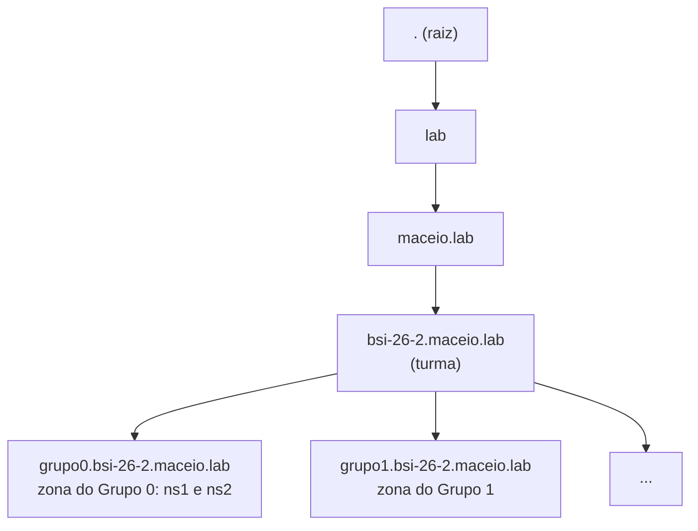
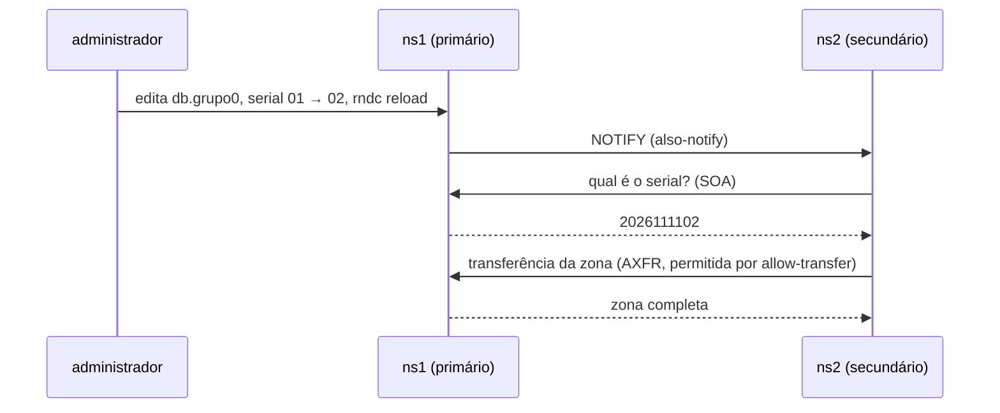

# Aula 09: DNS do Grupo com BIND9 — `ns1` primário e `ns2` secundário

Objetivo: entender como funciona o DNS e montar, nas VMs da Etapa 1, o **DNS do grupo** para o domínio `grupo0.bsi-26-2.maceio.lab`: o `ns1` como servidor **primário**, o `ns2` como **secundário** e todas as VMs resolvendo os nomes umas das outras. Corresponde às seções 7 e 8 do [Projeto Final](projeto-final/README.md).

**Duração:** 1h30 · **Ambiente:** VirtualBox, as 9 VMs da Etapa 1 · **Base:** Aulas 06 a 08 e Etapa 1

O LDAP fica para a [Aula 10](Aula10.md). Ele depende do DNS: os clientes encontram o servidor LDAP pelo nome `ldap.grupo0.bsi-26-2.maceio.lab`. **Por isso o DNS vem primeiro.**

---

## Organização da aula

| Tempo | Parte | Conteúdo |
|:--|:--|:--|
| 0–20 min | Teoria | DNS: hierarquia, servidor autoritativo e recursivo, zonas, registros e primário/secundário (seção 1) |
| 20–30 min | Preparação | Mapa das VMs, *snapshot*, hostnames e conferência do gateway (seção 2) |
| 30–55 min | Prática 1 | `ns1` primário: zona direta e reversa (seção 3) |
| 55–70 min | Prática 2 | `ns2` secundário e transferência de zona (seção 4) |
| 70–85 min | Prática 3 | DNS de todas as VMs apontado para o grupo e testes na VM `cliente` (seções 5 e 6) |
| 85–90 min | Fechamento | O que precisa estar pronto para a Aula 10 (seção 8) |

---

## 1. Conceitos

O DNS traduz nomes em endereços (e o contrário) por meio de um banco de dados **distribuído e hierárquico** [1, 2, 6]. Nenhum servidor conhece todos os nomes: cada um responde pela sua parte da árvore, chamada **zona**.



| Papel | O que faz | No projeto |
|:--|:--|:--|
| **Autoritativo** | Responde com certeza pelos nomes da zona que hospeda | `ns1` e `ns2`, donos de `grupo0.bsi-26-2.maceio.lab` |
| **Recursivo** | Busca a resposta em outros servidores para quem perguntou e guarda em *cache* | Os mesmos `ns1` e `ns2`, só para a rede do grupo |
| **Encaminhador** (*forwarder*) | Recebe as consultas que o recursivo não sabe responder | DNS do laboratório, `172.20.20.1` |
| **Primário** | Guarda o arquivo da zona, editado pelo administrador | `ns1` |
| **Secundário** | Copia a zona do primário (**transferência de zona**) e continua respondendo se ele cair | `ns2` |

**Registros usados no projeto:**

| Registro | Significado | Exemplo (Grupo 0) |
|:--|:--|:--|
| `SOA` | Início da zona: servidor principal, contato e **serial** | serial `2026111101` (formato `AAAAMMDDnn`) |
| `NS` | Servidor de nomes da zona | `ns1.grupo0.bsi-26-2.maceio.lab.` |
| `A` | Nome → endereço IPv4 | `ldap → 192.168.26.7` |
| `PTR` | Endereço → nome (zona reversa) | `192.168.26.7 → ldap.grupo0.bsi-26-2.maceio.lab.` |

**Primário e secundário.** O `ns2` não tem arquivo de zona escrito à mão. Ele pergunta ao `ns1` o **serial** do SOA e, se o serial aumentou, baixa a zona inteira. O `ns1` também **avisa** o `ns2` a cada recarga (NOTIFY), e a cópia acontece em segundos [1, 5]:



Três regras que mais derrubam zonas:

1. **Todo nome completo termina com ponto** (`gw.grupo0.bsi-26-2.maceio.lab.`). Sem o ponto, o BIND acrescenta o nome da zona ao final.
2. **O serial do SOA precisa aumentar** a cada alteração; senão, o `ns2` não copia a zona nova.
3. `NS` aponta para nomes com registro `A` próprio, **nunca para um CNAME** [3].

---

## 2. Preparação das VMs

### 2.1 Mapa das VMs

As VMs da Etapa 1 continuam nos mesmos PCs e com os mesmos IPs. Muda o papel de cada uma, que passa a ter o **nome do serviço** como hostname (seção 5 do enunciado).

**Tabela 1:** Mapa do Grupo 0 (modelo). Para o Grupo **X**, some `16·X` ao último octeto: no Grupo 1, o `ns1` é `192.168.26.18`.

| VM da Etapa 1 | Serviço | IP (Grupo 0) | FQDN | Aula |
|:--|:--|:--|:--|:--:|
| Gateway | `gw` | WAN `172.20.23.x` · LAN `192.168.26.1` | `gw.grupo0.bsi-26-2.maceio.lab` | 09 |
| VM1 | `ns1` (DNS primário) | `192.168.26.2` | `ns1.grupo0.bsi-26-2.maceio.lab` | 09 |
| VM2 | `ns2` (DNS secundário) | `192.168.26.3` | `ns2.grupo0.bsi-26-2.maceio.lab` | 09 |
| VM3 | `www` | `192.168.26.4` | `www.grupo0.bsi-26-2.maceio.lab` | 11 |
| VM4 | `bd` | `192.168.26.5` | `bd.grupo0.bsi-26-2.maceio.lab` | 11 |
| VM5 | `arquivos` | `192.168.26.6` | `arquivos.grupo0.bsi-26-2.maceio.lab` | 11 |
| VM6 | `ldap` | `192.168.26.7` | `ldap.grupo0.bsi-26-2.maceio.lab` | 10 |
| VM7 | livre (bônus) | `192.168.26.8` | — | — |
| VM8 | `cliente` (testes) | `192.168.26.9` | `cliente.grupo0.bsi-26-2.maceio.lab` | 09 |

Em todos os comandos desta aula, troque `grupo0` pelo seu grupo e os IPs pelos do seu grupo.

### 2.2 *Snapshot*

No VirtualBox, selecione a VM e use **Máquina → Tirar Snapshot** (nome: `antes-aula09`). Se algo quebrar, volte a ele em **Snapshots → Restaurar**. Faça isso pelo menos no `ns1` e no `ns2`.

### 2.3 Hostname com o nome do serviço (todas as VMs)

Exemplo na VM1, que vira o `ns1`:

```bash
sudo hostnamectl set-hostname ns1.grupo0.bsi-26-2.maceio.lab
sudo nano /etc/hosts
```

Deixe no `/etc/hosts` só a própria máquina. Os nomes das outras VMs passam a vir do DNS:

```
127.0.0.1   localhost
127.0.1.1   ns1.grupo0.bsi-26-2.maceio.lab ns1
```

Repita em todas as VMs com o nome da Tabela 1. A VM7 fica com o nome da Etapa 1.

### 2.4 Conferir o gateway (`gw`)

Os servidores DNS precisam do NAT da Etapa 1 para consultar o encaminhador `172.20.20.1`. No `gw`:

```bash
sudo sysctl net.ipv4.ip_forward                        # = 1
sudo iptables -t nat -L POSTROUTING -n -v              # MASQUERADE da rede do grupo pela enp0s3
```

Na VM `cliente`: `ping -c 2 1.1.1.1` deve responder. Se não responder, corrija o gateway antes de seguir (Aula 08 e Etapa 1).

---

## 3. Prática 1 — `ns1` primário

Roteiro baseado no manual do BIND e na documentação do Ubuntu Server [1, 4].

### 3.1 Instalar o BIND9 (`ns1`, `ns2` e clientes)

No `ns1` e no `ns2`:

```bash
sudo apt-get update
sudo apt-get install -y bind9 bind9-utils dnsutils
```

Na VM `cliente`, só as ferramentas de consulta:

```bash
sudo apt-get update && sudo apt-get install -y dnsutils
```

### 3.2 Opções do servidor (`ns1` e `ns2`, o mesmo arquivo)

`/etc/bind/named.conf.options`:

```
acl grupo { 192.168.26.0/28; localhost; };

options {
    directory "/var/cache/bind";
    listen-on-v6 { none; };

    allow-query     { grupo; };                   // só as VMs do grupo
    allow-recursion { grupo; };                   // nomes de fora só para o grupo
    allow-transfer  { none; };                    // liberado só nas zonas do ns1

    forwarders { 172.20.20.1; };                  // DNS do laboratório
    dnssec-validation no;                         // só no laboratório: o DNS da rede não valida DNSSEC
};
```

| Opção | Por quê |
|:--|:--|
| `acl grupo` | Dá um nome à rede do grupo (no Grupo 1, `192.168.26.16/28`) |
| `allow-recursion { grupo; }` | Sem ela, o servidor responderia nomes de fora para qualquer um (*open resolver*) |
| `allow-transfer { none; }` | Ninguém copia as zonas, exceto quem for liberado em cada zona |
| `forwarders` | O que não é do grupo vai para o DNS do laboratório |

### 3.3 Declarar as zonas (`ns1`)

`/etc/bind/named.conf.local`. O `ns1` entrega as zonas só ao `ns2` e o avisa a cada mudança:

```
zone "grupo0.bsi-26-2.maceio.lab" {
    type primary;
    file "/etc/bind/db.grupo0";
    allow-transfer { 192.168.26.3; };
    also-notify    { 192.168.26.3; };
};

zone "26.168.192.in-addr.arpa" {
    type primary;
    file "/etc/bind/db.192.168.26";
    allow-transfer { 192.168.26.3; };
    also-notify    { 192.168.26.3; };
};
```

> **Zona reversa.** O nome é a parte de rede do IP **ao contrário**, seguida de `in-addr.arpa`: a rede `192.168.26.x` vira `26.168.192.in-addr.arpa`. Cada grupo coloca nela **só os endereços do seu grupo**.

### 3.4 Arquivo da zona direta (`ns1`)

`/etc/bind/db.grupo0`:

```
$TTL 3600
@       IN  SOA ns1.grupo0.bsi-26-2.maceio.lab. administrador.grupo0.bsi-26-2.maceio.lab. (
                2026111101  ; serial (AAAAMMDDnn) - aumente a cada alteração
                3600        ; refresh: de quanto em quanto tempo o ns2 confere o serial
                900         ; retry: nova tentativa se o ns1 não responder
                604800      ; expire: o ns2 para de responder se ficar 7 dias sem o ns1
                300 )       ; TTL das respostas negativas

        IN  NS      ns1.grupo0.bsi-26-2.maceio.lab.
        IN  NS      ns2.grupo0.bsi-26-2.maceio.lab.

gw       IN  A   192.168.26.1
ns1      IN  A   192.168.26.2
ns2      IN  A   192.168.26.3
www      IN  A   192.168.26.4
bd       IN  A   192.168.26.5
arquivos IN  A   192.168.26.6
ldap     IN  A   192.168.26.7
cliente  IN  A   192.168.26.9
```

O e-mail do responsável é escrito com ponto no lugar do `@`: `administrador.grupo0...` significa `administrador@grupo0...`.

### 3.5 Arquivo da zona reversa (`ns1`)

`/etc/bind/db.192.168.26`. No Grupo 1, os números vão de `17` a `25`:

```
$TTL 3600
@       IN  SOA ns1.grupo0.bsi-26-2.maceio.lab. administrador.grupo0.bsi-26-2.maceio.lab. (
                2026111101 3600 900 604800 300 )

        IN  NS      ns1.grupo0.bsi-26-2.maceio.lab.
        IN  NS      ns2.grupo0.bsi-26-2.maceio.lab.

1       IN  PTR     gw.grupo0.bsi-26-2.maceio.lab.
2       IN  PTR     ns1.grupo0.bsi-26-2.maceio.lab.
3       IN  PTR     ns2.grupo0.bsi-26-2.maceio.lab.
4       IN  PTR     www.grupo0.bsi-26-2.maceio.lab.
5       IN  PTR     bd.grupo0.bsi-26-2.maceio.lab.
6       IN  PTR     arquivos.grupo0.bsi-26-2.maceio.lab.
7       IN  PTR     ldap.grupo0.bsi-26-2.maceio.lab.
9       IN  PTR     cliente.grupo0.bsi-26-2.maceio.lab.
```

### 3.6 Validar e carregar (`ns1`)

```bash
sudo named-checkconf                                                    # sem saída = sem erro
sudo named-checkzone grupo0.bsi-26-2.maceio.lab /etc/bind/db.grupo0     # "OK"
sudo named-checkzone 26.168.192.in-addr.arpa /etc/bind/db.192.168.26    # "OK"
sudo systemctl restart named
sudo systemctl status named --no-pager
dig @127.0.0.1 www.grupo0.bsi-26-2.maceio.lab +short                    # 192.168.26.4
```

---

## 4. Prática 2 — `ns2` secundário

O `ns2` já tem o BIND9 e o mesmo `named.conf.options` (seções 3.1 e 3.2). Falta só declarar as zonas como **secundárias**. Ele baixa as zonas do `ns1` e as grava em `/var/cache/bind/`, a pasta em que o BIND pode escrever.

`/etc/bind/named.conf.local` do `ns2`:

```
zone "grupo0.bsi-26-2.maceio.lab" {
    type secondary;
    primaries { 192.168.26.2; };
    file "/var/cache/bind/db.grupo0";
};

zone "26.168.192.in-addr.arpa" {
    type secondary;
    primaries { 192.168.26.2; };
    file "/var/cache/bind/db.192.168.26";
};
```

```bash
sudo named-checkconf
sudo systemctl restart named
sudo journalctl -u named --no-pager -n 20 | grep -i transfer   # "Transfer completed" para as duas zonas
ls -l /var/cache/bind/                                         # db.grupo0 e db.192.168.26 criados pelo BIND
dig @127.0.0.1 ldap.grupo0.bsi-26-2.maceio.lab +short          # 192.168.26.7, respondido pelo ns2
```

> Os arquivos copiados ficam em formato binário (*raw*). Para ler o conteúdo: `named-compilezone -f raw -F text -o - grupo0.bsi-26-2.maceio.lab /var/cache/bind/db.grupo0`.

---

## 5. Prática 3 — DNS de todas as VMs apontado para o grupo

Em **todas as VMs** (inclusive `ns1`, `ns2` e o `gw`, na placa `enp0s8` da LAN), no arquivo `/etc/netplan/00-installer-config.yaml` da Etapa 1, troque o bloco `nameservers`:

```yaml
      nameservers:
        search: [grupo0.bsi-26-2.maceio.lab]
        addresses: [192.168.26.2, 192.168.26.3]
```

```bash
sudo netplan apply
resolvectl status | grep -A2 "DNS Servers"        # 192.168.26.2 e 192.168.26.3
```

O `search` permite usar o **nome curto**: `ping ldap` vira `ping ldap.grupo0.bsi-26-2.maceio.lab`.

---

## 6. Testes do DNS (na VM `cliente`)

Correspondem aos testes 2 a 5 da seção 13 do enunciado.

```bash
dig www.grupo0.bsi-26-2.maceio.lab                        # flag aa e o IP .4
dig +short ldap                                           # o domínio de busca completa o nome
dig -x 192.168.26.7 +short                                # ldap.grupo0.bsi-26-2.maceio.lab.
dig @ns1 grupo0.bsi-26-2.maceio.lab SOA +short
dig @ns2 grupo0.bsi-26-2.maceio.lab SOA +short            # mesmo serial do ns1
dig +short ifal.edu.br                                    # nome de fora, pelo encaminhador
```

Na resposta do primeiro `dig`, observe:

| Campo | O que mostra |
|:--|:--|
| `flags: qr aa rd ra` | `aa` = resposta **autoritativa**: veio do dono da zona |
| `ANSWER SECTION` | O registro `A` pedido |
| `SERVER: 192.168.26.2#53` | Qual servidor respondeu |

**Teste do secundário:**

1. No `ns1`, acrescente ao `db.grupo0` a linha `teste    IN  A   192.168.26.14`, aumente o serial para `2026111102`, valide com `named-checkzone` e rode `sudo rndc reload`.
2. No `ns2`, confira no log a notificação e a nova transferência: `sudo journalctl -u named -n 10`.
3. No `cliente`: `dig @ns2 teste.grupo0.bsi-26-2.maceio.lab +short` → `192.168.26.14`.
4. No `ns1`, pare o BIND (`sudo systemctl stop named`) e repita `dig www.grupo0.bsi-26-2.maceio.lab` no `cliente`: o `ns2` responde sozinho. Depois, `sudo systemctl start named` no `ns1` e remova o registro `teste` (aumentando o serial de novo).

**Exercícios de conferência** (registre no tutorial):

1. De cada VM, `ping -c 2` para `gw`, `ns1`, `ns2` e `ldap` pelo nome curto.
2. De cada VM, `dig +short` para os nomes da Tabela 1.
3. De cada VM, `dig -x` para os IPs de `gw`, `ns1`, `ns2` e `cliente`.
4. Explique no tutorial por que o `dig` para o `ns2` mostra o mesmo serial do `ns1`, e o que acontece se você editar a zona e esquecer de aumentar o serial.

### 6.1 Problemas comuns

| Sintoma | Causa provável | O que fazer |
|:--|:--|:--|
| `named-checkzone` reclama de `ns1.grupo0...grupo0...` | Nome completo sem o ponto final | Acrescente o `.` no final dos nomes completos |
| `status: REFUSED` | IP fora da `acl grupo` | Confira a sub-rede do grupo em `named.conf.options` |
| `status: SERVFAIL` para nomes de fora | `gw` sem NAT, ou validação DNSSEC ligada | Seção 2.4 e `dnssec-validation no` |
| `ns2` sem os arquivos em `/var/cache/bind` | `allow-transfer` do `ns1` sem o IP do `ns2`, ou arquivo do secundário fora de `/var/cache/bind` | Corrija e rode `sudo rndc retransfer grupo0.bsi-26-2.maceio.lab` no `ns2` |
| Mudança no `ns1` não chega ao `ns2` | Serial não aumentou | Aumente o serial e `sudo rndc reload` |
| `ping ldap` não resolve | Falta o `search` no Netplan | Seção 5 |
| `named` não sobe | Erro de sintaxe (falta `;` ou `}`) | `sudo named-checkconf` e `sudo journalctl -u named -n 30` |

---

## 7. Registro no repositório do grupo

Na seção **DNS** do tutorial do grupo, no [Modelo de 7 Passos](README.md):

1. O `named.conf.options` e o `named.conf.local` do `ns1` e do `ns2`.
2. Os dois arquivos de zona do `ns1`.
3. O log da transferência no `ns2` (`journalctl -u named | grep -i transfer`).
4. A saída dos testes da seção 6, inclusive o teste do secundário.
5. O Netplan de uma VM com o bloco `nameservers`.

---

## 8. Para a Aula 10 (18/11)

Chegue com:

- [ ] Hostnames das 9 VMs com o nome do serviço.
- [ ] `ns1` e `ns2` respondendo com o mesmo serial.
- [ ] Todas as VMs resolvendo `ldap.grupo0.bsi-26-2.maceio.lab` → `192.168.26.7`.

Na Aula 10 o grupo instala o OpenLDAP na VM `ldap` e liga o login unificado nas 9 VMs. Sem o DNS funcionando, o SSSD não encontra o servidor.

---

## Referências

[1] INTERNET SYSTEMS CONSORTIUM. **BIND 9 Administrator Reference Manual** — zonas `primary` e `secondary`, `allow-transfer`, `also-notify`, `primaries` e `forwarders`. Disponível em: <https://bind9.readthedocs.io/>.

[2] MOCKAPETRIS, P. **RFC 1034 — Domain Names: Concepts and Facilities** e **RFC 1035 — Domain Names: Implementation and Specification**. IETF, 1987. Disponíveis em: <https://www.rfc-editor.org/rfc/rfc1034> e <https://www.rfc-editor.org/rfc/rfc1035>.

[3] ELZ, R.; BUSH, R. **RFC 2181 — Clarifications to the DNS Specification**, seção 10.3. IETF, 1997. Disponível em: <https://www.rfc-editor.org/rfc/rfc2181>.

[4] CANONICAL. **Domain Name Service (DNS)** — servidor primário e secundário. Ubuntu Server documentation. Disponível em: <https://ubuntu.com/server/docs/how-to/networking/install-dns/>.

[5] VIXIE, P. **RFC 1996 — A Mechanism for Prompt Notification of Zone Changes (DNS NOTIFY)**. IETF, 1996. Disponível em: <https://www.rfc-editor.org/rfc/rfc1996>.

[6] KUROSE, James F.; ROSS, Keith W. **Redes de Computadores e a Internet**. 8. ed. Pearson, 2022. Cap. 2, seção 2.4 (DNS).
