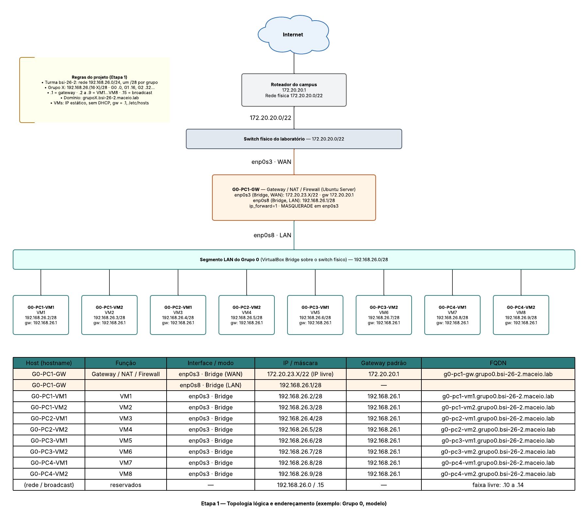
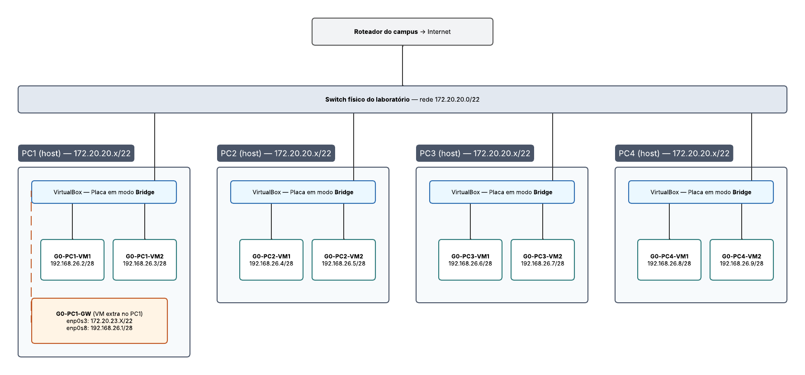

# Projeto de LSOR — Turma bsi-26-2 (2026.2)

## Etapa 1 — Rede virtualizada com 8 VMs e Gateway NAT

Este projeto adapta o [Projeto Final de Fundamentos de Redes (bsi-26-1)](https://github.com/alaelson/labredes_virtualbox/blob/main/projeto-final/README.md) para a disciplina de **Laboratório de Sistemas Operacionais e Redes**. A diferença principal é a inclusão de uma VM **gateway** (Gateway / NAT / Firewall), como na Aula 07 e na Aula 08. Toda a saída das VMs do grupo passa a ser feita por esse gateway.

### 1. Objetivo

1. Criar um ambiente de rede com **8 máquinas virtuais** Ubuntu Server (vm1 a vm8) e **mais 1 VM gateway**, totalizando 9 VMs por grupo.
2. Configurar o gateway com duas placas de rede, roteando e mascarando (NAT) o tráfego da rede do grupo para a rede do laboratório.
3. Documentar todo o processo em um tutorial/roteiro no repositório do grupo no GitHub.

### 2. Topologia

**Figura 1:** Topologia lógica e endereçamento (exemplo do Grupo 0, modelo).

**Figura 2:** Topologia física. São 4 PCs do laboratório, com 2 VMs em cada um, e o gateway como VM extra no PC1.

Diagrama editável no Lucid: [LSOR BSI - Etapa 1 - Topologia com Gateway](https://lucid.app/lucidchart/abc3cbc7-cc7c-443f-92e4-6e01df18e10d/view)

> **Por que Bridge e não Rede Interna?** Na Aula 07, o gateway e o cliente estavam no mesmo PC, então a *Rede Interna* do VirtualBox funcionava. Neste projeto as VMs ficam em **4 PCs diferentes**, e a Rede Interna não atravessa hosts. Por isso todas as placas usam **Placa em Ponte (Bridge)**. A rede do grupo (192.168.26.x/28) é um segmento lógico sobre o mesmo switch físico do laboratório.

### 3. Rede física do laboratório

| Parâmetro | Valor |
|:--|:--|
| Rede do laboratório | `172.20.20.0/22` (255.255.252.0) |
| Gateway / DNS do laboratório | `172.20.20.1` |
| Faixa para IPs estáticos das VMs (ver Aula 06) | a partir de `172.20.23.1` (testar com `ping` antes de usar) |

### 4. Endereçamento IP dos grupos

- A turma **bsi-26-2** usa a rede **192.168.26.0/24**, dividida em sub-redes **/28** (255.255.255.240), uma por grupo.
- O Grupo **X** usa a rede `192.168.26.(16 × X)/28`: o Grupo 0 (modelo) usa o 1º range, o Grupo 1 o 2º, o Grupo 2 o 3º, e assim por diante.
- Dentro da sub-rede do grupo, a distribuição é:
  - 1º IP útil: **gateway**, interface LAN `enp0s8`.
  - 2º ao 9º IP útil: **vm1 a vm8**.
  - Os demais endereços ficam livres.

| Grupo | Rede /28 | Gateway (LAN) | VM1 … VM8 | Broadcast |
|:--:|:--|:--|:--|:--|
| 0 (modelo) | 192.168.26.0 | .1 | .2 – .9 | .15 |
| 1 | 192.168.26.16 | .17 | .18 – .25 | .31 |
| 2 | 192.168.26.32 | .33 | .34 – .41 | .47 |
| 3 | 192.168.26.48 | .49 | .50 – .57 | .63 |
| 4 | 192.168.26.64 | .65 | .66 – .73 | .79 |
| 5 | 192.168.26.80 | .81 | .82 – .89 | .95 |

### 5. Nomenclatura e domínio (FQDN)

- O domínio de cada grupo segue o formato `grupoX.bsi-26-2.maceio.lab`.
- Os hostnames seguem o padrão da planilha de acompanhamento: `Gx-PC1-GW` para o gateway e `Gx-PCy-VMz` para as VMs (PC 1 a 4, VM 1 ou 2 em cada PC).
- O FQDN de cada máquina é o hostname em minúsculas seguido do domínio: `<host>.grupoX.bsi-26-2.maceio.lab`.
- Exemplos do Grupo 1:
  - `g1-pc1-gw.grupo1.bsi-26-2.maceio.lab`
  - `g1-pc1-vm1.grupo1.bsi-26-2.maceio.lab`

### 6. Tabela de referência — Grupo 0 (modelo)

| Host | Placa / modo VirtualBox | Interface | IP / máscara | Gateway padrão | FQDN |
|:--|:--|:--|:--|:--|:--|
| G0-PC1-GW | Adaptador 1 · Bridge (WAN) | enp0s3 | 172.20.23.X/22 (IP livre) | 172.20.20.1 | g0-pc1-gw.grupo0.bsi-26-2.maceio.lab |
| G0-PC1-GW | Adaptador 2 · Bridge (LAN) | enp0s8 | 192.168.26.1/28 | — | — |
| G0-PC1-VM1 (VM1) | Adaptador 1 · Bridge | enp0s3 | 192.168.26.2/28 | 192.168.26.1 | g0-pc1-vm1.grupo0.bsi-26-2.maceio.lab |
| G0-PC1-VM2 (VM2) | Adaptador 1 · Bridge | enp0s3 | 192.168.26.3/28 | 192.168.26.1 | g0-pc1-vm2.grupo0.bsi-26-2.maceio.lab |
| G0-PC2-VM1 (VM3) | Adaptador 1 · Bridge | enp0s3 | 192.168.26.4/28 | 192.168.26.1 | g0-pc2-vm1.grupo0.bsi-26-2.maceio.lab |
| G0-PC2-VM2 (VM4) | Adaptador 1 · Bridge | enp0s3 | 192.168.26.5/28 | 192.168.26.1 | g0-pc2-vm2.grupo0.bsi-26-2.maceio.lab |
| G0-PC3-VM1 (VM5) | Adaptador 1 · Bridge | enp0s3 | 192.168.26.6/28 | 192.168.26.1 | g0-pc3-vm1.grupo0.bsi-26-2.maceio.lab |
| G0-PC3-VM2 (VM6) | Adaptador 1 · Bridge | enp0s3 | 192.168.26.7/28 | 192.168.26.1 | g0-pc3-vm2.grupo0.bsi-26-2.maceio.lab |
| G0-PC4-VM1 (VM7) | Adaptador 1 · Bridge | enp0s3 | 192.168.26.8/28 | 192.168.26.1 | g0-pc4-vm1.grupo0.bsi-26-2.maceio.lab |
| G0-PC4-VM2 (VM8) | Adaptador 1 · Bridge | enp0s3 | 192.168.26.9/28 | 192.168.26.1 | g0-pc4-vm2.grupo0.bsi-26-2.maceio.lab |

### 7. Requisitos de configuração

1. **Hardware:** listar a configuração de cada VM (memória, CPUs, disco). O padrão da disciplina é 512 MB de RAM, 1 vCPU e 32 GB de disco.
2. **Rede (Netplan):**
   - Todas as VMs usam IP estático, **sem DHCP**.
   - As VMs vm1 … vm8 usam gateway padrão no 1º IP do grupo.
   - O gateway usa `172.20.20.1` como rota padrão na `enp0s3` e não tem rota padrão na `enp0s8`.
3. **Gateway:**
   - Habilitar `net.ipv4.ip_forward=1` de forma persistente.
   - Criar a regra de mascaramento `iptables -t nat -A POSTROUTING -o enp0s3 -j MASQUERADE` e persistir as regras (ver Aula 08).
4. **Nomes:**
   - Configurar o hostname de cada VM com `hostnamectl`.
   - Adicionar o mapeamento IP/nomes (hostname, FQDN e apelidos) no `/etc/hosts` de **todas** as VMs.
5. **Usuários:** cada VM deve ter o usuário administrador e um usuário para cada integrante do grupo, conforme a lista oficial da turma.
6. **Ambiente:** criar VMs novas especificamente para este projeto.
7. **Testes:** registrar no tutorial os resultados de:
   - `ping` entre todas as VMs, usando IP e nome;
   - acesso `ssh` entre as VMs com os usuários criados;
   - saída para a internet a partir das VMs, passando pelo gateway (`ping 8.8.8.8`, `ping google.com`, `traceroute`).

---

## Prazos e entregas

### Etapa 1 — data a definir

a) Preencher, na planilha de acompanhamento, as tabelas de **nomes e IPs** de todas as VMs do grupo, incluindo o gateway (seções 4 a 6).

b) Apresentar o **diagrama de topologia** do grupo, adaptado das Figuras 1 e 2 com os IPs do grupo.

c) Criar a página do projeto do grupo no GitHub.

### Etapa 2 (final) — data a definir

Entrega e apresentação final do ambiente funcionando, com o tutorial completo e as evidências de testes.
