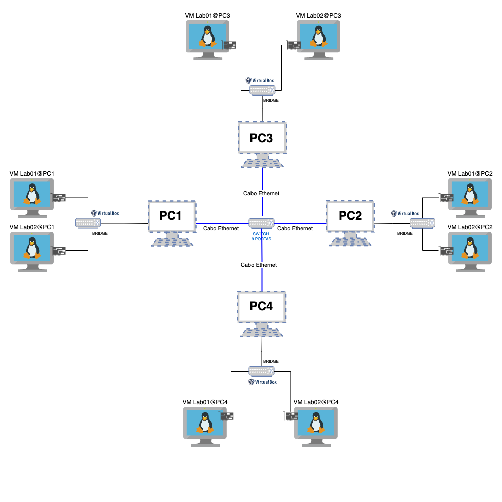

### Projeto da Etapa 1 de Fundamentos de Redes de Computadores - Turma bsi-26-2 (2026.2)

1. **Objetivo:** Criar um ambiente de rede contendo **8 máquinas virtuais** com o S.O. Ubuntu Server [1].
2. **Documentação:** Criar um documento tutorial/roteiro contendo o passo-a-passo de configuração e execução de um ambiente de rede virtualizada [1].
3. **Hardware:** Listar a configuração de hardware utilizada em cada MV (Ex.: quantidade de memória, número de processadores/cores, espaço em disco) [1].
4. **Endereçamento IP:** O endereçamento e o nome do grupo serão identificados pelo par nome-número do grupo [1].
    * Criar uma tabela com as definições dos IPs das MVs com a máscara de rede **/28** (255.255.255.240) [1].
    * A turma **bsi-26-1** utilizará a rede **192.168.26.0/24** para criar as sub-redes dos grupos.
    * **Exemplos:**
        * O Grupo 1 da turma bsi-26-1 usará a faixa 192.168.26.0 - 192.168.26.15/28.
        * O Grupo 2 da turma bsi-26-1 usará a faixa 192.168.26.16 - 192.168.26.31/28.
5. **Nomenclatura e Domínio (FQDN):** Criar uma tabela com as definições de nomes para hostname, nomes de domínio, apelidos (aliases) e endereços IP das MVs [1].
    * O domínio deve obedecer ao formato: `<grupoX>.bsi-26-1.maceio.lab`.
    * **Exemplo de hostname:** `servidor.grupo1.bsi-26-1.maceio.lab`.
6. **Configuração de Rede:** Editar os hostnames no S.O. de cada MV e adicionar o mapeamento IP/Nomes no arquivo `/etc/hosts` de cada VM [1].
7. **Usuários:** Em cada VM deve haver o usuário administrador e os usuários com os nomes dos **integrantes do grupo** [1]. Devem ser utilizados os nomes conforme a lista oficial (ex: `alex.rodrigo`, `andrey.joshua`, `andrezza`, `arthur.jonatha`, etc.) [2, 3].
8. **Ambiente:** É necessário criar novas VMs especificamente para este projeto [1].
9. **Testes:** Colocar no tutorial os resultados de todos os testes de **ping** e **acesso SSH**, utilizando os usuários criados nas VMs e os nomes dos hosts [1].

 Figura 1:  Topologia de Rede Virtualizada para a execução do projeto.

   
   

# Prazos e Entregas

## Etapa 1 - 11/06/2026
a) Apresentar as tabelas de definições de nomes e IPs para todas as VMs.

b) Criar a página do GitHub do projeto do grupo.

## Etapa 2 (Final) - 18/06/2026
Entrega e apresentação final do projeto.
