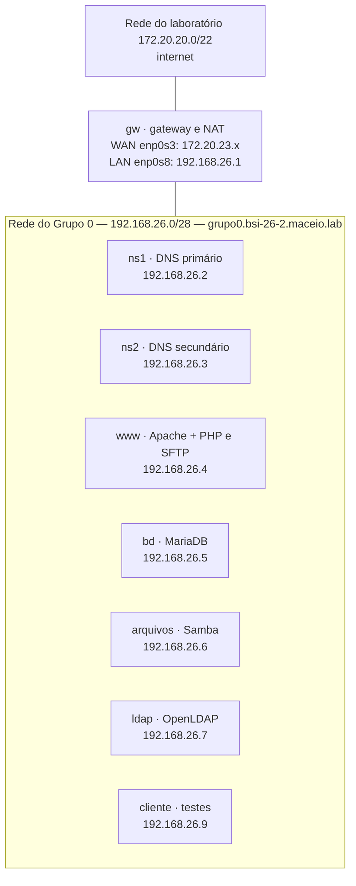
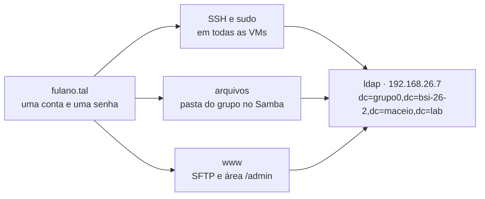

# Projeto de LSOR — Turma bsi-26-2 (2026.2)

## Projeto Final — Serviços de rede com login unificado

### 1. Apresentação

Na Etapa 1, cada grupo montou no laboratório uma rede privada com 9 VMs, IPs fixos e um gateway NAT. No Projeto Final, o grupo **usa as mesmas 9 VMs, nos mesmos PCs e com os mesmos IPs**, e transforma essa rede num ambiente de serviços, como o de uma pequena empresa:

| Serviço | VM | O que o grupo vai implantar |
|:--|:--|:--|
| **Gateway** | `gw` | Roteamento e NAT da rede do grupo (já feito na Etapa 1) |
| **DNS** | `ns1` e `ns2` | Servidor de nomes primário e secundário com BIND9, zona direta e reversa |
| **Login unificado** | `ldap` | Diretório OpenLDAP com os usuários e grupos; todas as VMs autenticam nele |
| **Servidor de arquivos** | `arquivos` | Compartilhamentos Samba para o grupo, com as contas do LDAP |
| **Banco de dados** | `bd` | MariaDB acessado pela rede, a partir do `www` |
| **Servidor web** | `www` | Apache com PHP, publicando a aplicação do grupo, enviada por SFTP |
| **Cliente de testes** | `cliente` | VM de onde o grupo testa todos os serviços pelo nome |

O ponto central do projeto é o **login unificado**: cada integrante tem **uma única conta e senha**, guardadas no LDAP, e usa essa conta para entrar por SSH em qualquer VM, abrir a pasta do grupo no Samba, enviar o site por SFTP e administrá-lo.

| Aula de apoio | Data | Seções do projeto |
|:--|:--|:--|
| [Aula 09: DNS do grupo](../Aula9.md) | 11/11 | 7 e 8 |
| [Aula 10: LDAP, login unificado e Samba](../Aula10.md) | 18/11 | 9, 10 e 11 |
| [Aula 11: Aplicação web (LAMP) e SFTP](../Aula11.md) | 25/11 | 12 e 13 |
| **Apresentação** | **02/12** | 14 |

### 2. Objetivos

Ao final do projeto, o grupo deve ser capaz de:

1. Configurar um DNS autoritativo com servidor primário e secundário, transferência de zona e resolução reversa.
2. Criar um diretório LDAP com usuários e grupos POSIX.
3. Integrar servidores Linux ao LDAP com SSSD e PAM, centralizando login, diretório home e `sudo`.
4. Compartilhar pastas por Samba com permissões pelo grupo do LDAP, e comparar com o acesso por conta local.
5. Montar uma aplicação web em duas camadas (Apache com PHP numa VM, MariaDB em outra), publicada por SFTP e com área restrita autenticada no LDAP.
6. Testar cada serviço e documentar as evidências.

### 3. Ambiente

| Item | Valor |
|:--|:--|
| Onde | VirtualBox nos 4 PCs do grupo no laboratório, placas em modo **Bridge** (como na Etapa 1) |
| VMs | As 9 VMs da Etapa 1: o gateway e as VM1 a VM8 |
| Sistema | Ubuntu Server da Etapa 1 |
| Placas de rede | `enp0s3` em todas as VMs; no `gw`, `enp0s3` (WAN) e `enp0s8` (LAN) |
| Usuário local | `administrador`, mantido em todas as VMs como acesso de emergência |

- Antes de cada serviço, **tire um *snapshot*** da VM (**Máquina → Tirar Snapshot** no VirtualBox). Se a configuração quebrar, volte a ele.
- As contas locais dos integrantes, criadas na Etapa 1, são **removidas** na Aula 10: a partir dela, as contas vêm do LDAP.

### 4. Topologia

**Figura 1:** Topologia do Grupo 0 (modelo). Nos outros grupos, muda a sub-rede (seção 5).



**Figura 2:** Login unificado. Todas as VMs e serviços consultam o mesmo diretório.



### 5. Endereçamento e nomes

A turma usa a rede **`192.168.26.0/24`** da Etapa 1, dividida em sub-redes **/28**, uma por grupo: o Grupo **X** usa `192.168.26.(16 × X)/28`. Cada VM mantém o IP da Etapa 1 e ganha o **nome do serviço** como hostname.

| VM da Etapa 1 | Serviço | IP | Grupo 0 (modelo) | Grupo 1 | FQDN (Grupo 0) |
|:--|:--|:--|:--|:--|:--|
| Gateway (LAN) | `gw` | `16·X + 1` | 192.168.26.1 | 192.168.26.17 | `gw.grupo0.bsi-26-2.maceio.lab` |
| VM1 | `ns1` | `16·X + 2` | 192.168.26.2 | 192.168.26.18 | `ns1.grupo0.bsi-26-2.maceio.lab` |
| VM2 | `ns2` | `16·X + 3` | 192.168.26.3 | 192.168.26.19 | `ns2.grupo0.bsi-26-2.maceio.lab` |
| VM3 | `www` | `16·X + 4` | 192.168.26.4 | 192.168.26.20 | `www.grupo0.bsi-26-2.maceio.lab` |
| VM4 | `bd` | `16·X + 5` | 192.168.26.5 | 192.168.26.21 | `bd.grupo0.bsi-26-2.maceio.lab` |
| VM5 | `arquivos` | `16·X + 6` | 192.168.26.6 | 192.168.26.22 | `arquivos.grupo0.bsi-26-2.maceio.lab` |
| VM6 | `ldap` | `16·X + 7` | 192.168.26.7 | 192.168.26.23 | `ldap.grupo0.bsi-26-2.maceio.lab` |
| VM7 | livre | `16·X + 8` | 192.168.26.8 | 192.168.26.24 | — |
| VM8 | `cliente` | `16·X + 9` | 192.168.26.9 | 192.168.26.25 | `cliente.grupo0.bsi-26-2.maceio.lab` |

- Máscara `/28` (255.255.255.240); rota padrão de todas as VMs = IP de LAN do `gw`.
- Domínio do grupo: `grupoX.bsi-26-2.maceio.lab`.

| Grupo | Sub-rede | `gw` (LAN) | `ns1` | Broadcast |
|:--:|:--|:--|:--|:--|
| 0 (modelo) | 192.168.26.0/28 | .1 | .2 | .15 |
| 1 | 192.168.26.16/28 | .17 | .18 | .31 |
| 2 | 192.168.26.32/28 | .33 | .34 | .47 |
| 3 | 192.168.26.48/28 | .49 | .50 | .63 |
| 4 | 192.168.26.64/28 | .65 | .66 | .79 |
| 5 | 192.168.26.80/28 | .81 | .82 | .95 |

### 6. Ordem de implementação

| Passo | Serviço | Depende de | Seção | Aula |
|:--:|:--|:--|:--:|:--:|
| 1 | Preparação: hostnames e gateway | — | 7 | 09 |
| 2 | DNS primário e secundário | Passo 1 | 8 | 09 |
| 3 | Servidor LDAP | DNS | 9 | 10 |
| 4 | Login unificado nas 9 VMs | LDAP | 10 | 10 |
| 5 | Servidor de arquivos (Samba) | Login unificado | 11 | 10 |
| 6 | Banco de dados e servidor web | Login unificado | 12 | 11 |
| 7 | SFTP restrito | Login unificado | 13 | 11 |

Só passe para o próximo passo depois de testar o anterior a partir da VM `cliente` (seção 14).

### 7. Preparação e gateway

1. **Hostname** de cada VM = nome do serviço, com `hostnamectl` (ex.: `ns1.grupo0.bsi-26-2.maceio.lab`). No `/etc/hosts`, fica só a linha `127.0.1.1` com o nome da própria VM; os demais nomes passam a vir do DNS.
2. **Gateway:** encaminhamento de pacotes e NAT da Etapa 1, persistentes após o *reboot* [1, 2]:

```bash
sudo sysctl net.ipv4.ip_forward                      # = 1
sudo iptables -t nat -L POSTROUTING -n -v            # MASQUERADE de 192.168.26.0/28 saindo pela enp0s3
```

### 8. DNS — `ns1` (primário) e `ns2` (secundário)

O DNS do grupo responde pelos nomes da seção 5 [3, 4, 5]. Passo a passo na [Aula 09](../Aula9.md).

**Requisitos:**

1. BIND9 em `ns1` e `ns2`, com recursão só para a rede do grupo e o DNS do laboratório (`172.20.20.1`) como encaminhador.
2. No `ns1`, como **primário**:
   - a zona direta `grupo0.bsi-26-2.maceio.lab`, com os registros **NS** (`ns1`, `ns2`) e um registro **A** para cada VM da seção 5;
   - a zona reversa `26.168.192.in-addr.arpa`, com um **PTR** para cada VM do grupo.
3. No `ns2`, as mesmas zonas como **secundário**, transferidas do `ns1`.
4. No `ns1`, transferência liberada só para o `ns2` (`allow-transfer`) e aviso de alterações (`also-notify`).
5. **Serial** do SOA incrementado a cada alteração, no formato `AAAAMMDDnn`.
6. DNS de **todas as VMs** apontado para `ns1` e `ns2`, com o domínio de busca do grupo.

### 9. LDAP — `ldap`

O OpenLDAP guarda os usuários e grupos do projeto no formato POSIX (RFC 2307), o mesmo dos arquivos `/etc/passwd` e `/etc/group` [6, 7, 8]. Passo a passo na [Aula 10](../Aula10.md).

**Requisitos:**

1. `slapd` configurado com o domínio do grupo. Base: `dc=grupo0,dc=bsi-26-2,dc=maceio,dc=lab`.
2. Unidades organizacionais `ou=usuarios` e `ou=grupos`.
3. Grupos POSIX:

| Grupo | `gidNumber` | Membros | Uso |
|:--|:--:|:--|:--|
| `lsor-g0` | 10000 | todos os integrantes | `sudo` nas VMs, pasta do grupo e área `/admin` do site |
| `sftpusers` | 10001 | `novato` | Usuário que só pode usar SFTP, numa pasta própria do `www` |

4. Um usuário para **cada integrante**, com login `nome.sobrenome`, e o usuário `novato`:
   - `uidNumber` a partir de **10001** para os integrantes; `10100` para o `novato`;
   - `homeDirectory: /home/<login>` e `loginShell: /bin/bash` (`/usr/sbin/nologin` para o `novato`);
   - senha gerada com `slappasswd`, nunca em texto puro no LDIF.

### 10. Login unificado nas 9 VMs (SSSD)

As 9 VMs buscam usuários, grupos e senhas no LDAP pelo SSSD [9, 10]. Passo a passo na [Aula 10](../Aula10.md).

**Requisitos:**

1. Contas locais dos integrantes, da Etapa 1, removidas em todas as VMs; `administrador` mantido.
2. SSSD configurado com o LDAP do grupo em todas as VMs.
3. Home criado no primeiro login (`mkhomedir`).
4. `sudo` para os integrantes pelo grupo `lsor-g0`.
5. Login por senha no SSH liberado.

### 11. Servidor de arquivos — `arquivos` (Samba)

Pastas compartilhadas por Samba, com acesso pelo grupo do LDAP [11]. Passo a passo na [Aula 10](../Aula10.md), em duas etapas: primeiro com uma conta local, criada só no `arquivos` (sem login unificado), e depois com as contas e o grupo do LDAP. A configuração final fica só com a segunda etapa.

| Compartilhamento | Caminho | Acesso |
|:--|:--|:--|
| `publico` | `/srv/arquivos/publico` | Leitura para todos, inclusive convidado; escrita para o `lsor-g0` |
| `grupo0` | `/srv/arquivos/grupo0` | Leitura e escrita só para o grupo `lsor-g0` |

- Pastas do grupo `lsor-g0`, com o bit setgid, para os arquivos novos herdarem o grupo.
- Cada integrante é cadastrado no Samba com `smbpasswd -a`, com a mesma senha do LDAP.
- Conta local da primeira etapa removida no fim.

### 12. Servidor web e banco de dados — `www` e `bd`

Aplicação em **duas camadas**: Apache com PHP no `www` e MariaDB no `bd` [13, 14, 15]. O grupo publica o [site demo](site-demo/README.md) ou outra aplicação PHP com MariaDB com as mesmas integrações. Passo a passo na [Aula 11](../Aula11.md).

1. **`bd`:** MariaDB escutando no IP do `bd`, banco `projeto` criado com o [`criar-banco.sql`](site-demo/bd/criar-banco.sql) e usuário da aplicação que só entra a partir do IP do `www`.
2. **`www`:** Apache, PHP e `php-mysql`; *virtual host* `www.grupo0.bsi-26-2.maceio.lab` publicando só a pasta `public/`.
3. **Envio do site por SFTP**, com a conta do LDAP; a pasta do site pertence ao grupo `lsor-g0`, para qualquer integrante poder atualizá-la.
4. **Área `/admin`:** usuário e senha do LDAP, liberada só para o grupo `lsor-g0` ([*virtual host* de exemplo](site-demo/apache/www.grupo0.bsi-26-2.maceio.lab.conf)).

### 13. SFTP restrito — `www`

O `novato` só envia arquivos para `/srv/sftp/novato/arquivos` no `www`, preso a essa pasta (`ChrootDirectory`) e sem terminal (`ForceCommand internal-sftp`), pelo grupo `sftpusers` do LDAP [12]. Passo a passo na [Aula 11](../Aula11.md).

### 14. Testes e apresentação (02/12)

Todos os testes são feitos **a partir da VM `cliente`**, ao vivo na apresentação, e registrados no tutorial (comando e saída).

| # | Serviço | Teste | Resultado esperado |
|:--:|:--|:--|:--|
| 1 | Gateway | `ping -c 2 1.1.1.1` | Saída para a internet pelo NAT do `gw` |
| 2 | DNS | `dig www.grupo0.bsi-26-2.maceio.lab` | IP `.4` do grupo, com a flag `aa` |
| 3 | DNS | `dig -x 192.168.26.7 +short` | `ldap.grupo0.bsi-26-2.maceio.lab.` |
| 4 | DNS | `dig @ns1 grupo0.bsi-26-2.maceio.lab SOA +short` e o mesmo com `@ns2` | Mesmo serial nos dois servidores |
| 5 | DNS | Parar o `named` do `ns1` e repetir o teste 2 | O `ns2` responde sozinho |
| 6 | LDAP | `ldapsearch -x -LLL -H ldap://ldap -b dc=grupo0,dc=bsi-26-2,dc=maceio,dc=lab uid` | Integrantes e `novato` listados |
| 7 | Login | `ssh fulano.tal@www`, `ssh fulano.tal@bd` e `ssh fulano.tal@arquivos`, com `id` e `sudo -l` | Mesma senha nas três; grupo `lsor-g0`; `sudo` liberado |
| 8 | Login | Trocar a senha com `ldappasswd` no `ldap` e repetir o teste 7 | A senha nova vale em todas as VMs |
| 9 | Samba | `smbclient //arquivos/publico -N -c ls` e `smbclient //arquivos/grupo0 -U fulano.tal -c 'put arquivo.txt'` | Convidado lê o `publico`; integrante grava no `grupo0`; `novato` negado |
| 10 | Samba | `ssh fulano.tal@arquivos 'ls -l /srv/arquivos/grupo0'` | O arquivo do teste 9 pertence a `fulano.tal` e ao grupo `lsor-g0` |
| 11 | Web | `curl -s http://www.grupo0.bsi-26-2.maceio.lab/` | Página com "Conectado ao MariaDB … em bd…" |
| 12 | Web | `curl -o /dev/null -w '%{http_code}\n' http://www/admin/`, sem e com `-u fulano.tal` | 401 sem senha; 200 com o integrante |
| 13 | Web | `lynx http://www/admin/` com a conta de um integrante para cadastrar um registro, e `SELECT` no `bd` | Registro gravado no banco |
| 14 | SFTP | `sftp novato@www` e depois `ssh novato@www` | SFTP só na pasta `arquivos`; SSH recusado |

Cada integrante deve saber explicar pelo menos um serviço.

---

## Entregas

O grupo documenta tudo no **repositório do projeto do grupo no GitHub**, com o tutorial no [Modelo de 7 Passos](../README.md).

1. **Planilha de acompanhamento:** completar as tabelas do grupo com os IPs, os nomes e os usuários do LDAP (login e `uidNumber`). Nunca coloque senhas na planilha.
2. **Diagrama de topologia** do grupo, adaptado das Figuras 1 e 2.
3. **Tutorial**, com uma seção por serviço (seções 7 a 13), contendo:
   - os arquivos de configuração alterados (Netplan, zonas e opções do BIND, `sssd.conf`, `smb.conf`, trecho do `sshd_config`, *virtual host* do Apache) — **sem senhas nem *hashes***;
   - os LDIF usados no diretório, sem o campo `userPassword`;
   - o código da aplicação web, sem o `config.php`;
   - as evidências dos 14 testes da seção 14;
   - os problemas encontrados e como foram resolvidos.
4. **Apresentação final** em **02/12**, com os testes executados ao vivo. O repositório do grupo deve estar atualizado até o início da aula.

### Bônus (opcional)

Para quem terminar antes: as configurações de segurança da [Aula 12 (extra)](../Aula12.md) — chaves SSH, TLS no LDAP, HTTPS, Samba seguro e DNSSEC. Outras opções: firewall no `gw` com política `DROP` na cadeia `FORWARD`; e-mail com Postfix e Dovecot na VM7; backup do banco e do LDAP com `cron`.

---

## Referências

[1] NETFILTER PROJECT. **iptables(8)** e **iptables-extensions(8)** — alvo `MASQUERADE`. Disponível em: <https://ipset.netfilter.org/iptables-extensions.man.html>.

[2] CANONICAL. **Configuring networks**. Ubuntu Server documentation. Disponível em: <https://ubuntu.com/server/docs/configuring-networks>.

[3] INTERNET SYSTEMS CONSORTIUM. **BIND 9 Administrator Reference Manual**. Disponível em: <https://bind9.readthedocs.io/>.

[4] CANONICAL. **Domain Name Service (DNS)**. Ubuntu Server documentation. Disponível em: <https://ubuntu.com/server/docs/how-to/networking/install-dns/>.

[5] MOCKAPETRIS, P. **RFC 1034 — Domain Names: Concepts and Facilities** e **RFC 1035 — Domain Names: Implementation and Specification**. IETF, 1987. Disponíveis em: <https://www.rfc-editor.org/rfc/rfc1034> e <https://www.rfc-editor.org/rfc/rfc1035>.

[6] CANONICAL. **Install and configure LDAP**. Ubuntu Server documentation. Disponível em: <https://documentation.ubuntu.com/server/how-to/openldap/install-openldap>.

[7] OPENLDAP FOUNDATION. **OpenLDAP Software Administrator's Guide**. Disponível em: <https://www.openldap.org/doc/admin26/>.

[8] HOWARD, L. **RFC 2307 — An Approach for Using LDAP as a Network Information Service**. IETF, 1998. Disponível em: <https://www.rfc-editor.org/rfc/rfc2307>.

[9] CANONICAL. **How to set up SSSD with LDAP**. Ubuntu Server documentation. Disponível em: <https://documentation.ubuntu.com/server/how-to/sssd/with-ldap>.

[10] SSSD PROJECT. **sssd-ldap(5)** — página de manual. Disponível em: <https://manpages.ubuntu.com/manpages/noble/man5/sssd-ldap.5.html>.

[11] CANONICAL. **Set up Samba as a file server**. Ubuntu Server documentation. Disponível em: <https://ubuntu.com/server/docs/how-to/samba/file-server/>.

[12] OPENBSD PROJECT. **sshd_config(5)** — opções `Match`, `ChrootDirectory` e `ForceCommand`. Disponível em: <https://man.openbsd.org/sshd_config>.

[13] APACHE SOFTWARE FOUNDATION. **Apache HTTP Server Version 2.4 Documentation — Virtual Hosts** e **mod_authnz_ldap**. Disponível em: <https://httpd.apache.org/docs/2.4/>.

[14] THE PHP GROUP. **PHP Manual — PDO**. Disponível em: <https://www.php.net/manual/en/book.pdo.php>.

[15] MARIADB FOUNDATION. **MariaDB Knowledge Base — Configuring MariaDB for Remote Client Access**. Disponível em: <https://mariadb.com/kb/en/configuring-mariadb-for-remote-client-access/>.

[16] KUROSE, James F.; ROSS, Keith W. **Redes de Computadores e a Internet**. 8. ed. Pearson, 2022.

[17] LACROIX, Jay. **Mastering Ubuntu Server**. 4. ed. Packt Publishing, 2023.
