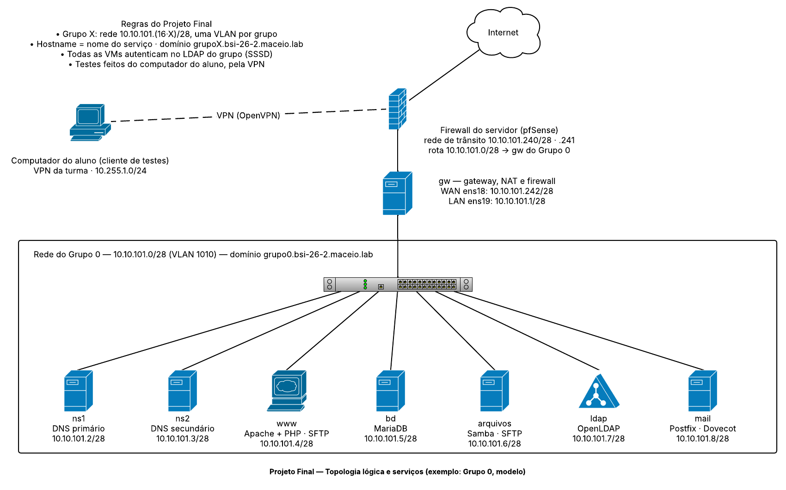
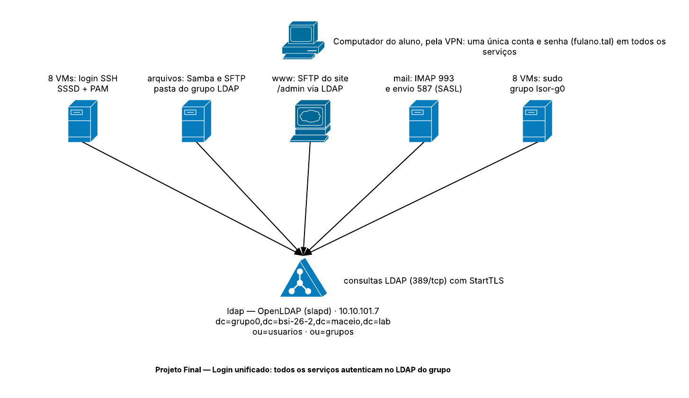

# Projeto de LSOR — Turma bsi-26-2 (2026.2)

## Projeto Final — Serviços de rede com login unificado

### 1. Apresentação

Na Etapa 1, cada grupo montou no laboratório uma rede privada com IPs fixos, nomes no domínio do grupo e um gateway NAT. No Projeto Final, o grupo recebe **8 máquinas virtuais no servidor do laboratório** e transforma essa rede num ambiente de serviços completo, como o de uma pequena empresa:

| Serviço | VM | O que o grupo vai implantar |
|:--|:--|:--|
| **Gateway e firewall** | `gw` | Roteamento, NAT e filtragem de pacotes entre a rede do grupo e o resto da rede |
| **DNS** | `ns1` e `ns2` | Servidor de nomes primário (master) e secundário (slave) com BIND9, zona direta e reversa |
| **Servidor web** | `www` | Apache com PHP, publicando a aplicação do grupo, e SFTP para enviar os arquivos do site |
| **Banco de dados** | `bd` | MariaDB acessado pela rede, a partir do `www` |
| **Servidor de arquivos** | `arquivos` | Compartilhamentos Samba e SFTP sobre as mesmas pastas |
| **Login unificado** | `ldap` | Diretório OpenLDAP com TLS; as 8 VMs autenticam nele |
| **E-mail** | `mail` | Postfix (envio e entrega) e Dovecot (leitura por IMAP) |

O ponto central do projeto é o **login unificado**: cada integrante tem **uma única conta e senha**, guardadas no LDAP, e usa essa conta para entrar por SSH em qualquer VM, enviar arquivos por SFTP, abrir a pasta do grupo, ler e enviar e-mail e administrar o site.

O **cliente de testes é o próprio computador do aluno**, conectado à VPN da turma: é dele que o aluno acessa o site no navegador, envia arquivos com um cliente SFTP, abre a pasta compartilhada e lê o e-mail.

### 2. Objetivos

Ao final do projeto, o grupo deve ser capaz de:

1. Configurar um gateway com roteamento, NAT e firewall para uma rede de servidores.
2. Configurar um DNS autoritativo com servidor primário e secundário, transferência de zona e resolução reversa.
3. Criar um diretório LDAP com usuários e grupos POSIX, protegido com TLS.
4. Integrar servidores Linux ao LDAP com SSSD e PAM, centralizando login, diretório home e `sudo`.
5. Publicar arquivos por Samba e SFTP com permissões por grupo.
6. Montar uma aplicação web em duas camadas (Apache com PHP numa VM, MariaDB em outra), com área restrita autenticada no LDAP.
7. Configurar envio e leitura de e-mail autenticados para o domínio do grupo.
8. Testar cada serviço a partir de um cliente remoto e documentar as evidências.

### 3. Ambiente

| Item | Valor |
|:--|:--|
| Onde | Servidor do laboratório (Proxmox VE), uma rede isolada por grupo |
| Acesso | VPN da turma: PC pessoal, PC do laboratório ou GitHub Codespaces |
| Sistema | Ubuntu Server 24.04 LTS em todas as VMs |
| VMs por grupo | 8, já criadas pelo professor |
| Hardware de cada VM | 1 vCPU, 512 MB de RAM (o `bd` pode crescer até 1 GB), 16 GB de disco |
| Usuário inicial | `administrador`, com senha entregue ao grupo em particular (não publique) |

As VMs são entregues **ligadas, com o hostname, o IP, a máscara, a rota padrão e o DNS inicial já configurados**. Todo o resto é trabalho do grupo, começando pelo gateway: até ele encaminhar pacotes, só a VM `gw` responde pela VPN.

- Placas de rede: no servidor, as placas aparecem como **`ens18`** (e `ens19` no `gw`), e não como `enp0s3`/`enp0s8` do VirtualBox. Confira com `ip -br addr` e use esses nomes no Netplan e nas regras do firewall.
- Revise o arquivo `/etc/netplan/50-cloud-init.yaml` de cada VM e registre-o no tutorial, como na Etapa 1.
- Antes de cada serviço, **tire um *snapshot*** da VM pelo painel do servidor. Se a configuração quebrar, volte ao *snapshot*.

### 4. Topologia

**Figura 1:** Topologia lógica e serviços (exemplo do Grupo 0, modelo).



**Figura 2:** Login unificado. Todos os serviços consultam o mesmo diretório LDAP.



Diagrama editável no Lucid: [LSOR BSI - Projeto Final - Topologia de Serviços](https://lucid.app/lucidchart/2545f7c4-b516-4c3a-9a05-80b9972dc18c/view)

### 5. Endereçamento e nomes

A turma usa a rede **`10.10.101.0/24`**, dividida em sub-redes **/28**, uma por grupo, na mesma regra da Etapa 1: o Grupo **X** usa a sub-rede `10.10.101.(16 × X)/28`. O último /28 (`10.10.101.240/28`) é a **rede de trânsito** que liga o `gw` de cada grupo ao firewall do servidor.

| VM | IP na rede do grupo | Grupo 0 (modelo) | Grupo 1 | FQDN (Grupo 0) |
|:--|:--|:--|:--|:--|
| `gw` (LAN, `ens19`) | `16·X + 1` | 10.10.101.1 | 10.10.101.17 | `gw.grupo0.bsi-26-2.maceio.lab` |
| `gw` (WAN, `ens18`) | `10.10.101.(242 + X)/28` | 10.10.101.242 | 10.10.101.243 | — |
| `ns1` | `16·X + 2` | 10.10.101.2 | 10.10.101.18 | `ns1.grupo0.bsi-26-2.maceio.lab` |
| `ns2` | `16·X + 3` | 10.10.101.3 | 10.10.101.19 | `ns2.grupo0.bsi-26-2.maceio.lab` |
| `www` | `16·X + 4` | 10.10.101.4 | 10.10.101.20 | `www.grupo0.bsi-26-2.maceio.lab` |
| `bd` | `16·X + 5` | 10.10.101.5 | 10.10.101.21 | `bd.grupo0.bsi-26-2.maceio.lab` |
| `arquivos` | `16·X + 6` | 10.10.101.6 | 10.10.101.22 | `arquivos.grupo0.bsi-26-2.maceio.lab` |
| `ldap` | `16·X + 7` | 10.10.101.7 | 10.10.101.23 | `ldap.grupo0.bsi-26-2.maceio.lab` |
| `mail` | `16·X + 8` | 10.10.101.8 | 10.10.101.24 | `mail.grupo0.bsi-26-2.maceio.lab` |

- Máscara `/28` (255.255.255.240); rota padrão de todas as VMs = IP de LAN do `gw`; rota padrão do `gw` = `10.10.101.241` (firewall do servidor).
- Domínio do grupo: `grupoX.bsi-26-2.maceio.lab`. O hostname de cada VM é o **nome do serviço**.
- Os endereços `16·X + 9` a `16·X + 14` ficam livres.

| Grupo | Sub-rede | `gw` LAN | WAN do `gw` | Broadcast |
|:--:|:--|:--|:--|:--|
| 0 (modelo) | 10.10.101.0/28 | .1 | .242 | .15 |
| 1 | 10.10.101.16/28 | .17 | .243 | .31 |
| 2 | 10.10.101.32/28 | .33 | .244 | .47 |
| 3 | 10.10.101.48/28 | .49 | .245 | .63 |
| 4 | 10.10.101.64/28 | .65 | .246 | .79 |
| 5 | 10.10.101.80/28 | .81 | .247 | .95 |

### 6. Ordem de implementação

| Passo | Serviço | Depende de | Seção |
|:--:|:--|:--|:--:|
| 1 | Gateway: encaminhamento, NAT e firewall | — | 7 |
| 2 | DNS primário e secundário | Gateway | 8 |
| 3 | Servidor LDAP com TLS | DNS | 9 |
| 4 | Login unificado nas 8 VMs | LDAP | 10 |
| 5 | Servidor de arquivos (Samba e SFTP) | Login unificado | 11 |
| 6 | Banco de dados e servidor web | DNS e LDAP | 12 |
| 7 | E-mail | DNS (registro MX) e login unificado | 13 |

Só passe para o próximo passo depois de testar o anterior **a partir do seu computador** (seção 14).

### 7. Gateway — `gw`

O `gw` tem duas placas: `ens18` na rede de trânsito (WAN) e `ens19` na rede do grupo (LAN). Como na [Aula 08](../Aula8.md) e na Etapa 1, ele vai encaminhar e mascarar o tráfego do grupo, e agora também **filtrar** o que entra [1, 2].

**Requisitos:**

1. Encaminhamento de pacotes persistente (`net.ipv4.ip_forward=1`).
2. NAT (`MASQUERADE`) só para o tráfego da rede do grupo que **sai** pela WAN:

```bash
sudo iptables -t nat -A POSTROUTING -s 10.10.101.0/28 -o ens18 -j MASQUERADE
```

3. Firewall na cadeia `FORWARD`, com política padrão `DROP`:

| Regra | Origem | Destino | Portas |
|:--|:--|:--|:--|
| Respostas | qualquer | qualquer | conexões `ESTABLISHED,RELATED` |
| Saída do grupo | `10.10.101.0/28` | qualquer | todas |
| Alunos na VPN | `10.255.1.0/24` | `10.10.101.0/28` | 22, 53, 80, 445, 587, 993, ICMP |
| DNS do servidor | `10.10.101.241` | `ns1`, `ns2` | 53 (tcp e udp) |

```bash
sudo iptables -P FORWARD DROP
sudo iptables -A FORWARD -m conntrack --ctstate ESTABLISHED,RELATED -j ACCEPT
sudo iptables -A FORWARD -i ens19 -o ens18 -s 10.10.101.0/28 -j ACCEPT
sudo iptables -A FORWARD -i ens18 -o ens19 -s 10.255.1.0/24 -p tcp -m multiport --dports 22,53,80,445,587,993 -j ACCEPT
sudo iptables -A FORWARD -i ens18 -o ens19 -s 10.255.1.0/24 -p udp --dport 53 -j ACCEPT
sudo iptables -A FORWARD -i ens18 -o ens19 -s 10.255.1.0/24 -p icmp -j ACCEPT
sudo iptables -A FORWARD -i ens18 -o ens19 -s 10.10.101.241 -d 10.10.101.2,10.10.101.3 -p udp --dport 53 -j ACCEPT
sudo iptables -A FORWARD -i ens18 -o ens19 -s 10.10.101.241 -d 10.10.101.2,10.10.101.3 -p tcp --dport 53 -j ACCEPT
sudo netfilter-persistent save
```

4. O `gw` também autentica no LDAP (seção 10) e mantém o `administrador` local para emergências.

> **Por que o aluno alcança as VMs sem DNAT?** O firewall do servidor tem uma rota para a rede de cada grupo apontando para o `gw` do grupo. O tráfego da VPN chega roteado, e o `gw` decide pela cadeia `FORWARD` o que entra. O NAT fica só para a saída do grupo para a internet.

### 8. DNS — `ns1` (primário) e `ns2` (secundário)

O DNS do grupo responde pelos nomes da tabela da seção 5. O firewall do servidor encaminha as consultas de `grupoX.bsi-26-2.maceio.lab` para o `ns1` e o `ns2` do grupo, de modo que **o computador do aluno, na VPN, também resolve esses nomes** [3, 4, 5].

**Requisitos:**

1. Instalar o BIND9 em `ns1` e `ns2`.
2. Em `ns1`, criar como **primário** (`type primary`, antigo `master`):
   - a zona direta `grupo0.bsi-26-2.maceio.lab`, com um registro **A** para cada VM, os registros **NS** (`ns1`, `ns2`) e o registro **MX** (`mail`);
   - a zona reversa, com um **PTR** para cada VM do grupo (seção 8.1).
3. Em `ns2`, criar as mesmas zonas como **secundário** (`type secondary`, antigo `slave`), transferidas do `ns1`.
4. No `ns1`, liberar a transferência só para o `ns2` (`allow-transfer`) e notificá-lo das alterações (`also-notify`).
5. Responder às consultas da rede do grupo, do firewall do servidor e da VPN; **recursão só para a rede do grupo**:

```
acl grupo  { 10.10.101.0/28; localhost; };
acl turma  { 10.10.101.0/24; 10.255.1.0/24; };
options {
    // ...
    allow-query     { grupo; turma; };
    allow-recursion { grupo; };
    forwarders      { 10.10.101.241; };
};
```

6. Incrementar o **serial** do SOA a cada alteração, no formato `AAAAMMDDnn`.
7. Depois de testar, apontar o DNS de **todas as VMs** para `ns1` e `ns2`, com o domínio de busca do grupo:

```yaml
      nameservers:
        search: [grupo0.bsi-26-2.maceio.lab]
        addresses: [10.10.101.2, 10.10.101.3]
```

> Os registros **NS** e **MX** precisam apontar para nomes com registro de endereço próprio, nunca para um apelido (CNAME) [6]. Como cada VM tem como hostname o nome do serviço, basta um registro A por VM.

#### 8.1 Zona reversa

Cada grupo declara a zona reversa `101.10.10.in-addr.arpa` contendo **só os PTR das suas 8 VMs** (ex.: `4 IN PTR www.grupo0.bsi-26-2.maceio.lab.`). O firewall do servidor encaminha a consulta reversa de cada endereço para o DNS do grupo dono daquele endereço, de modo que `dig -x 10.10.101.4` funciona a partir de qualquer lugar da VPN.

> Numa rede real, quem recebe só um pedaço (/28) de uma rede usa a delegação *classless* da RFC 2317 [7], com uma zona como `0-15.101.10.10.in-addr.arpa`. Fica como desafio opcional (seção 15).

**Validação antes de recarregar:**

```bash
sudo named-checkconf
sudo named-checkzone grupo0.bsi-26-2.maceio.lab /etc/bind/db.grupo0
sudo named-checkzone 101.10.10.in-addr.arpa /etc/bind/db.10.10.101
sudo rndc reload
```

### 9. LDAP — `ldap`

O OpenLDAP guarda os usuários e grupos do projeto no formato POSIX (RFC 2307), o mesmo dos arquivos `/etc/passwd` e `/etc/group` [8, 9, 10].

**Requisitos:**

1. Instalar `slapd` e `ldap-utils` e reconfigurar com `sudo dpkg-reconfigure slapd`, usando o domínio do grupo. A base fica `dc=grupo0,dc=bsi-26-2,dc=maceio,dc=lab`.
2. Criar as unidades organizacionais `ou=usuarios` e `ou=grupos`.
3. Criar os grupos POSIX (`posixGroup`):

| Grupo | `gidNumber` | Membros (`memberUid`) | Uso |
|:--|:--:|:--|:--|
| `lsor-g0` | 10000 | todos os integrantes | `sudo` nas VMs, pasta do grupo, publicação do site e área `/admin` |
| `sftpusers` | 10001 | `novato` | Usuários que só podem usar SFTP no `arquivos` |

4. Criar um usuário (`inetOrgPerson`, `posixAccount`, `shadowAccount`) para **cada integrante**, com login `nome.sobrenome`, e o usuário `novato`:
   - `uidNumber` a partir de **10001** (as contas locais começam em 1000);
   - `homeDirectory: /home/<login>` e `loginShell: /bin/bash` (`/usr/sbin/nologin` para o `novato`);
   - `mail: <login>@grupo0.bsi-26-2.maceio.lab`;
   - senha gerada com `slappasswd` (nunca em texto puro no LDIF).

```ldif
dn: uid=fulano.tal,ou=usuarios,dc=grupo0,dc=bsi-26-2,dc=maceio,dc=lab
objectClass: inetOrgPerson
objectClass: posixAccount
objectClass: shadowAccount
uid: fulano.tal
cn: Fulano de Tal
sn: Tal
mail: fulano.tal@grupo0.bsi-26-2.maceio.lab
uidNumber: 10001
gidNumber: 10000
homeDirectory: /home/fulano.tal
loginShell: /bin/bash
userPassword: {SSHA}cole-aqui-a-saida-do-slappasswd
```

5. **Proteger o LDAP com TLS (StartTLS).** O SSSD só envia senhas por conexão criptografada, então este item é obrigatório:
   - criar uma autoridade certificadora (CA) do grupo e um certificado para `ldap.grupo0.bsi-26-2.maceio.lab` com `openssl`;
   - configurar `olcTLSCACertificateFile`, `olcTLSCertificateFile` e `olcTLSCertificateKeyFile` em `cn=config` com `ldapmodify -Y EXTERNAL -H ldapi:///`;
   - deixar a chave privada legível só por `root` e pelo grupo `openldap` (`chmod 640`);
   - copiar **só o certificado da CA** (`ca-grupo0.crt`) para `/usr/local/share/ca-certificates/` das 8 VMs e rodar `sudo update-ca-certificates`.

```bash
openssl req -x509 -newkey rsa:2048 -nodes -days 365 \
  -keyout ca-grupo0.key -out ca-grupo0.crt -subj "/CN=CA do Grupo 0 - LSOR"
openssl req -newkey rsa:2048 -nodes -keyout ldap.key -out ldap.csr \
  -subj "/CN=ldap.grupo0.bsi-26-2.maceio.lab"
printf "subjectAltName=DNS:ldap.grupo0.bsi-26-2.maceio.lab\n" > san.ext
openssl x509 -req -in ldap.csr -CA ca-grupo0.crt -CAkey ca-grupo0.key -CAcreateserial \
  -days 365 -extfile san.ext -out ldap.crt
```

**Verificação** (o `-ZZ` obriga o StartTLS; se o certificado estiver errado, o comando falha):

```bash
ldapsearch -x -ZZ -H ldap://ldap.grupo0.bsi-26-2.maceio.lab \
  -b dc=grupo0,dc=bsi-26-2,dc=maceio,dc=lab "(objectClass=posixAccount)" uid uidNumber gidNumber
```

> A chave da CA e as senhas **não vão para o GitHub**. No tutorial, mostre os comandos e os resultados, não o conteúdo das chaves.

### 10. Login unificado nas 8 VMs (SSSD)

Com o LDAP funcionando, **as 8 VMs** passam a buscar usuários, grupos e senhas nele pelo SSSD [11, 12].

**Requisitos:**

1. Instalar `sssd-ldap`, `libnss-sss`, `libpam-sss` e `ldap-utils`.
2. Criar `/etc/sssd/sssd.conf` (dono `root`, permissão `600`) e reiniciar o `sssd`:

```ini
[sssd]
services = nss, pam
domains = grupo0

[domain/grupo0]
id_provider = ldap
auth_provider = ldap
ldap_uri = ldap://ldap.grupo0.bsi-26-2.maceio.lab
ldap_search_base = dc=grupo0,dc=bsi-26-2,dc=maceio,dc=lab
ldap_id_use_start_tls = true
ldap_tls_reqcert = demand
ldap_tls_cacert = /etc/ssl/certs/ca-certificates.crt
cache_credentials = true
```

3. Criar o home no primeiro login: `sudo pam-auth-update --enable mkhomedir`.
4. Liberar o login por senha no SSH para as contas do LDAP (`PasswordAuthentication yes` em `/etc/ssh/sshd_config.d/`), se a imagem vier com ele desligado.
5. Dar `sudo` aos integrantes pelo grupo do LDAP: `sudo visudo -f /etc/sudoers.d/lsor-g0` com a linha `%lsor-g0 ALL=(ALL:ALL) ALL`.
6. **Manter o `administrador` local** em todas as VMs: é o acesso de emergência se o LDAP cair.

**Verificação (em cada VM):**

```bash
getent passwd fulano.tal     # uid 10001, vindo do LDAP
id fulano.tal                # deve listar o grupo lsor-g0
grep fulano.tal /etc/passwd  # não deve aparecer: a conta não é local
```

### 11. Servidor de arquivos — `arquivos` (Samba e SFTP)

O `arquivos` oferece as **mesmas pastas** por dois protocolos: Samba, para abrir no explorador de arquivos, e SFTP, para transferir com um cliente como FileZilla ou WinSCP [13, 14].

**Requisitos:**

1. Pastas e compartilhamentos Samba:

| Compartilhamento | Caminho | Acesso |
|:--|:--|:--|
| `publico` | `/srv/arquivos/publico` | Leitura para qualquer usuário, inclusive convidado |
| `grupo0` | `/srv/arquivos/grupo0` | Leitura e escrita só para o grupo `lsor-g0` (`valid users = @lsor-g0`) |

2. A pasta `grupo0` pertence ao grupo `lsor-g0`, com permissão `2770`; no `smb.conf`, use `force group = lsor-g0`, `create mask = 0660` e `directory mask = 2770`. Valide com `testparm`.
3. O Samba guarda a senha num formato próprio. Cadastre cada integrante com `sudo smbpasswd -a <login>`, com a mesma senha do LDAP.
4. **SFTP dos integrantes:** login normal pelo SSH, com acesso às pastas de `/srv/arquivos`. O que um integrante grava por SFTP aparece no Samba, e vice-versa.
5. **SFTP restrito do `novato`** (grupo `sftpusers`): sem terminal e preso ao próprio diretório. No final do `/etc/ssh/sshd_config`:

```
Match Group sftpusers
    ChrootDirectory /srv/sftp/%u
    ForceCommand internal-sftp
    AllowTcpForwarding no
    X11Forwarding no
```

```bash
sudo mkdir -p /srv/sftp/novato/arquivos
sudo chown root:root /srv/sftp/novato && sudo chmod 755 /srv/sftp/novato   # exigência do ChrootDirectory
sudo chown novato:sftpusers /srv/sftp/novato/arquivos
sudo sshd -t && sudo systemctl restart ssh
```

> **Por que outra senha no Samba?** O Samba precisa de um *hash* que o esquema POSIX do LDAP não guarda. Unificar também essa senha exige o esquema do Samba no LDAP (desafio opcional, seção 15).

### 12. Servidor web e banco de dados — `www` e `bd`

A aplicação web fica em **duas camadas**: o Apache com PHP no `www` e o MariaDB no `bd`, conversando pela rede do grupo. O grupo publica a aplicação de exemplo do [site demo](site-demo/README.md), ou outra aplicação PHP com MariaDB que tenha as mesmas integrações [15, 16, 17, 18].

**Requisitos:**

1. **`bd`:** MariaDB escutando no IP do `bd` (`bind-address`), banco `projeto` criado com o script [`criar-banco.sql`](site-demo/bd/criar-banco.sql) e usuário da aplicação que só entra **a partir do IP do `www`**, com `SELECT`, `INSERT`, `UPDATE` e `DELETE` no banco `projeto`.
2. **`www`:** Apache, PHP e o módulo `php-mysql`; *virtual host* `www.grupo0.bsi-26-2.maceio.lab` publicando só a pasta `public/` da aplicação.
3. **SFTP no `www`:** os integrantes enviam os arquivos do site do próprio computador por SFTP. A pasta do site pertence ao grupo `lsor-g0` (permissão `2775`), para qualquer integrante atualizar o site com a conta do LDAP.
4. **Área restrita no LDAP:** a pasta `/admin` pede usuário e senha do LDAP e só abre para o grupo `lsor-g0`, com o módulo `authnz_ldap` do Apache ([exemplo de *virtual host*](site-demo/apache/www.grupo0.bsi-26-2.maceio.lab.conf)).
5. A página inicial mostra a conexão com o `bd`; a página de consulta lista os grupos, integrantes e VMs; a área `/admin` cadastra, edita e remove registros.

O passo a passo completo, com os comandos, está no [README do site demo](site-demo/README.md).

### 13. E-mail — `mail` (Postfix e Dovecot)

Usaremos **Postfix** para receber e enviar mensagens (SMTP) e **Dovecot** para a leitura (IMAP). São os pacotes padrão do Ubuntu para e-mail, bem documentados e leves: juntos, ocupam poucas dezenas de MB de memória. As caixas postais são dos usuários do LDAP, que o SSSD já torna visíveis para o sistema [19, 20, 21].

O servidor atende **só o domínio do grupo**: não recebe nem envia mensagens para a internet.

**Requisitos:**

1. **Postfix** (*Internet Site* na instalação), em `/etc/postfix/main.cf`:
   - `myhostname = mail.grupo0.bsi-26-2.maceio.lab` e `mydomain = grupo0.bsi-26-2.maceio.lab`;
   - `mydestination = $myhostname, $mydomain, localhost`;
   - `mynetworks = 127.0.0.0/8, 10.10.101.0/28` (as VMs do grupo enviam sem senha);
   - `home_mailbox = Maildir/`.
2. **Envio autenticado (porta 587, *submission*)** para os clientes de e-mail no computador do aluno: em `/etc/postfix/master.cf`, ativar o serviço `submission` com STARTTLS obrigatório e autenticação SASL feita pelo Dovecot (`smtpd_sasl_type = dovecot`, `smtpd_sasl_path = private/auth`).
3. **Dovecot** (`dovecot-imapd`), com IMAP sobre TLS na porta 993, caixas no formato Maildir e autenticação pelo PAM, que usa o SSSD. O Dovecot também oferece ao Postfix o *socket* de autenticação em `/var/spool/postfix/private/auth`. A sintaxe depende da versão (`dovecot --version`): na 2.4, o Maildir é definido com `mail_driver = maildir` e `mail_path = ~/Maildir`; na 2.3, com `mail_location = maildir:~/Maildir` [20].
4. O home de cada integrante precisa existir no `mail` antes da primeira mensagem: faça um login por SSH com cada um nessa VM (o `mkhomedir` cria o diretório).
5. O registro **MX** do domínio aponta para `mail` (seção 8).

> **Alternativas.** Um MTA menor, como o OpenSMTPD, tem configuração mais curta, mas menos documentação em português e menos integração com o Dovecot. Uma interface web (Roundcube no `www`) fica como desafio opcional: o teste principal é com um cliente de e-mail no computador do aluno.

### 14. Testes a partir do computador do aluno

Conectado à VPN, o aluno testa cada serviço **do próprio computador** e registra comando e saída (ou captura de tela) no tutorial. Os comandos de terminal valem no Linux, no macOS e no Codespaces; no Windows, use o equivalente indicado.

| # | Serviço | Teste | Resultado esperado |
|:--:|:--|:--|:--|
| 1 | Gateway | `ping 10.10.101.4` e `traceroute 10.10.101.4` (Windows: `tracert`) | O penúltimo salto é a WAN do `gw` do grupo |
| 2 | Gateway | De uma VM: `ping 1.1.1.1` e `curl -I https://ubuntu.com` | Saída para a internet pelo NAT do `gw` |
| 3 | DNS | `dig www.grupo0.bsi-26-2.maceio.lab` (Windows: `Resolve-DnsName`) | IP `.4` do grupo |
| 4 | DNS | `dig @10.10.101.2 grupo0.bsi-26-2.maceio.lab SOA` e o mesmo com `@10.10.101.3` | Mesmo serial nos dois servidores, com resposta autoritativa (`aa`) |
| 5 | DNS | `dig -x 10.10.101.8` | `mail.grupo0.bsi-26-2.maceio.lab.` |
| 6 | DNS | `dig MX grupo0.bsi-26-2.maceio.lab` | `10 mail.grupo0.bsi-26-2.maceio.lab.` |
| 7 | DNS | Desligar o `ns1` e repetir o teste 3 | O `ns2` responde sozinho |
| 8 | Login | `ssh fulano.tal@www...`, `ssh fulano.tal@bd...` e `ssh fulano.tal@mail...`, e `sudo -l` em cada uma | Mesma senha do LDAP nas três; `sudo` liberado |
| 9 | Login | Trocar a senha de um integrante no LDAP (`ldappasswd`) e repetir o teste 8 | A senha nova vale em todas as VMs |
| 10 | LDAP | `ssh` numa VM e `ldapsearch -x -ZZ ...` (seção 9) | Usuários e grupos listados por StartTLS |
| 11 | Arquivos | Abrir `\\arquivos.grupo0.bsi-26-2.maceio.lab\grupo0` no Explorer (Linux: `smbclient //arquivos.../grupo0 -U fulano.tal`) e gravar um arquivo | Gravação liberada para integrantes; `novato` negado |
| 12 | Arquivos | Conectar por SFTP ao `arquivos` (FileZilla, WinSCP ou `sftp fulano.tal@arquivos...`) e baixar o arquivo do teste 11 | O mesmo arquivo aparece nos dois protocolos |
| 13 | Arquivos | `sftp novato@arquivos...` e depois `ssh novato@arquivos...` | SFTP funciona dentro de `/arquivos`; SSH recusado |
| 14 | Web | Enviar o site por SFTP para o `www` e abrir `http://www.grupo0.bsi-26-2.maceio.lab/` no navegador | Página com "Conectado ao MariaDB … em bd…" |
| 15 | Web | Abrir `/admin`, entrar com um integrante, cadastrar, editar e remover um registro de cada tabela | Alterações refletidas no `bd` (`SELECT` no MariaDB); `novato` não entra |
| 16 | E-mail | Configurar Thunderbird (ou outro cliente) com IMAP 993 e SMTP 587 de dois integrantes e trocar mensagens | Mensagens enviadas e recebidas; `sudo tail /var/log/mail.log` no `mail` mostra `status=sent` |
| 17 | Firewall | Do computador, `nc -vz 10.10.101.5 22` e `nc -vz 10.10.101.5 3306` (Windows: `Test-NetConnection 10.10.101.5 -Port 3306`) | Porta 22 aberta; 3306 bloqueada pelo `gw` (o banco só atende o `www`) |

### 15. Desafios opcionais (bônus)

- **HTTPS** no `www`, com certificado assinado pela CA do grupo e redirecionamento de HTTP para HTTPS.
- **Webmail** (Roundcube) no `www`, lendo as caixas do `mail` por IMAP.
- **Senha única também no Samba**, com o esquema do Samba no LDAP.
- **Zona reversa *classless*** (RFC 2317) para o /28 do grupo [7].
- **Replicação do LDAP** (*syncrepl*) para uma segunda VM.
- **Backup automático** do banco `projeto` e do LDAP (`mysqldump` e `slapcat`) com `cron`, gravado na pasta do grupo no `arquivos`.

---

## Entregas

O grupo documenta tudo no **repositório do projeto do grupo no GitHub**, com o tutorial no [Modelo de 7 Passos](../README.md).

1. **Planilha de acompanhamento:** completar as tabelas do grupo com os IPs, os nomes e os usuários do LDAP (login e `uidNumber`). Nunca coloque senhas na planilha.
2. **Diagrama de topologia** do grupo, adaptado das Figuras 1 e 2.
3. **Tutorial**, com uma seção por serviço (seções 7 a 13), contendo:
   - a configuração de hardware de cada VM (memória, CPUs, disco);
   - os arquivos de configuração alterados (Netplan, regras do `iptables`, zonas do BIND, `sssd.conf`, `smb.conf`, trecho do `sshd_config`, *virtual host* do Apache, `main.cf` e `master.cf` do Postfix, arquivos do Dovecot) — **sem senhas, chaves privadas ou *hashes***;
   - os LDIF usados no diretório, sem o campo `userPassword`;
   - o código da aplicação web (pode ser o site demo, com as adaptações do grupo), sem o `config.php`;
   - as evidências dos 17 testes da seção 14;
   - os problemas encontrados e como foram resolvidos.
4. **Apresentação final**, com os testes executados ao vivo a partir do computador de um integrante.

**Prazos:** data a definir.

---

## Referências

[1] NETFILTER PROJECT. **iptables(8)** e **iptables-extensions(8)** — alvo `MASQUERADE` e módulos `conntrack` e `multiport`. Disponível em: <https://ipset.netfilter.org/iptables-extensions.man.html>.

[2] CANONICAL. **Configuring networks**. Ubuntu Server documentation. Disponível em: <https://ubuntu.com/server/docs/configuring-networks>.

[3] INTERNET SYSTEMS CONSORTIUM. **BIND 9 Administrator Reference Manual**. Disponível em: <https://bind9.readthedocs.io/>.

[4] CANONICAL. **Domain Name Service (DNS)**. Ubuntu Server documentation. Disponível em: <https://ubuntu.com/server/docs/how-to/networking/install-dns/>.

[5] MOCKAPETRIS, P. **RFC 1034 — Domain Names: Concepts and Facilities** e **RFC 1035 — Domain Names: Implementation and Specification**. IETF, 1987. Disponíveis em: <https://www.rfc-editor.org/rfc/rfc1034> e <https://www.rfc-editor.org/rfc/rfc1035>.

[6] ELZ, R.; BUSH, R. **RFC 2181 — Clarifications to the DNS Specification** (seção 10.3). IETF, 1997. Disponível em: <https://www.rfc-editor.org/rfc/rfc2181>.

[7] EIDNES, H.; DE GROOT, G.; VIXIE, P. **RFC 2317 — Classless IN-ADDR.ARPA delegation**. IETF, 1998. Disponível em: <https://www.rfc-editor.org/rfc/rfc2317>.

[8] CANONICAL. **Install and configure LDAP**. Ubuntu Server documentation. Disponível em: <https://documentation.ubuntu.com/server/how-to/openldap/install-openldap>.

[9] OPENLDAP FOUNDATION. **OpenLDAP Software Administrator's Guide**. Disponível em: <https://www.openldap.org/doc/admin26/>.

[10] HOWARD, L. **RFC 2307 — An Approach for Using LDAP as a Network Information Service**. IETF, 1998. Disponível em: <https://www.rfc-editor.org/rfc/rfc2307>.

[11] CANONICAL. **How to set up SSSD with LDAP**. Ubuntu Server documentation. Disponível em: <https://documentation.ubuntu.com/server/how-to/sssd/with-ldap>.

[12] SSSD PROJECT. **sssd-ldap(5)** — página de manual. Disponível em: <https://manpages.ubuntu.com/manpages/noble/man5/sssd-ldap.5.html>.

[13] CANONICAL. **Set up Samba as a file server**. Ubuntu Server documentation. Disponível em: <https://ubuntu.com/server/docs/how-to/samba/file-server/>.

[14] OPENBSD PROJECT. **sshd_config(5)** — opções `Match`, `ChrootDirectory` e `ForceCommand`. Disponível em: <https://man.openbsd.org/sshd_config>.

[15] APACHE SOFTWARE FOUNDATION. **Apache HTTP Server Version 2.4 Documentation — Virtual Hosts**. Disponível em: <https://httpd.apache.org/docs/2.4/vhosts/>.

[16] APACHE SOFTWARE FOUNDATION. **Apache Module mod_authnz_ldap**. Disponível em: <https://httpd.apache.org/docs/2.4/mod/mod_authnz_ldap.html>.

[17] THE PHP GROUP. **PHP Manual — PDO**. Disponível em: <https://www.php.net/manual/en/book.pdo.php>.

[18] MARIADB FOUNDATION. **MariaDB Knowledge Base — Configuring MariaDB for Remote Client Access**. Disponível em: <https://mariadb.com/kb/en/configuring-mariadb-for-remote-client-access/>.

[19] CANONICAL. **Mail services** (Postfix e Dovecot). Ubuntu Server documentation. Disponível em: <https://documentation.ubuntu.com/server/how-to/mail-services>.

[20] DOVECOT. **Upgrading Dovecot CE from 2.3 to 2.4**. Disponível em: <https://doc.dovecot.org/main/installation/upgrade/2.3-to-2.4.html>.

[21] KLENSIN, J. **RFC 5321 — Simple Mail Transfer Protocol**; GELLENS, R.; KLENSIN, J. **RFC 6409 — Message Submission for Mail**. IETF, 2008 e 2011. Disponíveis em: <https://www.rfc-editor.org/rfc/rfc5321> e <https://www.rfc-editor.org/rfc/rfc6409>.

[22] KUROSE, James F.; ROSS, Keith W. **Redes de Computadores e a Internet**. 8. ed. Pearson, 2022. (Capítulo 2: DNS e correio eletrônico.)

[23] LACROIX, Jay. **Mastering Ubuntu Server**. 4. ed. Packt Publishing, 2023.
