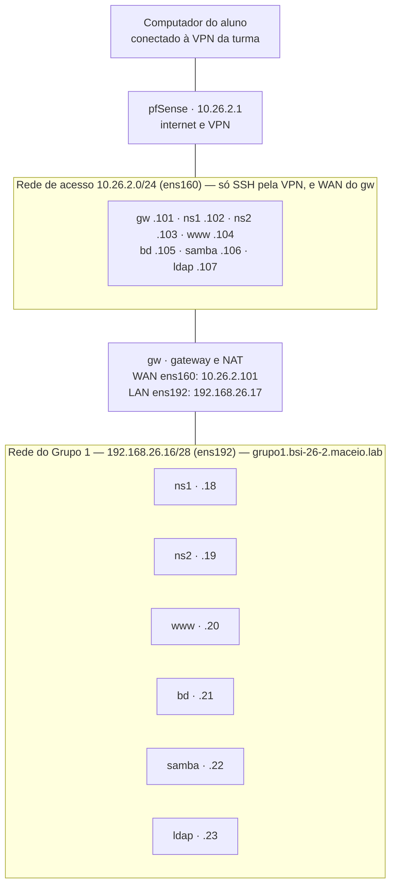

# Migração do Projeto Final para as VMs do LabRedes (VPN)

Laboratório de Sistemas Operacionais de Redes — turma bsi-26-2 (2026.2)

Na Etapa 1, cada grupo montou a sua rede em VMs do VirtualBox, nos PCs do laboratório. No Projeto Final, o grupo passa a usar **VMs do LabRedes**, hospedadas no servidor do laboratório e acessadas pela **VPN da turma**. Este documento mostra o que muda em relação ao [enunciado do Projeto Final](README.md) e como levar para as VMs novas o que o grupo já fez.

O que não muda: os serviços, os nomes, a sub-rede `/28` do grupo, a ordem de implementação e os testes. O `gw` continua sendo o **gateway e NAT** da rede do grupo, como na Etapa 1.

## 1. O que muda

| Item | Etapa 1 (VirtualBox) | Projeto Final (LabRedes, pela VPN) |
|:--|:--|:--|
| Onde ficam as VMs | PCs do laboratório | Servidor do LabRedes |
| Como acessar | Console do VirtualBox | VPN e SSH, de qualquer lugar |
| Quantidade de VMs | 9 (gateway e VM1 a VM8) | 7 por grupo: `gw`, `ns1`, `ns2`, `www`, `bd`, `samba` e `ldap` |
| VM `cliente` | VM8 | Não existe: os testes são feitos a partir do `gw` (seção 6) |
| Placas de rede | `enp0s3` (e `enp0s8` no `gw`) | **Duas em todas as VMs:** `ens160` (acesso) e `ens192` (rede do grupo) |
| Rede de acesso | Rede do laboratório `172.20.20.0/22` | `10.26.2.0/24`, na `ens160` |
| Rede do grupo | `/28` do grupo em `192.168.26.0/24` | A mesma `/28`, agora na `ens192` |
| *Snapshot* antes de cada serviço | Pelo VirtualBox | Não há: guarde os arquivos de configuração no repositório do grupo antes de cada mudança |

## 2. As duas placas de rede

Uma **placa de rede** (interface) é a ligação da VM com uma rede. O Ubuntu dá a cada placa um nome fixo, que depende do tipo de placa virtual: no VirtualBox eram `enp0s3` e `enp0s8`; no LabRedes são `ens160` e `ens192`.

**`ens160` — rede de acesso (`10.26.2.0/24`).** Já vem configurada.

- Cada VM tem um IP fixo nessa rede (seção 3). É por ele que vocês entram na VM por SSH, pela VPN.
- No `gw`, ela é a **WAN**: a saída para a internet, pelo pfSense (`10.26.2.1`), como a `enp0s3` do gateway na Etapa 1.
- Nas outras VMs, ela serve **só para o acesso pela VPN**. A saída para a internet passa a ser pelo `gw`.
- Se o IP da `ens160` for apagado ou trocado, a VM fica inacessível pela VPN, e só o professor ou o monitor conseguem recuperá-la.

**`ens192` — rede do grupo (`/28` do grupo).** Configurada por vocês.

- Recebe o IP da Etapa 1 (seção 5 do enunciado e planilha de acompanhamento).
- É a rede onde os serviços do grupo conversam entre si: DNS, LDAP, Samba, web e banco de dados.
- No `gw`, é a **LAN**, como a `enp0s8` na Etapa 1.
- As `ens192` de todos os grupos ficam no mesmo segmento de rede, como os PCs do laboratório na Etapa 1: o que separa os grupos é a sub-rede `/28` de cada um. Use só os IPs da faixa do seu grupo.

**Figura 1:** Topologia do Grupo 1 nas VMs do LabRedes.



## 3. VMs, funções e IPs

As VMs chegam com o hostname `gNN-vmK` (`NN` = número do grupo, `K` = número da VM). A função de cada uma é fixa:

| VM | Função | IP na rede do grupo (`ens192`) | FQDN (Grupo X) |
|:--|:--|:--|:--|
| `gNN-vm1` | `gw` | `16·X + 1` | `gw.grupoX.bsi-26-2.maceio.lab` |
| `gNN-vm2` | `ns1` | `16·X + 2` | `ns1.grupoX.bsi-26-2.maceio.lab` |
| `gNN-vm3` | `ns2` | `16·X + 3` | `ns2.grupoX.bsi-26-2.maceio.lab` |
| `gNN-vm4` | `www` | `16·X + 4` | `www.grupoX.bsi-26-2.maceio.lab` |
| `gNN-vm5` | `bd` | `16·X + 5` | `bd.grupoX.bsi-26-2.maceio.lab` |
| `gNN-vm6` | `samba` (servidor de arquivos) | `16·X + 6` | `samba.grupoX.bsi-26-2.maceio.lab` |
| `gNN-vm7` | `ldap` | `16·X + 7` | `ldap.grupoX.bsi-26-2.maceio.lab` |

IPs de cada grupo:

| Grupo | VM1 a VM7 (`ens160`) | Rede do grupo (`ens192`) | `gw` (LAN) |
|:--|:--|:--|:--|
| 0 (modelo, professor) | `10.26.2.51` a `.57` | `192.168.26.0/28` (`.1` a `.7`) | `192.168.26.1` |
| 1 | `10.26.2.101` a `.107` | `192.168.26.16/28` (`.17` a `.23`) | `192.168.26.17` |
| 2 | `10.26.2.108` a `.114` | `192.168.26.32/28` (`.33` a `.39`) | `192.168.26.33` |
| 3 | `10.26.2.115` a `.121` | `192.168.26.48/28` (`.49` a `.55`) | `192.168.26.49` |
| 4 | `10.26.2.122` a `.128` | `192.168.26.64/28` (`.65` a `.71`) | `192.168.26.65` |

A VM1 de cada grupo usa o primeiro IP da faixa, a VM2 o segundo, e assim por diante. A planilha de acompanhamento tem a tabela completa, VM por VM.

## 4. Como acessar

A **VPN** (*Virtual Private Network*) cria um túnel cifrado entre o seu computador e a rede do laboratório: com ela conectada, o seu computador alcança a rede `10.26.2.0/24` como se estivesse lá. O cliente usado é o **OpenVPN**.

1. Instale o cliente OpenVPN e importe o perfil `.ovpn` da turma (publicado no Classroom).
2. Conecte com o seu usuário e a sua senha da VPN (planilha de usuários da turma). Essa conta é só da VPN: não é a conta das VMs nem a do LDAP do grupo.
3. Entre na VM por SSH, trocando o IP pelo da VM que você quer acessar:

```bash
ssh administrador@10.26.2.101
```

O usuário `administrador` e a senha são os mesmos da Etapa 1. Ele continua sendo o acesso de emergência em todas as VMs.

## 5. Passo a passo da migração

Faça os passos **na ordem**: primeiro o `gw`, depois as outras VMs. Enquanto o `gw` não estiver pronto, as outras VMs ficam sem internet (o acesso por SSH continua funcionando).

**Passo 1. Guardar o que foi feito no VirtualBox.** Antes de tudo, copie para o repositório do grupo no GitHub os arquivos de configuração da Etapa 1: Netplan, `/etc/hosts`, regras do NAT do gateway e as configurações dos serviços já iniciados (por exemplo, as zonas do DNS). As VMs novas começam limpas.

**Passo 2. Ajustar o nome de cada VM.** Em cada VM, troque o hostname `gNN-vmK` pelo FQDN da seção 3. Exemplo para o `ns1` do Grupo 1:

```bash
sudo hostnamectl set-hostname ns1.grupo1.bsi-26-2.maceio.lab
```

Ajuste também a linha `127.0.1.1` do `/etc/hosts`:

```bash
sudo nano /etc/hosts
```

**Passo 3. Configurar a rede do `gw`.** O **Netplan** é a ferramenta do Ubuntu que lê os arquivos YAML de `/etc/netplan/` e configura as placas de rede. Edite o arquivo do `gw`:

```bash
sudo nano /etc/netplan/00-installer-config.yaml
```

Mantenha o bloco da `ens160` como está e altere só o bloco da `ens192`, com o IP de LAN do `gw`. Exemplo para o Grupo 1:

```yaml
    ens192:            # LAN - rede do grupo
      dhcp4: false
      addresses:
        - 192.168.26.17/28
```

No `gw`, a `ens192` não leva gateway nem DNS: a rota padrão continua sendo o pfSense, pela `ens160`.

**Passo 4. Aplicar com segurança.** Use o `netplan try`: ele aplica a configuração e a desfaz sozinho em 120 segundos se você não confirmar. Se um erro derrubar a conexão SSH, basta esperar e entrar de novo.

```bash
sudo netplan try
```

Se a conexão SSH continuar funcionando, aperte **Enter** para confirmar. Confira:

```bash
ip -c -4 a
```

**Passo 5. Encaminhamento e NAT no `gw`.** Refaça a configuração do gateway da Etapa 1, trocando os nomes das placas: a WAN agora é a `ens160` (era a `enp0s3`). Confira que o encaminhamento de pacotes está ligado (deve mostrar `= 1`):

```bash
sudo sysctl net.ipv4.ip_forward
```

E que o NAT está saindo pela `ens160`, com a sub-rede do grupo (Grupo 1 no exemplo):

```bash
sudo iptables -t nat -L POSTROUTING -n -v
```

A regra esperada é um `MASQUERADE` de `192.168.26.16/28` com saída `ens160`. Deixe as duas configurações persistentes após o *reboot*, como na Etapa 1.

**Passo 6. Configurar a rede das outras VMs.** Nas VMs `ns1`, `ns2`, `www`, `bd`, `samba` e `ldap`, a rota padrão passa a ser o `gw`, como na Etapa 1. Para o acesso pela VPN continuar funcionando, a `ens160` perde a rota padrão, mas ganha duas rotas específicas pelo pfSense: uma para as redes da VPN (`10.0.0.0/8`) e outra para a rede dos servidores do laboratório (`172.20.0.0/24`).

```bash
sudo nano /etc/netplan/00-installer-config.yaml
```

Exemplo completo para o `ns1` do Grupo 1 (troque os IPs pelos da VM):

```yaml
network:
  version: 2
  renderer: networkd
  ethernets:
    ens160:            # Acesso - SSH pela VPN
      dhcp4: false
      addresses:
        - 10.26.2.102/24
      routes:
        - to: 10.0.0.0/8
          via: 10.26.2.1
        - to: 172.20.0.0/24
          via: 10.26.2.1
    ens192:            # LAN - rede do grupo
      dhcp4: false
      addresses:
        - 192.168.26.18/28
      routes:
        - to: default
          via: 192.168.26.17
      nameservers:
        addresses: [172.20.0.10, 172.20.0.11]
```

O DNS fica nos servidores do laboratório (`172.20.0.10` e `172.20.0.11`) até o DNS do grupo estar pronto. Depois, ele passa a ser o `ns1` e o `ns2` do grupo (seção 8 do enunciado).

Aplique com o `netplan try` (passo 4) e confirme com **Enter** se o SSH continuar funcionando. Confira a rota padrão, que deve apontar para o IP de LAN do `gw`:

```bash
ip -c route
```

E a saída para a internet pelo NAT do `gw`:

```bash
ping -c 2 1.1.1.1
```

**Passo 7. Testar a rede do grupo.** De cada VM, faça `ping` para as outras pelos IPs da rede do grupo. Exemplo, do `ns1` para o `ldap` do Grupo 1:

```bash
ping -c 3 192.168.26.23
```

**Passo 8. Seguir o projeto.** A partir daqui, os serviços do Projeto Final são configurados na rede do grupo (`ens192`), conforme o enunciado, a partir da seção 8.

## 6. Testes sem a VM `cliente`

No LabRedes não há a VM `cliente`. Os testes da seção 14 do enunciado são feitos **a partir do `gw`**, acessado por SSH pela VPN. O `gw` está na rede do grupo e, depois do DNS pronto, usa o `ns1` e o `ns2` do grupo como servidores de nomes, como fazia a VM `cliente`.

Do seu computador, pela VPN, vocês alcançam só os IPs `10.26.2.x` das VMs. Os IPs da rede do grupo (`192.168.26.x`) só são alcançados de dentro das VMs.

## 7. Cuidados

- Nunca apague nem troque o IP da `ens160` no Netplan.
- Ao mexer na rede, use sempre `sudo netplan try` em vez de `sudo netplan apply`.
- Não desligue as VMs pelo sistema (`poweroff`): só o professor consegue ligá-las de novo. Se precisar reiniciar, use `sudo reboot`.
- Registre no repositório do grupo cada alteração de configuração feita nas VMs: é ela que substitui o *snapshot* do VirtualBox.
- Em caso de problema de acesso, procure o professor ou o monitor da disciplina.

---

## Referências

[1] CANONICAL. **Netplan documentation** — YAML configuration reference (`routes`, `nameservers`) e `netplan try`. Disponível em: <https://netplan.readthedocs.io/>.

[2] CANONICAL. **Configuring networks**. Ubuntu Server documentation. Disponível em: <https://ubuntu.com/server/docs/configuring-networks>.

[3] NETFILTER PROJECT. **iptables(8)** e **iptables-extensions(8)** — alvo `MASQUERADE`. Disponível em: <https://ipset.netfilter.org/iptables-extensions.man.html>.

[4] OPENVPN INC. **OpenVPN Community Resources — Reference manual for OpenVPN 2.6**. Disponível em: <https://openvpn.net/community-resources/reference-manual-for-openvpn-2-6/>.
