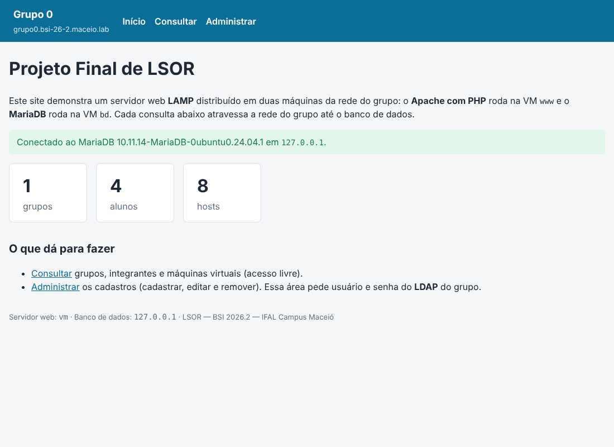
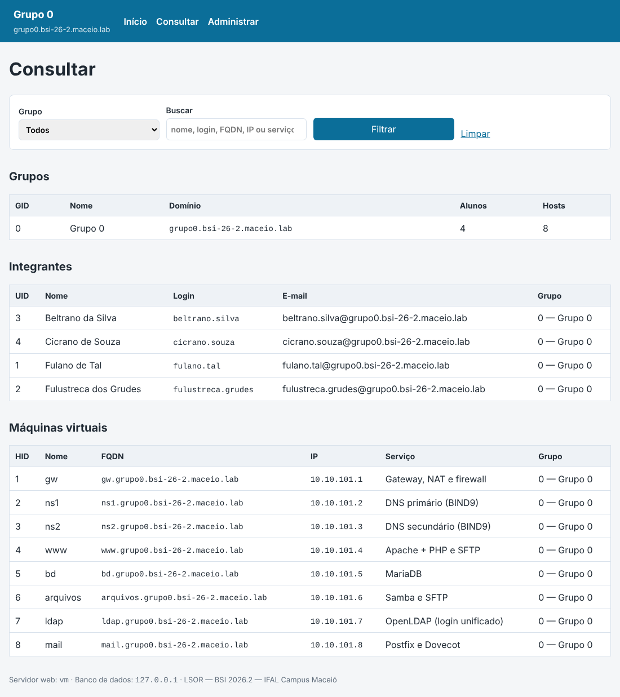
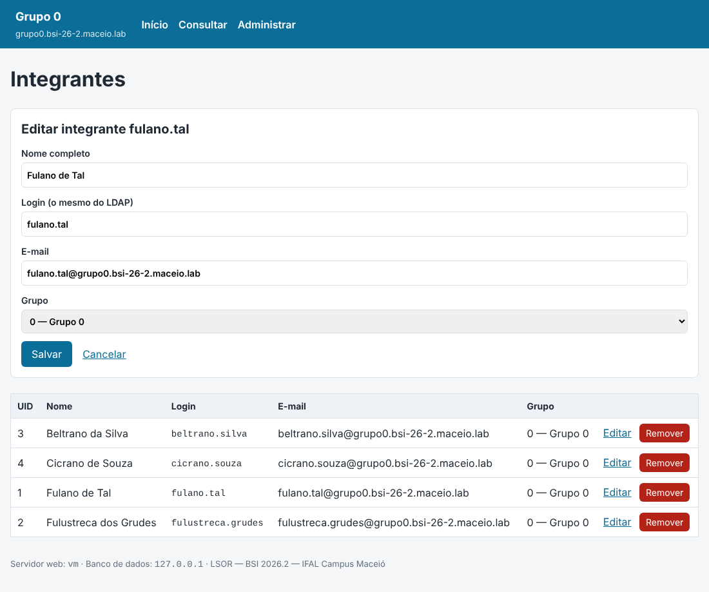

# Site demo LAMP — Projeto Final de LSOR

Aplicação PHP de exemplo para o servidor web do Projeto Final. Ela cadastra os **grupos**, os **integrantes** e as **máquinas virtuais** do projeto e demonstra três integrações de rede:

- o **Apache com PHP** roda na VM `www` e o **MariaDB** roda na VM `bd`: cada página atravessa a rede do grupo até o banco;
- a área **Administrar** (`/admin`) pede usuário e senha do **LDAP** do grupo, verificados pelo próprio Apache;
- os arquivos do site chegam ao servidor por **SFTP**, a partir do computador do aluno conectado à VPN.

O grupo pode usar este site como está, adaptá-lo ou escrever outra aplicação PHP com MariaDB, desde que mantenha as três integrações acima e a documente no tutorial.

| Página | Acesso | O que faz |
|:--|:--|:--|
| `index.php` | Livre | Situação da conexão com o banco (servidor e versão) e totais cadastrados |
| `consulta.php` | Livre | Lista grupos, integrantes e VMs, com filtro por grupo e busca por nome, login, FQDN, IP ou serviço |
| `admin/grupos.php` | LDAP | Cadastrar, editar e remover grupos |
| `admin/alunos.php` | LDAP | Cadastrar, editar e remover integrantes |
| `admin/hosts.php` | LDAP | Cadastrar, editar e remover máquinas virtuais |

## Estrutura

```text
site-demo/
├── bd/criar-banco.sql                       # executar na VM bd
├── apache/www.grupo0.bsi-26-2.maceio.lab.conf   # virtual host com a área /admin protegida pelo LDAP
└── www.grupo0.bsi-26-2.maceio.lab/          # copiar para /var/www/ na VM www
    ├── app/                                 # fora do DocumentRoot: nunca é entregue ao navegador
    │   ├── config.exemplo.php               # copiar para config.php e preencher
    │   ├── db.php                           # conexão PDO e funções de consulta
    │   └── layout.php                       # cabeçalho, rodapé, escape de HTML, mensagens e token CSRF
    └── public/                              # DocumentRoot
        ├── index.php
        ├── consulta.php
        ├── admin/ (index.php, grupos.php, alunos.php, hosts.php)
        └── css/estilo.css
```

## Instalação

Os exemplos usam o Grupo 0 (`www` = `10.10.101.4`, `bd` = `10.10.101.5`). Troque pelos dados do seu grupo.

### 1. Banco de dados (VM `bd`)

```bash
sudo apt install mariadb-server
sudo mysql_secure_installation
```

O MariaDB só escuta em `127.0.0.1` por padrão. Para o `www` alcançá-lo, em `/etc/mysql/mariadb.conf.d/50-server.cnf`:

```ini
bind-address = 10.10.101.5
```

Edite o `criar-banco.sql` (IP do `www` e senha do usuário `siteapp`), envie-o por SFTP e carregue:

```bash
sudo systemctl restart mariadb
sudo mariadb < criar-banco.sql
sudo ss -tlnp | grep 3306          # deve mostrar 10.10.101.5:3306
```

O usuário `siteapp` só entra **a partir do IP do `www`** e só tem `SELECT`, `INSERT`, `UPDATE` e `DELETE` no banco `projeto`. A aplicação não precisa de mais que isso.

### 2. Servidor web (VM `www`)

```bash
sudo apt install apache2 php libapache2-mod-php php-mysql mariadb-client
mariadb -h bd.grupo0.bsi-26-2.maceio.lab -u siteapp -p projeto -e 'SELECT COUNT(*) FROM host'   # teste de rede até o banco
```

Envie a pasta `www.grupo0.bsi-26-2.maceio.lab/` por SFTP para o seu home no `www` (FileZilla, WinSCP ou `sftp` no terminal) e instale:

```bash
sudo cp -r ~/www.grupo0.bsi-26-2.maceio.lab /var/www/
cd /var/www/www.grupo0.bsi-26-2.maceio.lab
sudo cp app/config.exemplo.php app/config.php
sudo nano app/config.php                       # servidor bd, usuário e senha do banco
sudo chown -R root:lsor-g0 .                   # integrantes (grupo do LDAP) podem atualizar o site por SFTP
sudo find . -type d -exec chmod 2775 {} +
sudo find . -type f -exec chmod 664 {} +
sudo chgrp www-data app/config.php && sudo chmod 640 app/config.php   # só o Apache lê a senha
```

Instale o virtual host de [`apache/`](apache/), que publica só a pasta `public/` e protege `/admin` com o LDAP:

```bash
sudo cp www.grupo0.bsi-26-2.maceio.lab.conf /etc/apache2/sites-available/
sudo a2enmod ldap authnz_ldap
sudo a2ensite www.grupo0.bsi-26-2.maceio.lab
sudo a2dissite 000-default
sudo apache2ctl configtest && sudo systemctl reload apache2
```

### 3. Testes (do computador do aluno, conectado à VPN)

```bash
curl -s http://www.grupo0.bsi-26-2.maceio.lab/ | grep -o 'Conectado[^<]*'
curl -s -o /dev/null -w '%{http_code}\n' http://www.grupo0.bsi-26-2.maceio.lab/admin/                   # 401
curl -s -o /dev/null -w '%{http_code}\n' -u fulano.tal http://www.grupo0.bsi-26-2.maceio.lab/admin/     # 200
```

No navegador, cadastre, edite e remova um registro de cada tabela e confira o resultado no `bd`:

```bash
sudo mariadb projeto -e 'SELECT * FROM grupo; SELECT * FROM aluno; SELECT * FROM host;'
```

## Como as consultas foram escritas

- **Instruções preparadas** (PDO com `prepare`/`execute` e `ATTR_EMULATE_PREPARES = false`): os valores digitados nunca são colados no texto do SQL, o que impede injeção de SQL.
- **Chaves estrangeiras** `aluno.gid` e `host.gid` → `grupo.gid` com `ON UPDATE CASCADE` e `ON DELETE CASCADE`. Remover um grupo remove seus integrantes e VMs, e trocar o número do grupo atualiza as duas tabelas, num único comando, sem `JOIN` no `DELETE`.
- **Cada `UPDATE` e `DELETE` atinge uma tabela só, pela chave primária** (`WHERE uid = ?`, `WHERE hid = ?`, `WHERE gid = ?`). O formulário de edição carrega o registro atual antes de salvar.
- **Erros não passam em silêncio**: o PDO lança exceção, e a página mostra a causa (valor repetido, grupo inexistente, falha de conexão). A mensagem de sucesso só aparece quando a operação realmente aconteceu.
- **Campos únicos** no banco (domínio do grupo, login e e-mail do integrante, FQDN da VM) e validação no PHP (formato de login, e-mail, FQDN e IP).
- **Saída escapada** com `htmlspecialchars` em todo dado vindo do banco (proteção contra XSS) e **token CSRF** em todo formulário que altera dados.
- **Padrão POST → redirecionamento → GET**: recarregar a página não repete o cadastro nem a remoção.
- **`utf8mb4`** no banco, nas tabelas e na conexão, e `SET NAMES utf8mb4` no script, para os acentos não corromperem.

### O que foi corrigido em relação à versão anterior do site demo

| Problema | Correção |
|:--|:--|
| A atualização de host executava `UPDATE aluno SET VmName …` (tabela errada), e o formulário enviava `VMName` enquanto o PHP lia `VmName` | `UPDATE host … WHERE hid = ?`, com os mesmos nomes de campo no formulário e no PHP |
| Remover aluno ou host usava `DELETE … INNER JOIN` com as três tabelas: sem nenhum host cadastrado, nenhum aluno era removido (e vice-versa); remover um grupo sem alunos ou sem hosts não removia nada | `DELETE` simples pela chave primária e remoção em cascata pelas chaves estrangeiras |
| A página de remoção incluía os scripts PHP de remoção dentro do HTML | Remoção só por formulário POST, com confirmação e token CSRF |
| A página de atualização era uma cópia da consulta | Edição com o registro carregado no formulário |
| Mensagem de sucesso exibida mesmo quando o SQL falhava; `mysqli_free_result` chamado sem consulta (erro fatal no PHP 8) | Exceções do PDO tratadas e mensagens de acordo com o resultado |
| Valores do formulário concatenados no SQL e exibidos sem escape | Instruções preparadas e `htmlspecialchars` |
| Usuário do banco com `ALL PRIVILEGES ON *.* WITH GRANT OPTION` e senha repetida em todos os arquivos | Usuário `siteapp` restrito ao banco `projeto` e ao IP do `www`; senha só no `app/config.php`, fora do DocumentRoot |

## Capturas (ambiente de teste)

| Início | Consultar | Administrar (integrantes) |
|:--:|:--:|:--:|
|  |  |  |

## Referências

- THE PHP GROUP. **PHP Manual — PDO** e **Prepared statements and stored procedures**. Disponível em: <https://www.php.net/manual/en/book.pdo.php> e <https://www.php.net/manual/en/pdo.prepared-statements.php>.
- MARIADB FOUNDATION. **MariaDB Knowledge Base — Foreign Keys**. Disponível em: <https://mariadb.com/kb/en/foreign-keys/>.
- MARIADB FOUNDATION. **MariaDB Knowledge Base — GRANT**. Disponível em: <https://mariadb.com/kb/en/grant/>.
- APACHE SOFTWARE FOUNDATION. **Apache Module mod_authnz_ldap**. Disponível em: <https://httpd.apache.org/docs/2.4/mod/mod_authnz_ldap.html>.
- OWASP FOUNDATION. **SQL Injection Prevention Cheat Sheet**, **Cross Site Scripting Prevention Cheat Sheet** e **Cross-Site Request Forgery Prevention Cheat Sheet**. Disponíveis em: <https://cheatsheetseries.owasp.org/>.
